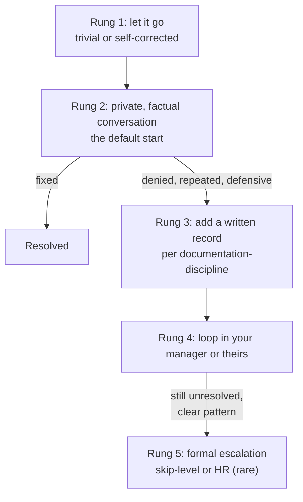

import LevelIntro from "../../../components/LevelIntro.astro";
import Checkpoint from "../../../components/Checkpoint.astro";
import PracticeCheck from "../../../components/PracticeCheck.astro";

export const unit = {
  track: "corporate-politics",
  unitSlug: "calibrated-confrontation",
};

L1 left Mia and her dragon drawing with three reactions and no way to choose
among them. This level moves to the workplace and builds the model: the five
rungs of the ladder, what makes a private conversation work, and why both
ends of the ladder cost you.

<LevelIntro
  items={[
    "The five-rung escalation ladder",
    "Wording a private conversation",
    "Why under- and over-reacting both cost",
  ]}
/>

## Which rung do you start on, and when do you move up?

**If nearly every guide says "talk to them privately first," why does that
sometimes fail, and what then?** Because a private talk is rung 2 of a
ladder, not the whole ladder. Knowing the next rungs exist is what makes it
safe to start low.

| Situation                                                                | Where to start                      |
| ------------------------------------------------------------------------ | ----------------------------------- |
| Teammate paraphrases loosely and corrects himself on the spot            | Rung 1                              |
| First time, ambiguous, in a fast meeting                                 | Rung 2                              |
| Second time this quarter, same person, same audience                     | Rung 2, ready to move up quickly    |
| Claimed sole authorship in writing to your skip-level after a first time | Higher: manager involved early      |
| Private talk was tried, he agreed, nothing changed                       | Move up one rung, not repeat rung 2 |

The ladder only works if you start low. Jumping to rung 4 or 5 for a
first-time, ambiguous incident burns the relationship and your credibility
before the lightest option had a real chance.

<Checkpoint question="A teammate paraphrases your idea slightly wrong in a stand-up, then says right away, 'that was Dana's fix, right?' Does this call for the ladder at all?">

Barely. This is a one-time slip with an immediate self-correction, so there
is no uncorrected credit left to address. Treating every loose phrasing as a
warning sign is the overreading trap, and a real response is for incidents
that actually stand uncorrected.

</Checkpoint>

<PracticeCheck
  track={unit.track}
  unitSlug={unit.unitSlug}
  topicId="escalation-ladder"
/>

## What does a private conversation sound like when it works?

**Two sentences describe the same meeting. Why does one get a correction
and the other a fight?** One assigns motive; the other states what happened
and its effect.

| Style          | Example                                                                                                                           | Likely reaction                         |
| -------------- | --------------------------------------------------------------------------------------------------------------------------------- | --------------------------------------- |
| Accusatory     | "You took credit for my work in front of the VP."                                                                                 | Defending his character, not the record |
| Non-accusatory | "In the roadmap review, the idempotency-key fix came across as your work. I built it, and I want that to be clear going forward." | Responding to what was actually said    |

The second sentence does not require you to know his intent. It costs you
nothing to phrase it that way, and it gives you real information: does he
correct it cleanly, or get defensive?

<Checkpoint question="Why start with a private, factual conversation even when you are fairly sure the credit-taking was deliberate?">

Because it costs almost nothing and it tells you something. A person who
fixes the record once it is pointed out privately has solved the problem, so
going to their manager would have been disproportionate. A person who
denies or gets defensive despite a specific, factual prompt has shown you
something real, and that response, not your suspicion alone, is what
justifies moving up.

</Checkpoint>

<PracticeCheck
  track={unit.track}
  unitSlug={unit.unitSlug}
  topicId="non-accusatory-framing"
/>

## Why do both ends of the scale cost you?

**If silence is "safe" and a public correction feels "fair," what is wrong
with each?** Each reacts to how the moment felt rather than to what happened
and how often.

| Response                              | What it costs                                                                                 |
| ------------------------------------- | --------------------------------------------------------------------------------------------- |
| Underreact: say nothing               | Teaches that the behaviour is free; more likely to repeat if deliberate                       |
| Overreact: public correction, wide cc | Can cost more credibility than it costs them if the incident looks smaller than your reaction |
| Calibrated: private, factual, matched | Gives room to correct, shows intent, preserves your standing either way                       |

A single ambiguous incident deserves a light, private response even if it
stung. A confirmed, repeated pattern deserves to move up even if a private
word feels like "not doing enough." The size of the response is set by the
situation table above, not by the size of your frustration.
