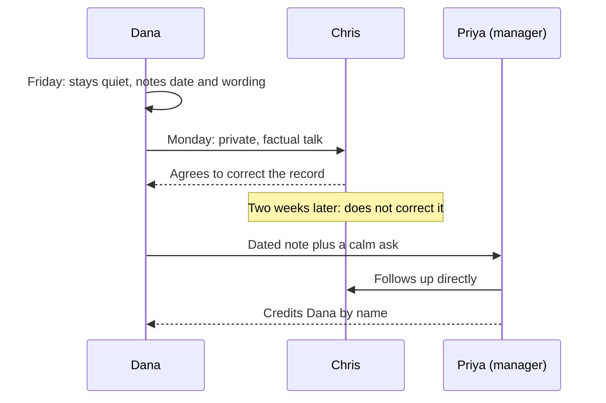

import Scenario from "../../../components/Scenario.astro";
import LevelIntro from "../../../components/LevelIntro.astro";
import Checkpoint from "../../../components/Checkpoint.astro";
import PracticeCheck from "../../../components/PracticeCheck.astro";

export const unit = {
  track: "corporate-politics",
  unitSlug: "calibrated-confrontation",
};

<Scenario label="Dana, Chris and the roadmap review">
  <Fragment slot="facts">
    

      
🛠️ Dana: three weeks on a double-charge bug, fix shipped Tuesday

      
🗣️ Friday: Chris tells the VP "I dug into the retry logic"

      
🤝 Monday: Dana's private talk, Chris agrees to correct it

      
🔁 Two weeks later: he does not correct it, so she moves up

      
👩‍💼 Manager Priya follows up and credits Dana by name

    

  </Fragment>

The fix took Dana three weeks: idempotency keys on the payment-retry path,
so a retried request cannot charge a customer twice. Friday, in the
quarterly roadmap review, her teammate Chris is asked what fixed the
double-charge incidents. "I dug into the retry logic," he says, "and
realized we needed idempotency keys on that path." He does not mention Dana.
The VP nods and the agenda moves on.

**Dana has about three seconds. What does a calibrated response look like
when the first attempt may not work?**

</Scenario>

L2 gave you the model: read the stakes, start low, word the private talk
factually. This level follows Dana end to end, including what L2 only
sketches: what to do when the private conversation does not hold.

<LevelIntro
  items={[
    "The three seconds, and the private talk",
    "When a rung fails and she moves up",
    "How the case changes if its facts change",
  ]}
/>

## What does Dana do in the room, and in the private talk?

**Why does she say nothing in the review, and is that underreacting?** It is
one incident in a fast meeting, and she does not yet know whether Chris
misremembered or left her out on purpose. Correcting a VP in front of the
room is hard to walk back if it turns out to be loose phrasing. So she
chooses the lightest workable rung and writes down the date and exact
wording while it is fresh.

<Checkpoint question="Was staying quiet in the room the same thing as underreacting?">

No. Underreacting means letting the incident go unaddressed. Dana decided
where and when to speak, not whether to. Picking the private rung over a
public correction for a first, still-ambiguous incident is the matched
response, not silence and not the maximal one.

</Checkpoint>

Monday morning she asks Chris for fifteen minutes in an empty room, with no
formal invite that signals trouble. She opens with wording prepared in
advance:

> "I wanted to close the loop on Friday's roadmap review. The idempotency-key
> fix came across as your work. I built it over the last three weeks, and I
> want that to be clear, especially since it will come up again."

It states what happened and its effect, and it does not claim to know his
intent. Chris answers defensively: "We worked on it together, I wasn't
trying to cut you out." Dana does not match his tone. She stays specific:
the design and implementation were hers, and accurate attribution matters
for how her work is seen this cycle. Chris agrees, a little stiffly, to
mention it if it comes up again.

<PracticeCheck
  track={unit.track}
  unitSlug={unit.unitSlug}
  topicId="private-talk-in-action"
/>

## What happens when the private talk does not hold?

**The talk happened, he agreed, and two weeks later the VP says "the retry
work Chris did" with Chris in the room. Should Dana simply have the same talk
again?** No. The first talk already produced a result: he agreed to correct
the record and, given the chance, did not. Repeating it treats that outcome
as if it had not occurred. A rung that was tried and failed is the trigger
to move up one.

She also does not correct him in the room a second time, because a repeated
public correction risks making her the source of friction regardless of who
is right. She goes to her manager, Priya, with two things: a dated factual
note, and a calm ask.

> "I built the idempotency-key fix. In the roadmap review Chris presented it
> as his work, I raised it with him directly the following Monday, and he
> agreed to correct it if it came up again. It came up two weeks later and he
> did not. I would like the attribution to be accurate, and I wanted you to
> have the full picture."

This is still calibrated. She does not ask for discipline or frame it as a
character attack. She gives the same facts Chris got, plus the one new fact
that justifies involving a manager. Priya follows up with Chris and credits
Dana by name the next time the fix comes up.

| Rung                    | What Dana did                                   | Did it hold?                            |
| ----------------------- | ----------------------------------------------- | --------------------------------------- |
| 1. Let it go, for now   | Quiet in the room; noted date and wording       | Kept the ambiguous read open            |
| 2. Private conversation | Factual, non-accusatory, Monday morning         | No: agreed, then did not correct        |
| 4. Manager              | Brought the dated note and a calm, specific ask | Yes: Priya followed up and credited her |

The dated note from Friday is why she could go straight from rung 2 to a
manager: rung 3 was already folded in, as
[documentation-discipline](/corporate-politics/documentation-discipline/)
recommends.

<Checkpoint question="Why does Dana move up the ladder here rather than repeat the private conversation?">

Because the lower rung was genuinely tried and produced direct evidence
that it did not hold. L2's ladder moves up when a rung has failed, and this
is that case: not a hunch that rung 2 would fail, but the fact that it did.

</Checkpoint>

<PracticeCheck
  track={unit.track}
  unitSlug={unit.unitSlug}
  topicId="when-a-rung-fails"
/>

## What changes if the facts change?

**Dana's case resolves cleanly at rung 4. What if it had been different?**
The worked example is one case, not the whole territory. Two variations show
how the mechanics shift.

- **The other person is much more established than you.** The private talk
  still comes first, and the factual wording matters even more, because a
  defensive, well-regarded person can make the disagreement costly for you.
  The fallback also changes: choose a manager who has the standing to raise
  it credibly with someone at that level, not just the default escalation
  path.
- **It happened in a written doc or a chat thread instead of a meeting.** A
  written channel is a permanent record, which cuts both ways. There is no
  doubt about the exact wording, but the misattribution does not fade the
  way a spoken remark does. So the private ask shifts from "get it right
  going forward" to "please post a correction where the original claim is
  still visible."

**Your turn.** Which of these would also change if Dana had no manager she
trusted, or if the credit mattered for a promotion decision next week? Work
out which rung you would start on, and what evidence you would want in hand
before moving up.

<PracticeCheck
  track={unit.track}
  unitSlug={unit.unitSlug}
  topicId="adapting-the-case"
/>
