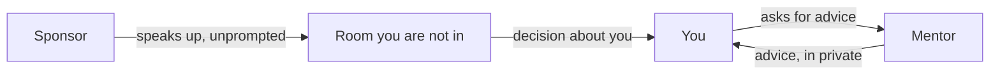
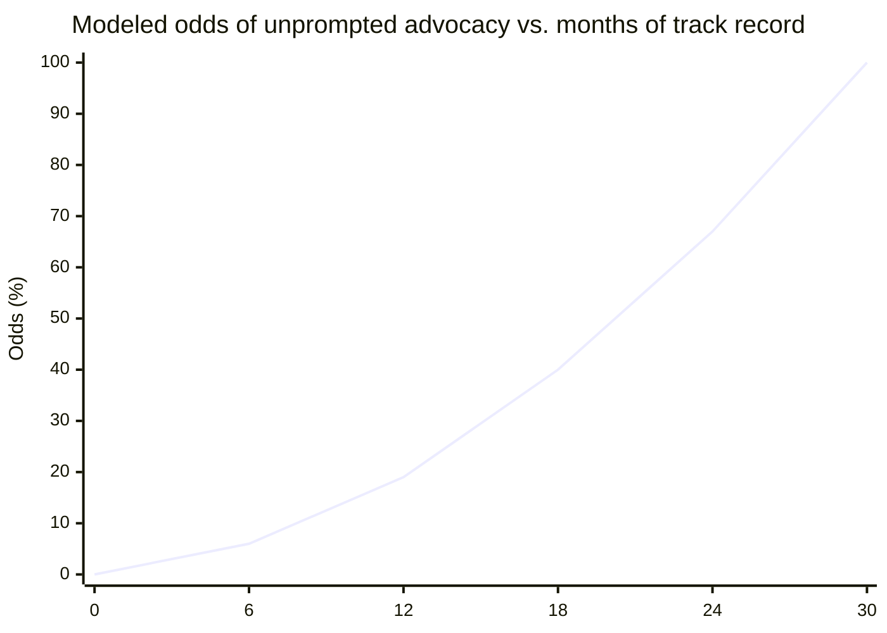
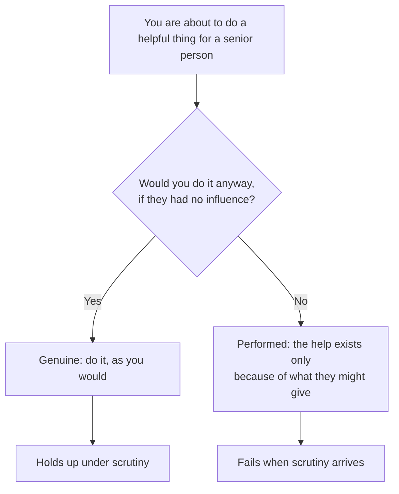

import LevelIntro from "../../../components/LevelIntro.astro";
import Checkpoint from "../../../components/Checkpoint.astro";
import PracticeCheck from "../../../components/PracticeCheck.astro";

export const unit = {
  track: "corporate-politics",
  unitSlug: "coalition-building-defense",
};

L1 showed Priya and Marcus hit the same unfair move with opposite outcomes,
because only one of them had someone who could act in a room they were not in.
L2 builds the model behind that gap: what makes a sponsor different, why that
cannot be built in a crisis, and where honest alliance-building stops.

<LevelIntro
  items={[
    "Where a sponsor's support happens",
    "Why the track record takes months, not weeks",
    "Real usefulness versus performed usefulness",
  ]}
/>

## What does a sponsor do that good advice cannot?

If a mentor already gives sharp advice, why is that not enough protection?
**Before reading on: where was the director deciding how to describe Priya's
work, and who could speak there?**

The decision happened in a meeting Priya was not in. A mentor saying privately,
"I'd push back on that reorg if I were you" is useful, and does nothing in that
meeting. Advice only works when you are in the room to use it.

A sponsor's advocacy costs them something real. If they are wrong about you, or
the person they pushed back on remembers it, the cost lands on their own
credibility. Nobody extends that casually, so it has to be earned.

<Checkpoint question="A colleague tells you, in a private 1:1, exactly what they would say to your manager if they were in your position. Is that colleague acting as your sponsor?">

No. That is a mentor, and a useful one. The difference is where the support
happens, not how sharp the advice is. Sponsorship means taking that stance into
a room you are not in, on your behalf, using their own standing. Advice you
could use yourself is not the same as someone making your case when you have no
voice in the conversation.

</Checkpoint>

<PracticeCheck
  track={unit.track}
  unitSlug={unit.unitSlug}
  topicId="sponsor-vs-mentor"
/>

## Why can a sponsor not be recruited once trouble starts?

If sponsorship is this valuable, why not ask a senior person the day things go
wrong? **Before reading on: what would the senior person have to believe about
you to put their name behind yours?**

They would need evidence, gathered over many occasions, without any pressure on
them to be impressed. [favor-economy](/corporate-politics/favor-economy/) makes
the case that goodwill is banked long before it is spent. A sponsor's backing
is the largest withdrawal there is, so it needs the deepest deposit history.

| Window         | What is happening                                          | What the senior person concludes          |
| -------------- | ---------------------------------------------------------- | ----------------------------------------- |
| Months 1 to 6  | Small, low-stakes useful work near them, repeatedly        | Nothing yet; it just looks like good work |
| Months 6 to 18 | A pattern is noticed, and they include you by default      | You are reliable, not just lucky once     |
| Months 18+     | Enough occasions exist that vouching for you is a safe bet | Worth putting their own name behind       |

The unit's interactive model puts numbers on the shape. It is a simple teaching
curve, not a measurement of real people: the modeled odds of a sponsor
advocating unprompted, by months of genuine track record.

The curve is flat early and steep late, which is the point: a few weeks of
urgent attentiveness sits at the bottom of it. Sudden, need-timed attention
toward someone with influence does not look like a track record. It looks like
what it is, and the person with real standing to protect is the one most likely
to notice the timing.

<Checkpoint question="An engineer, hearing layoffs may be coming, spends two weeks aggressively complimenting a director and volunteering for anything the director is watching. Does that build the protection this unit describes?">

No, and for a reason beyond "it is late". It inverts the mechanism.
Sponsorship comes from a sustained pattern that predates any need, which is
what makes later advocacy read as credible instead of self-interested. Two
weeks of visible, need-timed attentiveness produces the opposite signal, and a
director experienced enough to be worth having as a sponsor is experienced
enough to recognize the timing.

</Checkpoint>

<PracticeCheck
  track={unit.track}
  unitSlug={unit.unitSlug}
  topicId="track-record-timeline"
/>

## What separates building an alliance from manipulating someone?

If a sponsor relationship has to be built on purpose, is it just strategy, and
what stops strategy from being manipulation with better manners?
**Before reading on: if the senior person never ends up sponsoring you, was the
effort wasted?**

The line is not whether you are deliberate. It is whether the usefulness is
real. [white](/corporate-politics/white/) frames legitimate influence as
reciprocity and genuine usefulness, not performing usefulness for an audience.

| Version                    | What it looks like                                                | If no sponsorship ever comes                 |
| -------------------------- | ----------------------------------------------------------------- | -------------------------------------------- |
| Genuine coalition-building | Careful, useful work that happens to be visible to someone senior | You still did good work and built a real tie |
| Transactional performance  | Flattery or selective helpfulness aimed at someone's influence    | Nothing was built, and it was never real     |

This matters practically as well as ethically. A performed relationship is
fragile in the moment you need it to hold: advocacy costs the sponsor their
credibility, and they extend it only after seeing trustworthy evidence over
time. Flattery does not survive that test.

<PracticeCheck
  track={unit.track}
  unitSlug={unit.unitSlug}
  topicId="honesty-line"
/>
