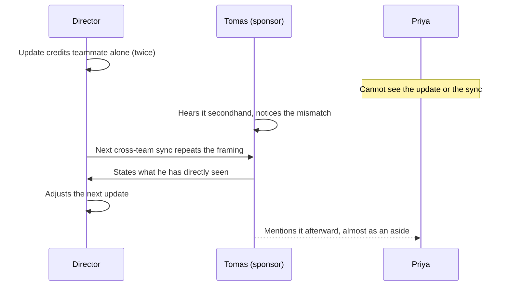

import Scenario from "../../../components/Scenario.astro";
import LevelIntro from "../../../components/LevelIntro.astro";
import Checkpoint from "../../../components/Checkpoint.astro";
import PracticeCheck from "../../../components/PracticeCheck.astro";

export const unit = {
  track: "corporate-politics",
  unitSlug: "coalition-building-defense",
};

<Scenario label="Two years, one meeting">
  <Fragment slot="facts">
    

      
🛠️ Months 2 to 11: four small acts of real usefulness

      
🪞 Month 18: a motive check Priya runs on herself

      
🚪 Around month 24: a meeting she is not in

      
📈 Modeled advocacy odds at month 24: 67%

    

  </Fragment>

Same people as L1 and L2. Priya works two teams away from Tomas, an engineer
whose team owns a ledger service hers depends on. He does not manage her,
formally mentor her, or have any particular reason to know her name. Two years
later, he speaks up for her unprompted in a room she is not in. L3 walks the
actual two years.

**Before reading on, predict: which single moment in those two years matters
most for what happens at the end, and is it the dramatic one?**

</Scenario>

<LevelIntro
  items={[
    "The small acts that become a track record",
    "A motive check when the timing is convenient",
    "The room she is not in, and what changes if the details differ",
  ]}
/>

## Year one: what does the groundwork actually look like?

If sponsorship is earned, what is Priya doing in the first year? Nothing that
looks like relationship-building. Four specific, unglamorous acts:

| Month | What Priya does                                                             | Why it counts                                                 |
| ----- | --------------------------------------------------------------------------- | ------------------------------------------------------------- |
| 2     | Files a bug against Tomas's service with a minimal repro and clear write-up | Fixed in twenty minutes instead of half a day                 |
| 5     | Reads his migration design doc carefully and flags a race condition         | Catches a bug nobody asked her to look for                    |
| 9     | On call at 2am, finds the real cause was elsewhere and credits that team    | Quietly keeps his team out of an incident that was not theirs |
| 11    | Co-presents the migration results and credits his original design           | Does not make the moment about herself                        |

Each act solved a real problem regardless of who was watching. That is why it
counts, and it is also why it cannot be rushed: each one only works because it
was not engineered to work.

<Checkpoint question="If Priya had spent that first year seeking chances to be seen near Tomas (volunteering for his demos, praising his talks in chat, angling into his 1:1s), would she have ended up in the same place?">

No, and probably not durably. The real acts mattered because they solved
problems whether or not anyone noticed: his service was fixed faster, a bug was
caught before production, his team avoided an incident. A version aimed at being
seen produces visibility without evidence. By L2's honesty line, that kind of
relationship fails under scrutiny, which is exactly when it would be tested.

</Checkpoint>

## Year two: what does Priya do when the timing is convenient?

At about eighteen months, Tomas is put in charge of choosing two engineers for
a small, high-visibility platform redesign group. Priya hears before it is
announced, and has an uncomfortable thought: _if I am extra helpful to Tomas
this week, does that help my chances?_ **Before reading on: how would you test
whether an act of help is genuine when you already know it could pay off?**

Her test: would I do this regardless of the platform-group decision? She has a
real idea for simplifying the ledger service's retry handling that she had been
meaning to raise for weeks. She raises it now, because the idea is worth
raising regardless of timing, and does not mention the group, steer toward it,
or do anything beyond a normal week. Tomas appreciates it as he has appreciated
a dozen things before. She never finds out whether it affected his pick, and
treats that as fine.

<Checkpoint question="Was raising the retry idea that week manipulative, given that Priya knew about the platform-group decision?">

No. She would have raised it regardless, the timing was coincidental rather
than engineered, and she shaped nothing around the decision. What would cross
the line is inventing a reason to be useful because of the decision, or
steering the conversation toward it. Genuine usefulness that lands in a
convenient week is still genuine; usefulness manufactured for the week is not.
The deciding question is whether the act would have happened anyway.

</Checkpoint>

Tomas picks two other engineers. Priya is not one of them, and nothing about the
relationship changes. That is evidence, in hindsight, of what kind of
relationship it was.

<PracticeCheck
  track={unit.track}
  unitSlug={unit.unitSlug}
  topicId="motive-test"
/>

## The room Priya is not in: what actually happens?

A new director arrives. Within a month, joint work Priya has driven for months
appears in two written leadership updates credited to a teammate alone, going to
people well above her manager. This is close to the pattern
[warning-signs](/corporate-politics/warning-signs/) describes: repeated, in a
channel she cannot see.

Priya does not ask Tomas to intervene. That was never the arrangement, and
asking would change what the relationship is. Tomas hears about the updates
secondhand from someone on the leadership distribution list, and it does not
match two years of firsthand evidence.

His statement, in the sync:

> "I've worked closely with Priya for two years. She reviewed the hardest parts
> of our ledger migration, caught the reconciliation race condition before it
> shipped, and from what I've seen she has been driving this project. That
> framing doesn't match what I know."

He accuses no one of motive; he states what he has directly observed, the way
[calibrated-confrontation](/corporate-politics/calibrated-confrontation/)
frames a factual correction. It works because it comes from someone with
independently earned standing about something he witnessed, not a favor called
in. The model's numbers say the same thing: at 24 months of track record the
modeled odds of unprompted advocacy are 67%, and with one sponsor the modeled
exposure to going unchallenged falls from 100% to 33%. Neither figure is a
measurement; both are teaching curves.

## Extend it: what changes if the details are different?

Priya's case worked with two years of runway and an organization where one
credible person's word carried weight. It is one worked case, not the whole
territory. Try extending it before moving on.

**What if you are new to an organization and have not had years to build this?**
You cannot manufacture two years on demand, and pretending otherwise is the
mistake this unit warns against. The first months of a new role are month one of
Priya's timeline, not a wasted period. What partially substitutes meanwhile: a
mentor for advice, and your own documented record (see
[documentation-discipline](/corporate-politics/documentation-discipline/)),
which reduces how much you need advocacy at all. What would you start this
week?

**What if the person with the most relevant influence is someone you do not get
along with?** Sponsorship needs direct, credible evidence your work is good, not
personal warmth. Could you build Priya's pattern of careful reviews and
reliable follow-through with someone you find difficult, and what would make
that still genuine rather than performed?

**What if your sponsor is wrong about the facts?** Their credibility is on the
line too. What does that say about how much you should rely on any one person?

None of these has one clean answer. Priya's timeline is a starting shape, not a
script.

<PracticeCheck
  track={unit.track}
  unitSlug={unit.unitSlug}
  topicId="adapt-to-context"
/>
