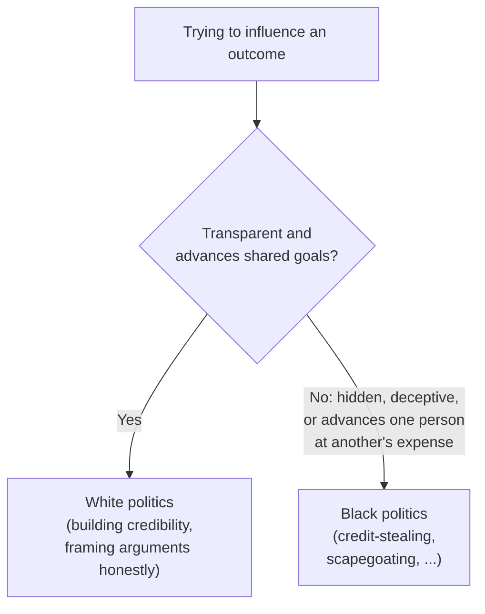

import LevelIntro from "../../../components/LevelIntro.astro";
import Checkpoint from "../../../components/Checkpoint.astro";
import PracticeCheck from "../../../components/PracticeCheck.astro";

export const unit = {
  track: "corporate-politics",
  unitSlug: "credit-stealing",
};

L1 named credit-stealing as one of five black-politics tactics and
introduced intent and deniability as the two things that shape how you
respond to it. This level goes one step deeper: what each of the five
tactics actually does, what evidence each one leaves behind, and why
deniability specifically makes black politics hard to call out in the moment.

<LevelIntro
  items={[
    "What each of the five tactics does",
    "The white/black dividing line",
    "Why deniability blocks direct confrontation",
  ]}
/>

## The five tactics, and the evidence each one leaves

**If "black politics" is one category, why name five separate tactics inside it?**
Because each damages trust through a different mechanism, and the mechanism decides
what you can actually observe and what a sensible first response looks like. This
table is for recognizing the moves and defending against them.

| Tactic               | What it does                                                    | What you can actually observe                    | A sound first defensive move                                       |
| -------------------- | --------------------------------------------------------------- | ------------------------------------------------ | ------------------------------------------------------------------ |
| Credit-stealing      | Presents someone else's work as the presenter's own             | One specific claim in one specific moment        | Restate your ownership factually; keep dated copies of your work   |
| Scapegoating         | Places blame for a failure on someone who did not cause it      | A mismatch between who decided and who is blamed | Point back to the record of who decided, calmly                    |
| Sabotage             | Weakens your work or standing, often while appearing supportive | Help that keeps arriving late or weakening       | Get commitments and timelines in writing                           |
| Weaponized rumors    | Spreads unverified claims with the source kept hidden           | A claim that nobody can trace to a first source  | Ask who said it first and exactly what they said; do not repeat it |
| Manufactured urgency | Frames a decision as time-critical to bypass review             | A deadline with no stated, checkable consequence | Ask what concretely happens if the decision waits                  |

**Do all five need the same kind of evidence?** No. Credit-stealing is often visible in
one moment: a specific claim in a specific meeting. Scapegoating and sabotage usually
need a pattern over time, because a single instance can be an honest mistake.
Weaponized rumors need you to trace where the information began, which is often
deliberately obscured.

<Checkpoint question="A colleague publicly says 'I did this' about something someone else built, versus a colleague who publicly blames someone else for a decision that colleague made. Which tactic is each one, and why does that difference change what kind of evidence you need before responding?">

The first is credit-stealing and the second is scapegoating. Credit-stealing is often
visible in a single moment: one specific claim, in one specific meeting, is enough to
notice it happening. Scapegoating usually needs more than one instance before it is
distinguishable from a genuine, honest misassignment of blame, because one "it was
their fault" can plausibly reflect the accuser's real, if mistaken, understanding of
what happened. That is why the response to a single credit-stealing claim can move
faster than the response to a single scapegoating incident. The evidence bar differs,
even though both are black politics.

</Checkpoint>

<PracticeCheck
  track={unit.track}
  unitSlug={unit.unitSlug}
  topicId="five-tactics"
/>

## What makes something "black" rather than "white" politics?

**If both involve trying to influence outcomes, what is the dividing line?**

The dividing line is not "trying to influence people". It is whether the tactic is
transparent and could survive being stated openly ("I built a strong case and
presented it clearly") versus whether it depends on concealment ("I let people believe
this was my idea"). Credit-stealing fails this test: it only works while the original
contributor's role stays hidden or unclear.

This is the same transparency test from
[white politics](/corporate-politics/white/): if explaining the move openly would make
it look worse, the move probably depends on concealment.
[Framing](/corporate-politics/framing/) is different: it can present true work clearly
without erasing who did it.

## Why does deniability make black politics hard to call out?

**If credit-stealing is so common, why don't more people confront it directly?** Because
most black-politics moves come with an escape hatch. The person can usually offer an
innocent-sounding line afterward: "I didn't mean to leave you out," "I just didn't think
to mention who ran the numbers." After a single incident, that excuse is hard to
disprove, so a direct public accusation is risky: if intent isn't established yet, the
accuser can look petty or paranoid, even when the instinct is correct.

Deniability does not prove someone meant harm. It does mean your response should build a
clearer record first, rather than jump to a public accusation.

| Line spoken in the room                        | How easy to explain innocently? | Why                                  |
| ---------------------------------------------- | ------------------------------- | ------------------------------------ |
| "Here is the analysis" (no names)              | Easy                            | Could be a plain oversight           |
| "The approach I came up with" (over your work) | Hard                            | It is an active claim of authorship  |
| The same claim, after you raised it privately  | Very hard                       | "I did not know" no longer covers it |

**Does this mean a single ambiguous incident should just be ignored?** No, but the
response should be different. For one incident: privately raise it and start
documenting. For an established pattern: a more direct conversation and escalation.
Treating every ambiguous moment as proof of a deliberate pattern is itself a common
mistake, covered in L3.

<Checkpoint question="Why does deniability specifically make black politics harder to call out than an honest mistake would be, and what does that imply about how a single incident should be handled versus a repeated one?">

Deniability works because it hands the person a ready-made, innocent-sounding excuse
that is genuinely hard to disprove after just one occurrence. That is exactly what makes
a loud, public accusation risky on a single incident: if intent isn't established, the
person raising it can come across as overreacting even when their read is right. So a
single ambiguous incident calls for a lower-confrontation response, like privately
raising it or starting to document what happened. A repeat changes the calculation,
because the same excuse stops covering a pattern: the person can no longer plausibly
claim they didn't know, which is what justifies a more direct response the second or
third time.

</Checkpoint>

<PracticeCheck
  track={unit.track}
  unitSlug={unit.unitSlug}
  topicId="deniability"
/>

## Failure modes at this level

| Failure mode                                              | What it gets wrong                                                                           |
| --------------------------------------------------------- | -------------------------------------------------------------------------------------------- |
| Treating every uncredited mention as deliberate           | Genuine oversights happen; assuming the worst can damage a relationship that did not need it |
| Ignoring a real pattern because each incident is deniable | Deniability on any one instance does not make the repeated pattern deniable                  |
| Answering black politics with black politics              | Trading a rumor for a rumor swaps one trust injury for another and rarely fixes anything     |
