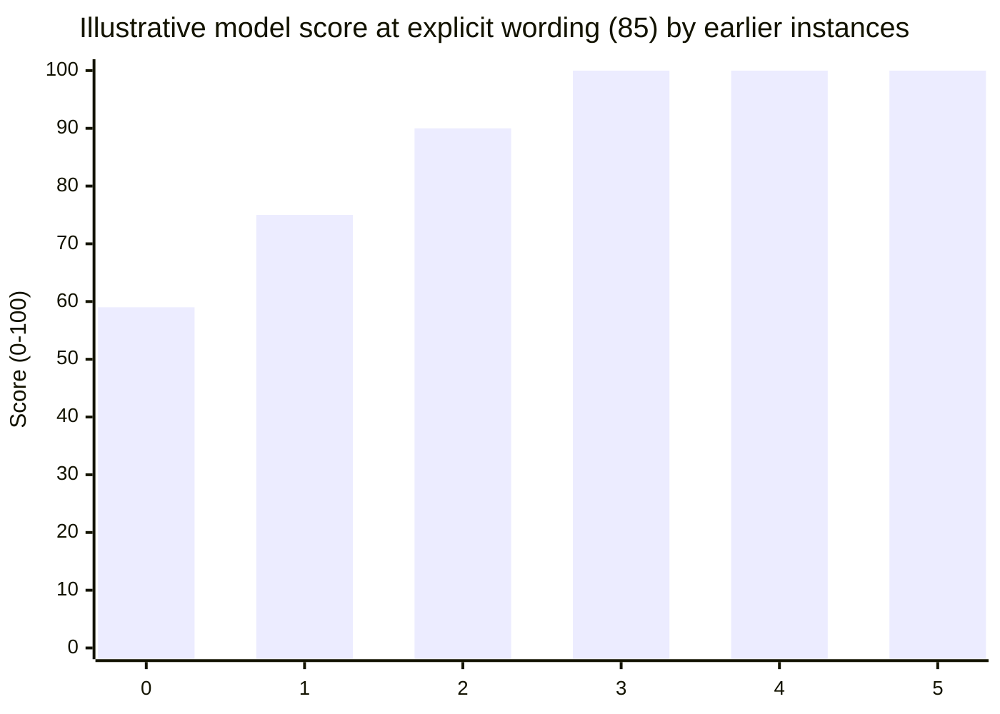
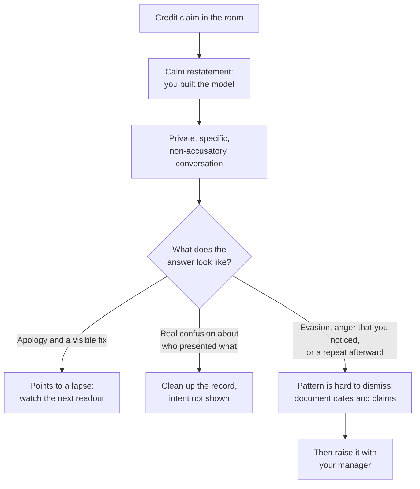

import Scenario from "../../../components/Scenario.astro";
import LevelIntro from "../../../components/LevelIntro.astro";
import Checkpoint from "../../../components/Checkpoint.astro";
import PracticeCheck from "../../../components/PracticeCheck.astro";

export const unit = {
  track: "corporate-politics",
  unitSlug: "credit-stealing",
};

<Scenario label="The scenario">
  <Fragment slot="facts">
    

      
🎤 The colleague said "the approach I came up with" in front of leadership

      
🛠️ You built the cost model over 3 weeks

      
❔ Unknown: whether this is a first instance or one of several

    

    

      

        59 / 100
        illustrative model score, first instance, explicit wording
      

      

        

      

    

  </Fragment>

Same facts as L1: a colleague presented your three-week analysis as "the approach I
came up with" in the executive readout. L3 works the case end to end. The unit's
demo is an illustrative teaching model, not a measurement: it scores how likely the
omission was deliberate from how directly the wording claims authorship and how
many times the same colleague has done it before. At explicit wording and no earlier
instance, it shows 59 out of 100: fairly clear, but not certain.

**Before reading on: with a score like that, would you confront the colleague in the
meeting, say nothing, or do something in between?**

</Scenario>

<LevelIntro
  items={[
    "Reading one incident versus a real pattern",
    "The calibrated in-the-moment and private responses",
    "When escalation is warranted, and when premature",
  ]}
/>

## Is this one incident enough to call it credit-stealing?

**In the Scenario, the colleague said "the approach I came up with" in front of
leadership. Is that enough, on its own, to be certain it was deliberate?** Not with full
certainty, but the wording matters. "I came up with" is a stronger, more specific claim
than a passive omission like "here's the analysis". Claiming authorship of someone
else's three weeks of work is harder to explain as accidental, especially if the
colleague was in meetings where the work was visibly being done.

A school version: if a group presentation forgets to say who made the chart, that might
be an oversight. If one student says "I made this chart" while knowing another made it,
that is an authorship claim, and it needs a firmer response because the words actively
move credit.

The illustrative model makes the two inputs concrete. At explicit wording (85) the score
is 59 on a first instance, then rises as the same colleague repeats it:

| Wording                       | Model wording input | Score on a first instance |
| ----------------------------- | ------------------- | ------------------------- |
| A passive omission, no claim  | 20                  | 14                        |
| A hedged, ambiguous mention   | 50                  | 35                        |
| "The approach I came up with" | 85                  | 59                        |

These wording inputs are assumed points chosen for illustration; the scores follow from
the demo's own formula. The direction is the point: both active wording and repetition
raise confidence, and no single incident has to be airtight once the pattern is clear.

**What would make this clearly part of a pattern?** The same colleague repeating the same
kind of behavior. On a first instance, treat it seriously but not as proven intent. On a
second or third, the pattern itself becomes the evidence.

<Checkpoint question="Three months earlier, the same colleague forgot to mention a different teammate's name while presenting a diagram in a different meeting. Does that earlier incident automatically make the Scenario's 'I came up with' claim part of an established pattern?">

Not automatically. The two incidents differ in exactly the way the distinction above
cares about. Forgetting a teammate's name on a diagram is closer to a passive omission,
the kind of thing an oversight plausibly explains. Saying "the approach I came up with"
is an active authorship claim. A real pattern needs the same actor repeating the same
kind of behavior, not two loosely similar incidents lumped together after the fact.
Treating them as automatically connected would be the jump the question above warns
against.

</Checkpoint>

<PracticeCheck
  track={unit.track}
  unitSlug={unit.unitSlug}
  topicId="incident-vs-pattern"
/>

## What does responding well actually look like?

**Should you correct the record out loud, right there in the executive meeting?** Usually
not as a first move. A public correction in front of leadership can read as an
interpersonal conflict playing out live, which often reflects worse on the person
raising it, regardless of who is right. A better first move is calibrated and low-risk:

> You, in the meeting, calmly: "Glad the cost-modeling approach landed well — happy to
> walk through the underlying assumptions if useful, since I built that model."

This accuses no one. It places your name next to the work, in the same room, without
confrontation. "Calibrated" means proportional: not silent, and not a public trial.

**Does a calm correction mean the issue is resolved?** Not necessarily. It fixes the
immediate record but not whether this was a lapse or the start of a pattern. The next
step is a private, specific, non-accusatory conversation:

> You, privately: "In the readout today, the pricing analysis came across as your work. I
> built that model over the last three weeks — can you help me understand what
> happened there?"

**Why ask privately instead of publicly?** It keeps the door open for a legitimate
explanation while making clear you noticed, and a repeat after that conversation is far
stronger evidence of intent than the first incident alone. Different answers mean
different things: a real apology plus a visible correction points toward a lapse; a
verifiable confusion about who was presenting what needs cleanup but is not intent; an
evasive answer, anger that you noticed, or a repeat makes the pattern much harder to
dismiss.

<Checkpoint question="The in-meeting line above never accuses the colleague of anything — it just restates who built the model. Why does that restraint matter for the private conversation that comes afterward, rather than just for the meeting itself?">

Because the private conversation depends on genuinely not having decided the answer yet.
If the in-meeting response had been an accusation, the relationship would already be
adversarial by the time the private conversation happens, and the colleague's
explanation, genuine or not, would be much harder to hear with an open mind for both of
you. By staying factual in the meeting, you keep the private conversation a real,
exploratory question rather than a follow-up to a fight. That is what lets the answer
(apology, confusion, evasiveness, or a repeat) function as evidence instead of confirming
a conclusion already reached in the room.

</Checkpoint>

## When does it become a pattern rather than an incident?

**If the same colleague does it again after the private conversation, what changes?** The
ambiguity from the first incident is gone: a conversation was had, and it happened
anyway. This is when documentation matters: specific dates, specific claims, specific
work products. It serves your own clarity and a manager conversation if one becomes
necessary. This unit does not go deep on documentation or a formal escalation
conversation; later units in this track cover those. What the credit-stealing case
settles is _when_ escalation is warranted versus premature.

| Failure mode                                                        | What it gets wrong                                                                      |
| ------------------------------------------------------------------- | --------------------------------------------------------------------------------------- |
| Publicly confronting the colleague in the same meeting              | Reads as live conflict, which can reflect worse on you regardless of who is right       |
| Saying nothing and hoping it does not repeat                        | Leaves the record uncorrected and signals the behavior went unnoticed                   |
| Treating the first incident as proof of an established pattern      | One incident, even a fairly clear one, is weaker evidence than a repeat; skips the talk |
| Escalating to a manager after one incident, before any conversation | Looks reactive and burns credibility a later, genuine pattern would need                |

<PracticeCheck
  track={unit.track}
  unitSlug={unit.unitSlug}
  topicId="calibrated-response"
/>

## What generalizes, and what is only this case?

The core lesson is that a single ambiguous incident calls for a calibrated, low-risk
response while a repeated pattern calls for a more direct one. Overreacting to one
incident and ignoring a real pattern because each instance is deniable both fail. That
lesson carries to the other four tactics in L2's table.

What is specific to this worked example is the exact in-meeting move, "happy to walk
through the assumptions, since I built that model". It works for credit-stealing because
the fix is re-attaching a name to existing work. **This is a case, not the whole
territory.** **Try extending it yourself:** if instead this were scapegoating, with a
colleague publicly blaming you for a decision you never made, would the same
low-confrontation move work, or does it need a different kind of immediate response?
And what changes if the news were worse, for example if the colleague were a manager
with influence over your review?

For the scapegoating question, the principle holds but the correction differs. With
credit-stealing, the clean move attaches your name back to the work. With
scapegoating, it attaches the decision back to the facts: "I want to separate two things:
I implemented the change after the decision was made, but I did not make the decision
to ship it." Same calibration, different factual correction.
