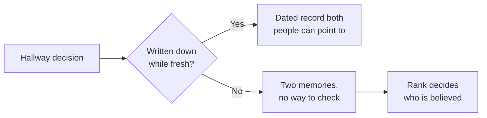

import Scenario from "../../../components/Scenario.astro";
import LevelIntro from "../../../components/LevelIntro.astro";
import PracticeCheck from "../../../components/PracticeCheck.astro";

export const unit = {
  track: "corporate-politics",
  unitSlug: "documentation-discipline",
};

<Scenario label="'I never said to skip the security review', except he did, in the hallway, three weeks ago.">
  <Fragment slot="facts">
    

      
🗣️ <strong>Day 0</strong>: director says, in passing, "just ship it, we'll review security after launch"

      
🚨 <strong>Day 21</strong>: a vulnerability surfaces in the shipped feature

      
❌ <strong>Director's line, now</strong>: "I never told anyone to skip the review"

      
📄 <strong>Written evidence</strong>: none

    

  </Fragment>

Three weeks ago, in a hallway conversation, a director told an engineer:
"just ship it, we'll review security after launch, we're behind schedule." The
engineer followed the instruction. This week a vulnerability surfaces in the
shipped feature, and in the incident review the director says: "I never told
anyone to skip the security review." There is no email, no message, no note,
just the engineer's memory against the director's.

**The engineer did exactly what was asked. Why is that not enough to protect
them?**

</Scenario>

The engineer's problem is not that they did something wrong. It is that the
decision lived only in two heads, and one of those heads now has a reason to
remember it differently.

<LevelIntro
  items={[
    "Why verbal decisions disappear",
    "Paranoid tone versus professional tone",
    "CYA done well as a habit",
  ]}
/>

## Where does a verbal decision actually live?

**Three weeks after a hallway chat, who can prove what was said?** Only the
people who were there, and only by memory.

- A verbal instruction is real the moment it is given, but afterwards it exists
  only in the memories of the people who heard it. Memories fade, and they are
  cheap to dispute, especially when disputing one is convenient.
- **Documentation discipline** is the habit of turning a verbal decision into a
  short written record, not to build a case against anyone, but so that "what
  was actually decided" does not depend on who argues more confidently later.
- An honest memory gap is just as dangerous as a lie. People genuinely forget
  hallway conversations they did not think mattered at the time.

<PracticeCheck
  track={unit.track}
  unitSlug={unit.unitSlug}
  topicId="verbal-record-gap"
/>

## Why does writing it down feel paranoid, and when is it not?

**If a "confirming what we discussed" note feels like publicly doubting a
colleague, why do it at all?** Because the feeling comes from the framing, not
from the act. The same facts can be sent as a routine note or as an accusation.

| What it is about | Reads as paranoid                   | Reads as professional                    |
| ---------------- | ----------------------------------- | ---------------------------------------- |
| Purpose          | Building a case against a person    | Creating a shared, accurate record       |
| Timing           | After trouble has already started   | Right after the conversation, as routine |
| Tone             | Defensive, anticipating an argument | Short and neutral, restating facts       |

Done well, this habit is often called **"CYA done well"**. It is not really
about blame: a clear record protects everyone in the conversation, including
the person who gave the instruction, from a dispute about what was said.

## Key terms

- **Documentation discipline**: the consistent habit of confirming verbal
  decisions in writing, close to when they happen.
- **Written confirmation**: a short, neutral message sent after a verbal
  decision, restating what was agreed so there is a shared, dated record.
- **CYA done well**: documentation whose purpose is an accurate shared record,
  as distinct from documentation whose purpose is building a case.
- **Paper trail**: the accumulated confirmations, emails and notes that together
  establish what was decided and when.

This unit is about workplace habits, not law. Whether a particular record would
count in a formal or legal dispute is a question for a lawyer or your HR
function, not something this unit can answer.

## What this unit covers

L2 works through what separates a confirmation that reads as professional from
one that reads as paranoid, when a decision actually needs one, and what a
strong one contains. L3 replays the Scenario twice, once with no paper trail
and once with a two-line confirmation, then asks what changes when the person
giving the instruction is much more senior.
