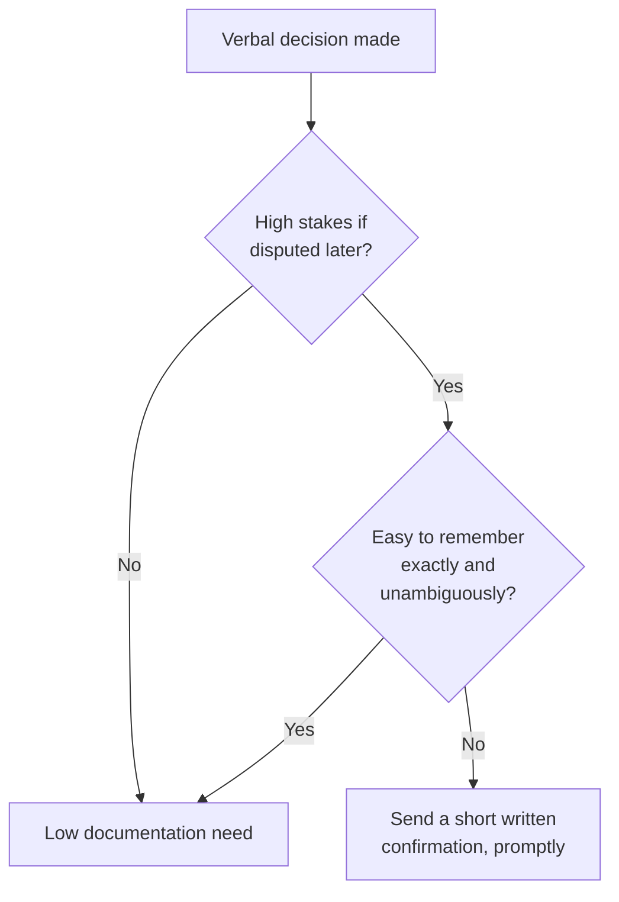

import LevelIntro from "../../../components/LevelIntro.astro";
import Checkpoint from "../../../components/Checkpoint.astro";
import PracticeCheck from "../../../components/PracticeCheck.astro";

export const unit = {
  track: "corporate-politics",
  unitSlug: "documentation-discipline",
};

L1 laid out the instinct: verbal decisions with real stakes deserve a written
trail. L2 gets precise about the part that trips people up, why the same habit
can read as professional diligence or as paranoid distrust, and how to tell
which decisions genuinely need it.

<LevelIntro
  items={[
    "Paranoid versus professional framing",
    "Stakes and ambiguity as the trigger",
    "What a strong confirmation contains",
  ]}
/>

## The gap is smaller than it feels

**If sending a confirmation feels like publicly doubting a colleague, how is it
ever not paranoid?** Because what makes it read as paranoid is rarely the act of
writing something down. It is the framing, the audience and the timing. The same
information, written two ways, lands completely differently.

| Element  | Reads as paranoid                                                        | Reads as professional                                                                 |
| -------- | ------------------------------------------------------------------------ | ------------------------------------------------------------------------------------- |
| Framing  | "I want this on record in case you deny it later"                        | "Just confirming what we agreed, so I have it for my notes"                           |
| Audience | Sent to the director's manager or a wide group, without them in the loop | Sent directly to the person who gave the instruction, as the primary recipient        |
| Timing   | Sent only after a problem has already surfaced                           | Sent right after the conversation, as a routine habit, before anything has gone wrong |
| Tone     | Detailed, defensive, anticipating an argument                            | Short, neutral, restating facts without editorializing                                |

**Does it only work if sent immediately?** Not strictly, but the closer to the
original conversation, the more it reads as routine practice rather than a
reaction to trouble. The interactive demo on this page draws that trend with a
simple teaching model, not measured data.

<PracticeCheck
  track={unit.track}
  unitSlug={unit.unitSlug}
  topicId="professional-vs-paranoid"
/>

## When does a decision actually need a trail?

**Every verbal decision could be documented. Is that the standard to aim for?**
No. Documenting literally everything reads as excessive and buries the decisions
that matter. The signal is **stakes and ambiguity together**: a decision that is
low-stakes, or completely unambiguous and easy to remember, does not need one.
The Scenario's decision (skip a security review, under schedule pressure, with
real consequences) is exactly the combination that does.

<Checkpoint question="A teammate verbally agrees, in a pair-programming session, to rename a local variable for clarity. Nothing else changes, and the rename will be sitting right there in the diff either way. Does the stakes-and-ambiguity test call for a written confirmation here?">

No. The stakes are essentially zero, since a variable name carries no
consequences if remembered wrong, and there is no ambiguity to resolve because
the diff is a permanent record of exactly what was agreed. A confirmation adds
nothing the code review does not already provide, and sending one anyway would
teach the teammate to see every interaction as being logged.

</Checkpoint>

<PracticeCheck
  track={unit.track}
  unitSlug={unit.unitSlug}
  topicId="stakes-and-ambiguity"
/>

## What does a good written confirmation contain?

**What makes a confirmation useful later, rather than vague enough to be
disputed anyway?** It restates the specific decision, not just the fact that a
conversation happened.

| Weak confirmation                                      | Strong confirmation                                                                                                                                    |
| ------------------------------------------------------ | ------------------------------------------------------------------------------------------------------------------------------------------------------ |
| "Thanks for the chat earlier!"                         | "Confirming what we discussed: we're shipping the payments feature without the security review this sprint, and will schedule the review post-launch." |
| "Following up on our conversation about the timeline." | "Confirming: the security review is deferred until after the Mar 15 launch, per your instruction, given the schedule pressure this sprint."            |

A strong confirmation names the specific decision, the reasoning given (if
any), and, just by existing, the date. It does not need to say "in case this
comes up later". The record speaks for itself.

<Checkpoint question="A colleague, after verbally agreeing to skip the security review, replies to your written confirmation with just 'Got it, thanks!' Is their reply a second, independent piece of evidence about what was decided?">

Only partly. It shows they received your message and did not object, which has
some value. But it does not restate the decision, so on its own, out of
context, "Got it, thanks!" could be a reply to almost anything. Its value comes
entirely from being attached to your specific confirmation, which is why the
discipline starts with the person documenting, not with waiting for the other
side to write the detailed version.

</Checkpoint>

<PracticeCheck
  track={unit.track}
  unitSlug={unit.unitSlug}
  topicId="strong-confirmation"
/>

## Failure modes at this level

- **Waiting until a dispute is brewing to start.** Documentation sent after
  trouble surfaces looks reactive and defensive. The habit only works as a
  habit, applied before trouble.
- **Documenting everything, regardless of stakes.** It trains colleagues to see
  every message from you as a potential paper trail.
- **Writing a vague confirmation.** "Thanks for the chat" creates no more of a
  record than silence. The decision itself has to be in writing.
