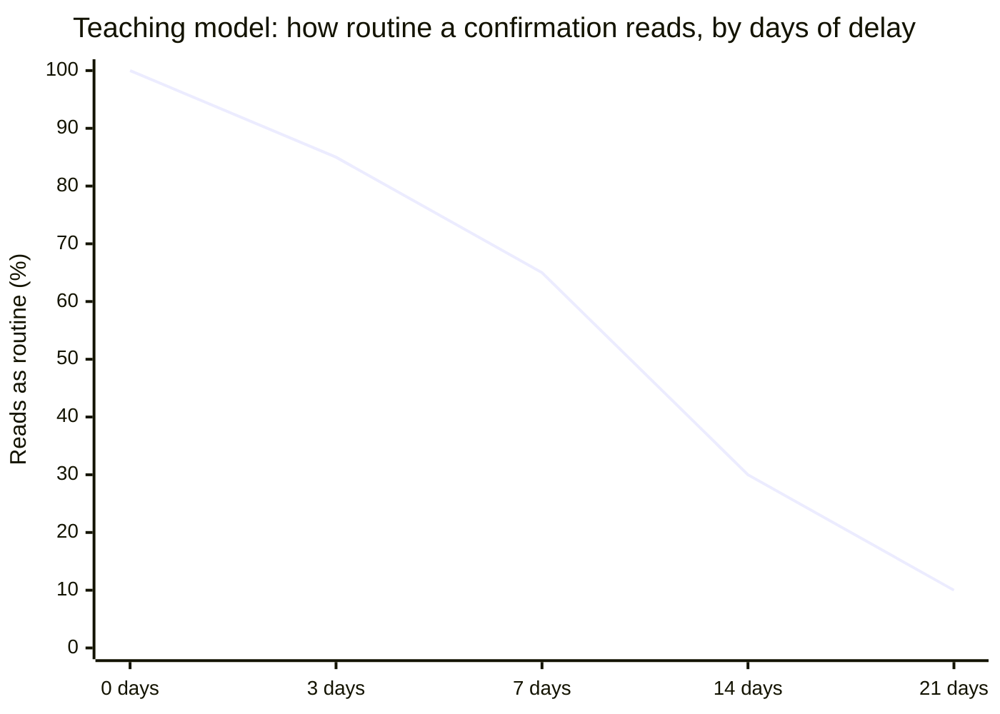

import Scenario from "../../../components/Scenario.astro";
import LevelIntro from "../../../components/LevelIntro.astro";
import Checkpoint from "../../../components/Checkpoint.astro";
import PracticeCheck from "../../../components/PracticeCheck.astro";

export const unit = {
  track: "corporate-politics",
  unitSlug: "documentation-discipline",
};

<Scenario label="The scenario, played twice">
  <Fragment slot="facts">
    

      
🅰️ <strong>Version A</strong>: no message sent, 21 days pass, dispute

      
🅱️ <strong>Version B</strong>: two-line confirmation sent on day 0

      
⚖️ Same hallway, same words, same director

      
❓ Only difference: one dated message

    

  </Fragment>

Same facts as L1 and L2: a director says "just ship it, we'll review security
after launch," an engineer complies, and 21 days later a vulnerability surfaces
and the director says they never said it. L3 plays that day-21 incident review
twice and asks what a single short message changes.

**Before reading on: if the director is not lying, only misremembering, does
the written confirmation still matter?**

</Scenario>

<LevelIntro
  items={[
    "An undocumented dispute in the room",
    "What a confirmation changes and what it does not",
    "Adapting the habit when the power gap is larger",
  ]}
/>

## Version A: no paper trail

**What actually happens in the incident review when nothing is in writing?** The
vulnerability surfaces, someone asks why the security review was skipped, and the
engineer says the director told them to, three weeks earlier. The director says:
"I never told anyone to skip the review."

The room now has two accounts and no way to check either. What happens next
depends on organizational power, not on what was true:

- The director outranks the engineer, so their account carries more default
  credibility, independent of accuracy.
- The engineer cannot produce evidence, so it reads as "he said, she said", which
  functionally means the more senior account wins.
- The engineer now carries individual responsibility for a decision someone
  else made, and cannot correct that record afterwards.

**Is the director necessarily lying?** No, and that changes what documentation
is for. People sincerely misremember hallway conversations they did not think
were important. The habit protects against an ordinary memory gap, not only
against bad faith.

<Checkpoint question="Version A is described as 'two accounts and no way to check either.' Does the room really stay undecided, or does it resolve the question anyway, and on what basis?">

It resolves it anyway, just not on the basis of what happened. Without evidence
the room defaults to whichever account carries more organizational credibility,
here the director's, purely because of rank. That is the real danger: an
undocumented dispute does not stay unresolved, it gets settled by power instead
of by fact, quietly, often without anyone noticing.

</Checkpoint>

## Version B: the same Scenario, with a written confirmation

**Replay the same hallway conversation, except the engineer sends this
immediately afterward.**

> **To:** [Director]
> **Subject:** Confirming: payments launch, security review timing
>
> Hi [Director], confirming what we just discussed: given the schedule pressure
> this sprint, we're shipping the payments feature without the security review,
> and will schedule the review after launch. Let me know if I've got that wrong.

Three weeks later the review has a dated, written record sent directly to the
director, in a neutral tone. **Does that remove the director's incentive to say
"I never said that"?** No. Incentives to avoid blame do not disappear because a
record exists. What changes is that the room no longer chooses between two
memories: a contemporaneous document settles the factual question whatever
anyone now prefers to remember.

| Element                            | Version A (no trail)                      | Version B (written confirmation)                                   |
| ---------------------------------- | ----------------------------------------- | ------------------------------------------------------------------ |
| What the room has to go on         | Two competing memories, 21 days old       | A dated, written record from day 0                                 |
| Whose account defaults to credible | The more senior person's, by default      | Neither: the record speaks independent of seniority                |
| Engineer's position afterward      | Carries the decision's consequences alone | Record shows the decision and its rationale, accurately attributed |

The interactive demo's teaching model puts a number on the timing point from L2:
perceived "routine" falls by 5 points per day of delay, with a floor of 10. These
values come from that model, not from research.

Version B sits at the left edge of that curve (0 days). Version A is the right
edge: at 21 days, any message sent would be read as a reaction to the incident,
which is the paranoid framing from L2.

<Checkpoint question="Version B's email never mentions blame, careers or the security risk. It only restates a scheduling decision. Why does it still protect the engineer three weeks later?">

Its protection does not come from arguing a case. It comes from existing, dated,
at the time of the decision. The engineer never has to defend themselves in the
message; its only job is to be a neutral record. That is why the professional
framing from L2 works: a message that reads as routine note-taking on day 0 still
works as decisive evidence on day 21, without ever having been written to look
like evidence.

</Checkpoint>

<PracticeCheck
  track={unit.track}
  unitSlug={unit.unitSlug}
  topicId="record-in-dispute"
/>

## Extend it: what if the decision-maker is much more senior?

**The Scenario's director is one level up. What if the instruction comes from a
VP, someone the engineer has very little standing to question?** The mechanics
do not change: a short, neutral confirmation works the same way. What changes is
the framing risk. Sending "confirming what we discussed" to someone far above
you can read as more presumptuous the larger the gap, simply because people do
it upward less often. The fix is not skipping it. Lean harder on the
professional framing: address it to the senior person directly, not cc'd to
their manager, keep it genuinely short, and phrase it as checking your own
understanding ("just want to make sure I understood correctly") rather than
holding them accountable.

**What would change if the news were worse**, say the instruction directly
contradicts a compliance policy rather than just trading off a schedule? The
two-line neutral tone still applies, but getting the framing right matters more:
a message that reads as even slightly accusatory may be taken as a threat, and
that is also the decision that most needs a record. At that point the question
is no longer a tone question, and talking to your HR function or a lawyer about
how to handle it is sensible. Nothing in this unit is legal advice.

This unit's Scenario is a case, not the whole territory. Try changing one thing
yourself: what if the instruction came by phone call, or in a meeting with six
people, or the other person simply never replies to your message? Work out what
the record would then contain, and what you would still not know.

<PracticeCheck
  track={unit.track}
  unitSlug={unit.unitSlug}
  topicId="upward-and-limits"
/>

## Failure modes at this level

- **Only documenting decisions from people at or below your own level.** The
  instinct to avoid "questioning" someone senior is backward: a decision from
  someone with more authority is often higher-stakes to have on record.
- **Cc'ing people who were not in the original conversation.** This tips a
  confirmation from professional to paranoid per L2's table, because it signals
  an audience beyond the person who decided.
- **Treating a confirmation as proof the other person cannot push back.**
  Version B changes what the disagreement is about, from "what was said" to
  whatever legitimate substance remains, such as whether the decision was a good
  one.
