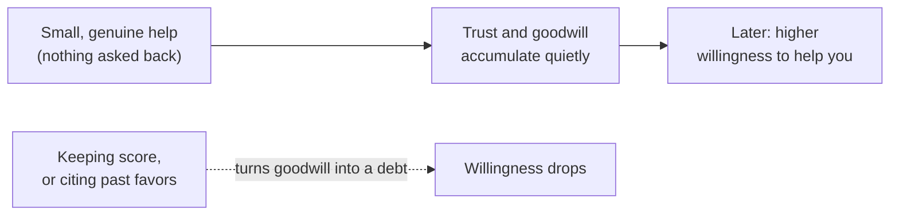

import Scenario from "../../../components/Scenario.astro";
import LevelIntro from "../../../components/LevelIntro.astro";
import PracticeCheck from "../../../components/PracticeCheck.astro";

export const unit = {
  track: "corporate-politics",
  unitSlug: "favor-economy",
};

<Scenario label="Two requests for the same notes">
  <Fragment slot="facts">
    

      
📓 <strong>The ask</strong> — "Can I borrow your notes tonight? I missed class."

      

        

          🧑‍🤝‍🧑 <strong>Maya</strong> — shared notes 4 times this term
          modeled willingness 55%
        

        

          

        

      

      

        

          🙋 <strong>Jon</strong> — has never spoken to the classmate
          modeled willingness 0%
        

        

          

        

      

      
Percentages come from this unit's teaching model (the demo in L2), not from a measurement.

    

  </Fragment>

Two students miss the same class and send the same message to the same
classmate: "Can I borrow your notes tonight?" Maya has shared her own notes
with that classmate four times this term, without ever asking for anything
back. Jon has never said a word to that classmate before tonight.

**Same words, same request, same night. Why does Maya's message get a quick
yes while Jon's gets left on read?**

The difference was not created tonight. It was built over the earlier weeks,
by small acts that looked unremarkable when they happened. The workplace
version is identical: the person who has quietly helped another team before
needs a favor from them gets a very different answer than a stranger does.

</Scenario>

<LevelIntro
  items={[
    "Why goodwill must exist before the ask",
    "Genuine help versus keeping score",
    "How a cold ask differs from a warm one",
  ]}
/>

## What is being built, and when?

**If help only works when it is already there, when does it have to be made?**
Before anyone needs it. By the time you are asking, the goodwill either exists
from earlier small help or it does not, and you cannot request it into being
at that moment.

- **Relationship capital** is the goodwill built from earlier small, genuine
  help. It makes people more willing to help you later.
- **The favor economy** is the informal, unwritten system by which help flows
  between people on the strength of their history, not their job titles.
- **Banking goodwill** means offering small, low-cost help before you need
  anything back.

<PracticeCheck
  track={unit.track}
  unitSlug={unit.unitSlug}
  topicId="deposit-vs-ploy"
/>

## Why does keeping score undo the work?

**If helping builds trust, would it not be smarter to track every favor so none
is wasted?** No. Help only builds trust while the receiver feels it was free.

- **Transactional keeping-score** treats each favor as a debt to be tracked and
  collected. People notice, and they become guarded instead of generous.
- **Reciprocity norms** are the widely shared feeling that kindness deserves
  kindness. They work like a feeling, not like a ledger with entries.

| Genuine deposit                                  | Reads as a ploy                                  |
| ------------------------------------------------ | ------------------------------------------------ |
| Answering a quick question when someone asks     | A large favor timed right before a known request |
| Sharing notes or context that saves someone time | "I helped you, so now you owe me" said out loud  |
| Help you would give to anyone in that spot       | A favor followed at once by asking one in return |

<PracticeCheck
  track={unit.track}
  unitSlug={unit.unitSlug}
  topicId="score-keeping"
/>

## What if there is no history at all?

**Jon still needs the notes tonight. Is he stuck?** Not stuck, but he starts
from zero.

- A **cold ask** is a request to someone who has no reason yet to prioritize
  you. Their **standing** with you is empty, so the request must carry its own
  weight: specific, small, and easy to say no to.
- A cold ask cannot borrow trust it has not earned. Pretending a friendship
  exists makes it worse.

| Term                 | Simple meaning                                               |
| -------------------- | ------------------------------------------------------------ |
| Relationship capital | Goodwill earned through earlier small, genuine help          |
| Standing             | How much trust or credibility you already have with a person |
| Cold ask             | A request made with no prior relationship to lean on         |

<PracticeCheck track={unit.track} unitSlug={unit.unitSlug} topicId="cold-ask" />

## What the next levels cover

L2 explains why the mechanism only works when help stays genuine, and how a
cold ask can still succeed. L3 follows one workplace case from start to finish
and asks what happens when the capital has to be spent through someone else.
