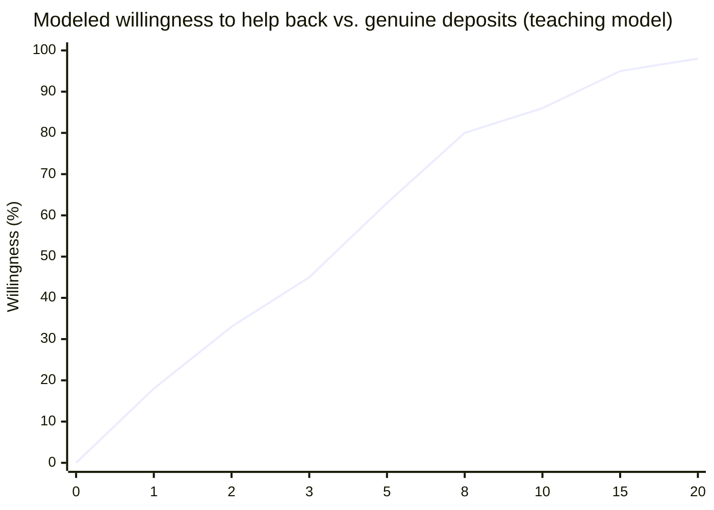
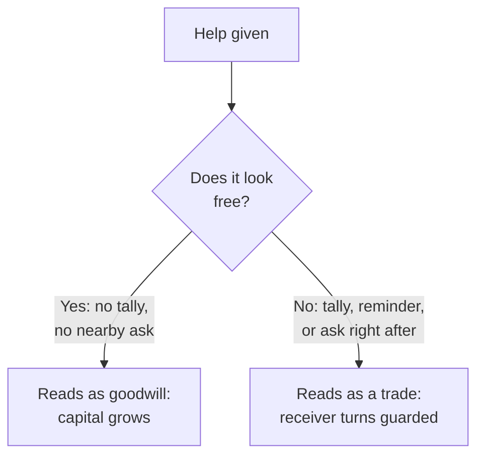

import LevelIntro from "../../../components/LevelIntro.astro";
import Checkpoint from "../../../components/Checkpoint.astro";
import PracticeCheck from "../../../components/PracticeCheck.astro";

export const unit = {
  track: "corporate-politics",
  unitSlug: "favor-economy",
};

L1 showed that Maya's yes came from earlier small acts, not from tonight's
wording. L2 works out the rule that makes the mechanism function: reciprocity
builds capital only while it stays genuine, and it breaks the moment it looks
tracked.

<LevelIntro
  items={[
    "How few deposits it takes to matter",
    "Why a visible tally backfires",
    "What a cold ask can still do",
  ]}
/>

## How many deposits does it take?

**Does Maya need a year of favors before her request lands?** Probably not. The
interactive demo on this unit uses a simple teaching model, not a measurement:
willingness to help back rises quickly with the first few genuine deposits,
then levels off. Its numbers, from the demo formula, are below.

| Genuine deposits    | 0   | 1   | 2   | 3   | 5   | 8   | 10  | 20  |
| ------------------- | --- | --- | --- | --- | --- | --- | --- | --- |
| Modeled willingness | 0%  | 18% | 33% | 45% | 63% | 80% | 86% | 98% |

The first three deposits add 45 points; deposits 11 through 20 add only 12.
The lesson is not a number to memorize. It is that a few genuine, low-cost
acts matter most, so waiting for a "big gesture" misses how the mechanism works.

<Checkpoint question="In the model, going from 10 to 20 deposits adds only 12 points, while going from 0 to 3 adds 45. What does that suggest about where effort is best spent?">

On starting, and on keeping the first few acts real. The early deposits move the
needle most because they change the situation from "no history" to "some
history." Piling on many more adds little, and doing so mechanically starts to
look like the tracking that undoes trust. The model is a teaching sketch, so
the exact numbers are not the point; the shape is.

</Checkpoint>

## What separates a deposit from a ploy?

**Two people each do a favor. One is a deposit and one is a setup. How can the
receiver tell?** Not by size. The test is whether the help would still make
sense if nothing were ever asked back.

- A quick answer to a coworker's question, a short review done without being
  asked twice, or a warning about an avoidable mistake all pass the test.
- A large, unrequested favor delivered right before a known request fails it,
  because the timing reveals the purpose.

<PracticeCheck
  track={unit.track}
  unitSlug={unit.unitSlug}
  topicId="deposit-vs-ploy"
/>

## Why does a visible tally backfire?

**If reciprocity is the engine, would explicit tracking not make it run
better?** It would break it. The moment help carries a visible expectation, it
stops reading as goodwill and starts reading as a trade.

**Quid pro quo** means "this for that". An openly agreed trade ("I will cover
your shift if you cover mine") is fine and honest. The problem is disguising a
trade as free help, because the receiver feels tracked afterwards.

<Checkpoint question="Maya reminds the classmate: 'Remember I shared my notes four times? Lend me yours tonight.' The history is real. Why can that still lower the chance of a yes?">

Because saying it aloud recasts four free acts as four payments in advance. The
classmate learns nothing new from the reminder, since they remember the notes,
so it adds no persuasion. It only reveals that Maya was counting, and being
counted makes people less generous, not more. The history was real either way;
what changed is whether it still looks free.

</Checkpoint>

<PracticeCheck
  track={unit.track}
  unitSlug={unit.unitSlug}
  topicId="score-keeping"
/>

## What can a cold ask still do?

**Jon has no deposits. Is the ask hopeless?** No, but it cannot lean on trust
that was never earned. It has to work through its own shape.

1. Name the smallest thing that would help, not the largest.
2. State the cost to the other person, for example "about five minutes".
3. Say why it is time-sensitive, briefly and truthfully.
4. Make a no easy: "No worries if tonight is not possible."

A request shaped this way is easier to grant, but it still starts at zero
standing and may be queued behind people the receiver already knows. Honesty
matters here too: claiming a friendship that does not exist is discovered
quickly and costs more than asking plainly.

<PracticeCheck track={unit.track} unitSlug={unit.unitSlug} topicId="cold-ask" />

## Is this only about favors?

The same pattern sits behind most durable relationships: small, consistent,
genuinely given contributions build a reserve that does not need to be spent at
once or recorded. The corrosive version, visible score-keeping and favors timed
next to asks, damages trust in any relationship, at work or outside it.
