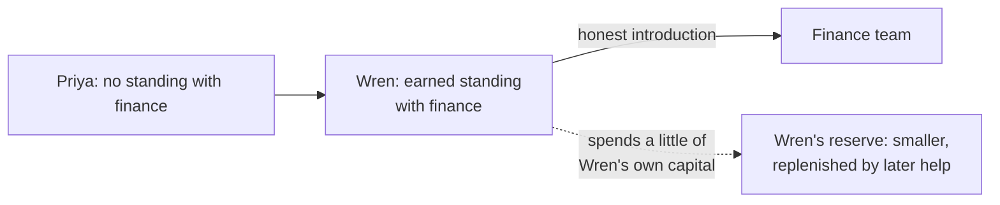

import Scenario from "../../../components/Scenario.astro";
import LevelIntro from "../../../components/LevelIntro.astro";
import Checkpoint from "../../../components/Checkpoint.astro";
import PracticeCheck from "../../../components/PracticeCheck.astro";

export const unit = {
  track: "corporate-politics",
  unitSlug: "favor-economy",
};

<Scenario label="The scenario">
  <Fragment slot="facts">
    

      
👤 <strong>Wren</strong> — coordinates events at a mid-sized company

      
🗓️ <strong>Over 6 months</strong> — answered 4 quick questions from the finance team, unprompted

      
🙋 <strong>Priya</strong> — coordinates events too, has never worked with finance

      
🎯 <strong>Today</strong> — both need finance to check a vendor invoice before a 5 pm payment cutoff

      
The 4 questions and 6 months are assumed for this case. The model value for 4 deposits is 55%, from this unit's teaching model.

    

  </Fragment>

Wren and Priya do the same job at the same company. This afternoon each needs
the finance team to check one vendor invoice before the 5 pm payment cutoff.
Over the past six months Wren answered four quick questions from finance
without being asked twice and never mentioned it. Priya has never dealt with
that team.

**Before reading on, predict: should Wren mention the earlier help to improve
the odds, or does saying it out loud change what it is worth?**

</Scenario>

<LevelIntro
  items={[
    "Warm ask, cold ask, and the reminder trap",
    "Borrowing credibility honestly, and what it costs",
    "How the picture shifts for a different audience or stake",
  ]}
/>

## What do the three versions of the message look like?

| Version                 | What is said                                                                                | Likely effect                                           |
| ----------------------- | ------------------------------------------------------------------------------------------- | ------------------------------------------------------- |
| Wren, silent about past | "Sorry for the short notice. Could someone check this invoice before 5? No worries if not." | Finance prioritizes it, based on goodwill already there |
| Priya, same wording     | The identical message                                                                       | Reasonable, but queued behind people finance knows      |
| Wren, citing the past   | "I have helped you four times, so now you owe me this."                                     | Feels like a bill; goodwill turns into resentment       |

The first two messages are word for word the same. The only difference is the
history, which is why wording alone cannot rescue a cold ask.

<Checkpoint question="Wren's reminder is true and the help was real. Why is the reminder still a poor move?">

Because it does not add information. Finance remembers the four answers, so
mentioning them adds no persuasion. What it does add is a signal that Wren was
counting, which recasts the earlier help as a prepayment. Receivers who feel
billed become guarded, and guarded people say "later". The silent version lets
the goodwill work in the background, where it has always worked.

</Checkpoint>

## What can Priya do without pretending?

**She has no standing and a hard deadline. What honest options exist?** Two,
and they can be combined.

1. Shape the ask to be easy to grant: one invoice, five minutes, a clear reason
   for the cutoff, and a graceful way to say no.
2. Ask someone who has standing, such as Wren, to make an honest introduction:
   "Priya does not know you yet, but this request is real and time-sensitive."

Whose capital pays? Wren's. Priya still has none of her own; Wren lends some of
what six months of small acts built. That is why the introduction must be
honest and why it is not free: vouching draws the reserve down, and it grows
back only through further genuine help, not through asking the same favor
repeatedly.

<Checkpoint question="If Priya instead says 'Wren and I both work with you folks all the time', what has gone wrong, even if finance agrees this once?">

She has claimed a relationship she has not earned, and finance may check it
against what they remember. If it holds up badly, the damage lands on Priya
and on Wren, whose name is now attached to a stretched story. Honest
borrowing says exactly who has the history and who does not. The request can
succeed on its own merits without that claim, and it keeps both people's
credibility intact if it does not.

</Checkpoint>

<PracticeCheck
  track={unit.track}
  unitSlug={unit.unitSlug}
  topicId="spending-capital"
/>

## What does the model say about spending and replenishing?

Using this unit's teaching model (not a measurement), four deposits give about
55% modeled willingness and three give about 45%. Spending capital does not
reset it to zero in the model or in real life, but it does lower the margin for
the next request. If Wren vouches for Priya, then vouches again next week,
finance may start to feel that Wren's word is being used as a currency. A
sensible habit is to make new, unrelated small deposits afterwards.

## Extend it: your turn to change the case

This scenario is a case, not the whole territory. Try changing one thing at a
time and ask what changes:

- Suppose Wren had announced each of the four answers in a team channel as it
  happened. How would finance feel about that, and how would everyone else
  watching feel? Do the two audiences react alike?
- Suppose the ask were large rather than small: five hours of finance time,
  not five minutes. Does the same amount of capital still cover it?
- Suppose the news were worse: finance says no. What does Wren or Priya do
  next, and what does it do to the relationship?

A reasonable answer to the first is mixed. Constant announcement can make the
recipient feel the help was performed for an audience, which weakens the
capital with them. Occasional, accurate visibility can help others understand
that Wren is reliable. Pattern and proportion are the line.

## Failure modes

| Failure mode                                         | What it gets wrong                                                   |
| ---------------------------------------------------- | -------------------------------------------------------------------- |
| Citing past favors when making an ask                | Reframes free help as a prepayment                                   |
| Expecting a well-worded cold ask to match a warm one | Standing, not phrasing, decides the queue                            |
| Timing a big favor right before a known ask          | The proximity itself signals a trade                                 |
| Claiming a relationship that does not exist          | Discovered quickly, and costs more than asking plainly               |
| Vouching repeatedly without replenishing             | Draws down the lender's capital until their word stops moving things |
