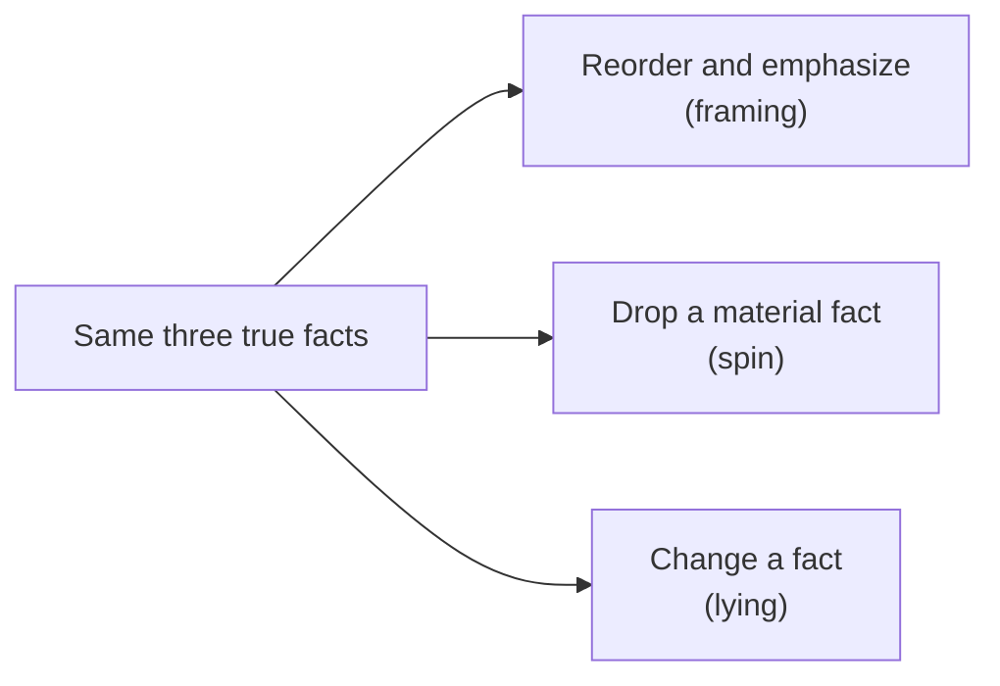

import Scenario from "../../../components/Scenario.astro";
import LevelIntro from "../../../components/LevelIntro.astro";
import PracticeCheck from "../../../components/PracticeCheck.astro";

export const unit = {
  track: "corporate-politics",
  unitSlug: "framing",
};

<Scenario label="Same project, same facts, two team updates that land completely differently">
  <Fragment slot="facts">
    

      
⚡ <strong>Win</strong> — page load time cut from 3.2s to 1.9s (40.6% faster)

      
⏰ <strong>Miss</strong> — shipped 3 weeks late (a 6-week estimate became 9 weeks)

      
🐛 <strong>Incident</strong> — a caching bug caused a 12-minute outage, found and fixed

    

    

      
Before

3.2s

      
After

1.9s

    

  </Fragment>

An engineer finishes a project where three things are true at once: a real,
measurable win (page loads got 40.6% faster), a real miss (three weeks late),
and a real incident (a 12-minute outage caused by a bug, since fixed).

Two team updates get written from those same three facts. One opens with
"sorry this took longer than planned, and we also had an outage..." The other
opens with "we cut page load time by 40.6%." Both are entirely true. Neither
adds or removes a single fact. **So why does one read like an apology and the
other like a success story, and is choosing which one to write already a
form of lying?**

Plain-words glossary: page load time is how long a page takes to appear; a
caching bug is a mistake in how stored data is reused; an outage means the
service stopped working for users for a while. The lesson is about telling
true facts, not about caching.

</Scenario>

<LevelIntro
  items={[
    "Framing, spin and lying compared",
    "Why owning your own story matters",
    "The honesty line in one sentence",
  ]}
/>

## What separates framing from spin from lying?

**If both updates are true, what could possibly make one of them dishonest?**
Only two things can: a false statement, or a missing fact that would have
changed how the reader judges the result.

| What you did with the same three facts                  | Name        | Honest?                                         |
| ------------------------------------------------------- | ----------- | ----------------------------------------------- |
| Chose which fact leads and how much space each one gets | **Framing** | Yes, as long as all three facts are still there |
| Left the outage out entirely                            | **Spin**    | No: nothing is false, but the picture is        |
| Wrote that there was no outage                          | **Lying**   | No: a false statement                           |

- **Framing** is choosing which true facts to emphasize, and in what order,
  without omitting anything material or asserting anything false.
- **Spin** is telling only true statements while leaving out a fact the
  reader needed, so the overall impression is false even though no sentence is.
- **Emphasis** is how much space or lead position a fact gets. It is the
  dial framing turns, and it works the same for good news and bad news.

Everyday version: "I finished the group project and got a high grade" is
true but misleading if you leave out "my partner did all the work." The
grade can lead the story, but the work split changes how someone judges the
result, so dropping it is spin.

<PracticeCheck
  track={unit.track}
  unitSlug={unit.unitSlug}
  topicId="framing-spin-lying"
/>

## Why tell the story yourself at all?

**What happens to the project's story if you simply say nothing about it?**
It still gets told. Someone assembles it from the first fact they heard, a
rumor, or whichever message was loudest, and you have no say in what leads.

- **Narrative ownership** is telling the story of your own work yourself,
  proactively, rather than leaving it to be assembled secondhand.
- Staying silent is not a neutral choice. It hands the framing decision to
  other people's first impressions.
- Reporting events in the order they happened is not neutral either. It is
  one frame among several, chosen by default instead of on purpose.

**The honesty line, in one sentence:** you may choose the order and the
emphasis of your story, but never what is true and never whether the facts a
reader needs to judge the outcome are present.

<PracticeCheck
  track={unit.track}
  unitSlug={unit.unitSlug}
  topicId="narrative-ownership"
/>

## What this unit covers

L2 turns the honesty line into a two-question test you can run on any
narrative, and works out what makes a fact material. L3 writes this same
update three ways, checks each against the test, and asks what changes when
the outage gets worse.
