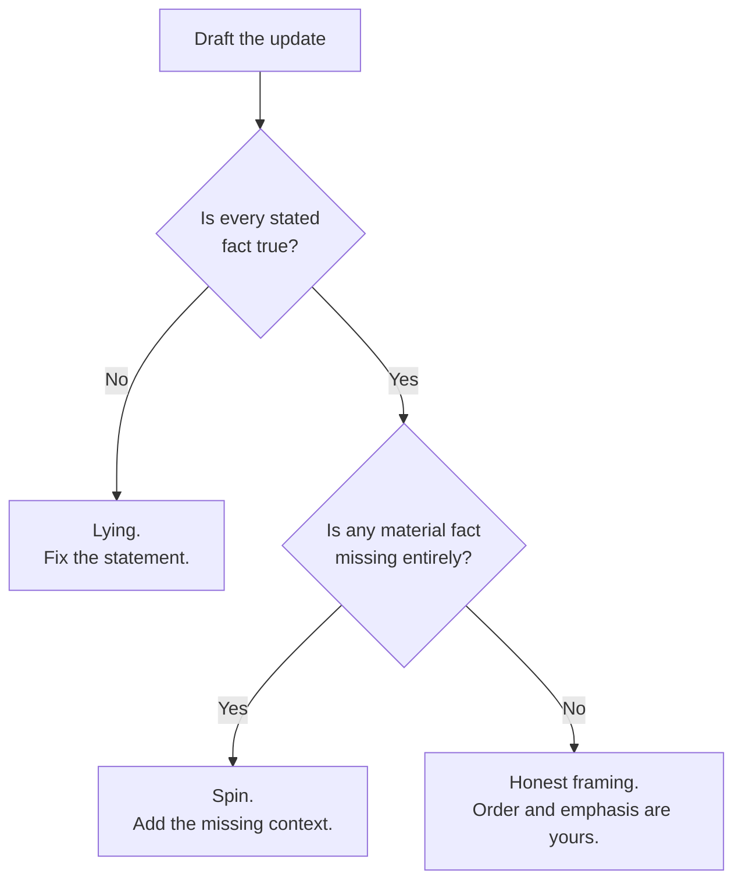

import LevelIntro from "../../../components/LevelIntro.astro";
import Checkpoint from "../../../components/Checkpoint.astro";
import PracticeCheck from "../../../components/PracticeCheck.astro";

export const unit = {
  track: "corporate-politics",
  unitSlug: "framing",
};

L1 drew the honesty line in one sentence: choose order and emphasis freely,
never change what is true, never drop what the reader needs. L2 makes that
line usable. It needs two things: a way to decide what "needs" means, and a
check you can run before you hit send.

<LevelIntro
  items={[
    "What makes a fact material",
    "The two-question honesty check",
    "Why a chronological report is still a frame",
  ]}
/>

## What makes a fact "material"?

**If omitting facts is what turns framing into spin, does an honest update
have to list every detail?** No. The test is not "everything", it is
_materiality_: would a reasonable reader's understanding of the outcome change
if they learned this fact?

A reasonable reader is a normal person trying to judge the result fairly, not
someone hunting for excuses and not someone who will be satisfied with
anything. The same fact can be material in one update and irrelevant in
another, because it depends on what is being judged.

| Fact                                         | Being judged                   | Material? | Why                                         |
| -------------------------------------------- | ------------------------------ | --------- | ------------------------------------------- |
| The project caused a 12-minute outage        | How the rollout went           | Yes       | Changes how risky the rollout looks         |
| The team used one editor rather than another | How the rollout went           | No        | Changes nobody's judgment of the outcome    |
| The group-project partner did all the work   | Whether you earned the grade   | Yes       | Changes who deserves the credit             |
| The poster font was Arial                    | Whether the event raised money | No        | Has no bearing on the amount                |
| No one was hurt                              | An accident report             | Yes       | The central fact the reader is asking about |

<Checkpoint question="A teammate's update says the project shipped and page loads are faster. Every word is true, but it never mentions the production outage the rollout caused. Using the table above, is that framing or spin, and what is the deciding fact?">

Spin. Nothing in the update is false, which is exactly why spin is hard to
catch: you cannot find the problem by checking sentences one at a time. The
deciding fact is materiality. A reasonable reader judging how the rollout went
would change their view on learning about the outage, and the update does not
just give it little space, it leaves it out entirely.

</Checkpoint>

<PracticeCheck
  track={unit.track}
  unitSlug={unit.unitSlug}
  topicId="materiality"
/>

## What two questions can you run before sending?

**"Does this feel honest?" is a mood, not a test. What would a test look
like?** Two independent yes/no questions about the draft, asked in order.

| Question                            | Catches | What passing it does not prove               |
| ----------------------------------- | ------- | -------------------------------------------- |
| 1. Is every stated fact true?       | Lying   | That nothing the reader needs is left out    |
| 2. Is every material fact included? | Spin    | That the update is well told or well ordered |

The two checks are independent. A narrative can pass the first and fail the
second, which is the definition of spin. Passing both only proves the update
is honest, not that it is good: the order and emphasis you chose are a separate
craft, and L3 shows the difference.

There is a third habit worth adding, because the checks above only ask whether
a fact is present. After both pass, ask whether each serious fact has enough
room for its seriousness. A heavy fact squeezed into a passing clause can leave
the same false impression an omission does. L3 returns to this.

<PracticeCheck
  track={unit.track}
  unitSlug={unit.unitSlug}
  topicId="honesty-check"
/>

## Why not just report events in the order they happened?

**If framing and spin are both risks, is the safest move to shape nothing and
report chronologically?** No. Chronological order is a frame like any other. It
just means the frame was chosen by habit instead of by you.

- Reading "first we failed, then we fixed it" feels different from "we
  delivered, after a failure we fixed." Both can be honest if they contain the
  same material facts.
- Whatever comes first carries the most weight, whether or not anyone decided
  it should.
- If a win and a setback both happened and you do not choose how to present
  them, the reader's own assumptions fill the gap.

<Checkpoint question="Someone argues that chronological order is the neutral choice, so it can't be framing. What is wrong with that?">

It treats "I did not decide" as if it meant "no decision was made". Order
always determines what a reader meets first, and first position always carries
weight, regardless of whether it was chosen on purpose. Calling the default
neutral only hides the choice. The real alternative to careless framing is
choosing order and emphasis deliberately, while keeping both honesty checks
passing.

</Checkpoint>

<PracticeCheck
  track={unit.track}
  unitSlug={unit.unitSlug}
  topicId="default-frame"
/>
