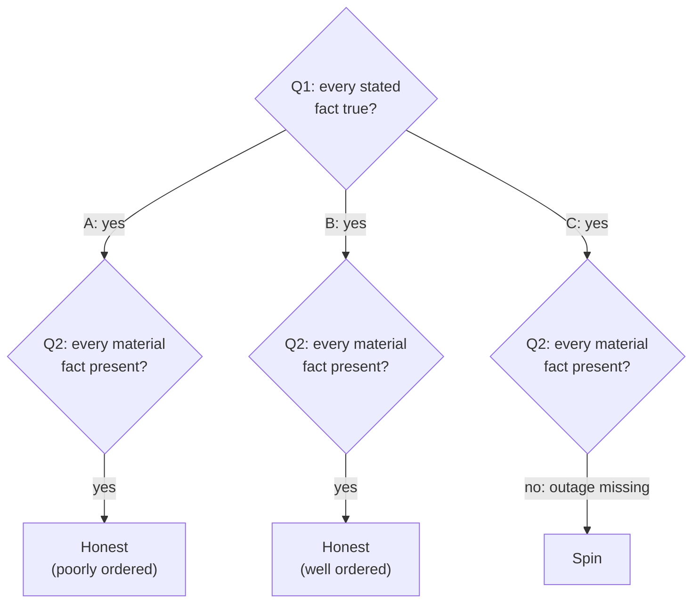

import Scenario from "../../../components/Scenario.astro";
import LevelIntro from "../../../components/LevelIntro.astro";
import Checkpoint from "../../../components/Checkpoint.astro";
import PracticeCheck from "../../../components/PracticeCheck.astro";

export const unit = {
  track: "corporate-politics",
  unitSlug: "framing",
};

<Scenario label="Three drafts, one set of facts, one standard">
  <Fragment slot="facts">
    

      
😔 <strong>Draft A</strong> — setback leads, win buried

      
✅ <strong>Draft B</strong> — win leads, every fact present

      
🚩 <strong>Draft C</strong> — win leads, outage missing

    

    
Shared facts: 40.6% faster loads (3.2s to 1.9s), 3 weeks late, a 12-minute outage.

  </Fragment>

All three drafts below are built from the facts you met in L1. Before reading
them, hold L2's two questions in mind: is every stated fact true, and is every
material fact present?

**One of these drafts is the only one that crosses the honesty line, and it
is not the one that sounds the most apologetic. Which is it, and what does
that tell you about where the line really sits?**

</Scenario>

<LevelIntro
  items={[
    "Three versions of the same true facts",
    "Where the honesty line actually crosses",
    "How much space a serious fact deserves",
  ]}
/>

## How do the three drafts read, and how do they score?

**Same facts, same standard: what does the check say about each draft?**

**Draft A, buried lead**

> Sorry this took longer than expected — we ran into some issues along the way,
> including a caching bug that caused a brief outage. The good news is the
> project is done now, and page load times did improve as part of the work.

**Draft B, honest framing**

> We shipped the caching layer rework, cutting page load time from 3.2s to
> 1.9s — a 40.6% improvement. It took 3 weeks longer than the original
> estimate: the caching logic turned out to be more interdependent with the
> session layer than expected, which is also what caused a 12-minute outage
> mid-rollout. That's fixed and covered by a new regression test now.

**Draft C, spin**

> We shipped the caching layer rework, cutting page load time from 3.2s to
> 1.9s — a 40.6% improvement. It took a bit longer than planned due to some
> added complexity in the caching logic.

Plain-words glossary: the caching layer stores data so pages load faster; the
session layer tracks who the user is; mid-rollout means while the change was
being released; a regression test is a check added so the same bug is less
likely to come back.

| Draft | Every stated fact true? | Outage present?           | Verdict                                        |
| ----- | ----------------------- | ------------------------- | ---------------------------------------------- |
| A     | Yes                     | Yes, but vague and buried | Honest, though the framing is accidental       |
| B     | Yes                     | Yes, with cause and fix   | Honest, and the framing is deliberate          |
| C     | Yes                     | **No, left out entirely** | Spin: true sentences, false overall impression |

Draft A and Draft B pass both questions. The difference between them is not
honesty, it is deliberateness: Draft B chose to lead with the result and to
name the outage's cause and duration, so a reader of B knows more than a reader
of A, not less. Draft C is the only one that crosses the line, and it crosses
by omission, not by a false sentence.

<Checkpoint question="A teammate defends Draft C with 'but I didn't lie.' Why does that defense answer the wrong question?">

Because lying and spin are caught by two separate checks. "I didn't lie" clears
only the first one, and Draft C does clear it. It fails the second: the outage
is a fact that would change how a reader judges the rollout, and it is absent,
not just brief. Passing the truth check is necessary but not sufficient. A
narrative can be built entirely from true sentences and still leave a reader
with a false overall impression, which is what spin is.

</Checkpoint>

<PracticeCheck
  track={unit.track}
  unitSlug={unit.unitSlug}
  topicId="three-drafts"
/>

## How much space does a serious fact deserve?

**Draft B gives the outage one clause and one clause on the fix, roughly 19 of
its 60 words. If the outage had been much worse, would that same treatment
still be honest?** The facts would stay accurate, but the treatment would stop
fitting them.

Honesty has a bright line, which is omission and false statements, and a
gradient on one side of it: the heavier the fact, the more room it needs before
a brief mention stops being emphasis and starts working like an omission. The
unit's interactive demo lets you drag exactly this. It holds Draft B's
treatment the same size and stretches the outage from 12 minutes toward 4
hours: the longer the outage, the larger the gap between how much room the fact
got and how much it deserved, and the more the same sentences read as spin to
an outside reader.

| What changes with a heavier outage                            | What honest framing does about it                |
| ------------------------------------------------------------- | ------------------------------------------------ |
| Who was affected (internal test traffic vs. paying customers) | States who and how many, not "some users"        |
| How long it lasted                                            | Gives the real duration, not "brief"             |
| Whether it can recur                                          | Says what prevents it and what remains risky     |
| Where it appears in the update                                | Still can follow the win, but gets its own space |

**This is one worked case, not the whole territory.** Draft B passes for a
12-minute outage that touched no customers. Try changing the facts:

- **What if the outage had lasted 4 hours and hit paying customers?** What would
  you add, and would you still lead with the speed-up?
- **What if the audience were the customers who were affected**, not your own
  team? Which fact would now lead?
- **What if the miss were larger than the win**, say the project cost more than
  it saved? Could a win-first update still be honest, and what would make it
  stop being so?

None of these has a single clean answer. The two questions give you the floor;
proportion, audience and stakes decide how far above the floor an honest update
has to go.

<Checkpoint question="If Draft B's treatment stays word-for-word identical but the outage becomes four hours long and hits paying customers, is it now spin?">

Not by the bright-line test: nothing is false and the outage is still named. But
it moves toward spin because the treatment no longer fits the fact. A reader who
later learns the real scale will feel the update minimized it, and that
reaction is the trust loss spin produces. The honest fix is not to abandon the
win-first order but to give the outage the room its weight requires: impact, fix,
prevention, and what is still risky.

</Checkpoint>

## Failure modes

| Failure mode                                       | What it gets wrong                                                                                   |
| -------------------------------------------------- | ---------------------------------------------------------------------------------------------------- |
| Treating any positive emphasis as dishonest        | Leading with a true win is not spin; the test is about omission and false statements, not enthusiasm |
| Assuming "I didn't technically lie" is enough      | Spin passes that bar completely; materiality is the second and equally necessary check               |
| Staying chronological to "stay neutral"            | Undeliberate framing, like Draft A, hands the decision to instinct instead of judgment               |
| Gesturing vaguely at a setback ("some issues")     | Reads as evasive even when nothing is hidden; name the cause and the size                            |
| Deciding what was material only after someone asks | The check is meant to run before sending, not to be assembled as a defense afterward                 |

<PracticeCheck
  track={unit.track}
  unitSlug={unit.unitSlug}
  topicId="proportion"
/>
