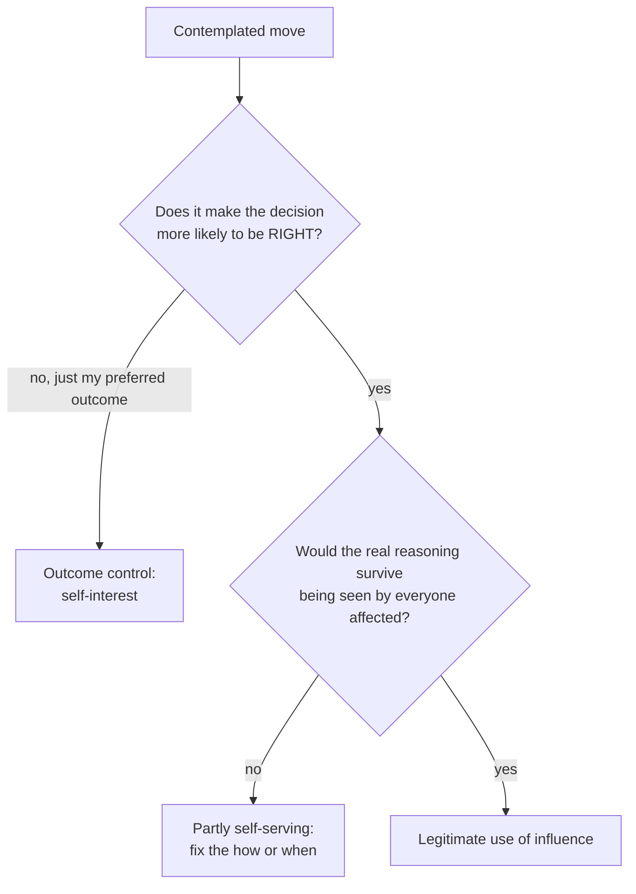

import Scenario from "../../../components/Scenario.astro";
import LevelIntro from "../../../components/LevelIntro.astro";
import PracticeCheck from "../../../components/PracticeCheck.astro";

export const unit = {
  track: "corporate-politics",
  unitSlug: "influence-tool-org-s-good",
};

<Scenario label="One engineer, one real risk, one director's flagship launch, three days to go.">
  <Fragment slot="facts">
    

      

        

          
🎯 Spend the influence on the decision

          
Raise the specific risk in the room where the ship date is set, before it locks.

        

        

          
🛡️ Spend it on my own position

          
Stay quiet, keep the goodwill, and be ready with a story if it fails.

        

      

      
👤 People whose objection could reshape this launch: <strong>about 3</strong> (story assumption)

      
⚖️ <strong>Same skill, same credibility, same meeting. Only the target differs.</strong>

    

  </Fragment>

Marcus has spent years learning how to be heard. Now his framing of a problem,
in the right meeting, reliably moves a decision. This week a director, Priya,
is about to ship a rewrite of the billing path she has promised her own
leadership. Marcus has read the design closely and found a specific,
checkable failure sequence nobody has tested.

Saying nothing costs him nothing today and keeps Priya friendly. Speaking
risks being remembered as the person who slowed her launch. Whichever he picks,
he can describe it to himself as reasonable.

**If the same skill can serve the decision or serve Marcus, what actually
tells the two uses apart?**

</Scenario>

The answer is not a new skill. This track already built the skills: reading
who really decides, framing honestly, raising a concern calmly, choosing
battles. The question here is what those skills are pointed at once enough
people depend on them.

<LevelIntro
  items={[
    "Why reach raises the stakes",
    "Decision quality vs. outcome control",
    "Why self-interest never fully goes away",
  ]}
/>

## Why does reach change the stakes?

**Marcus makes the same misstep twice: once as a newcomer nobody listens to,
once as the person every launch review waits for. Is the cost the same?**
No. The mechanism is the same, and the number of people downstream is not.

| Reach of the person's influence           | Who pays when it is used badly                              |
| ----------------------------------------- | ----------------------------------------------------------- |
| Mostly their own team, one room at a time | Mostly themselves: a stalled review, a bruised relationship |
| An org-wide launch, many rooms            | People who never see the choice being made                  |

- **Influence at scale**: a person's framing, timing, or objection reliably
  changes what the whole organization decides.
- [`staying-principled`](/corporate-politics/staying-principled/) described
  drift as a series of individually defensible compromises. Here the same
  drift sends its bill to more people.

<PracticeCheck
  track={unit.track}
  unitSlug={unit.unitSlug}
  topicId="scale-stakes"
/>

## How do you tell the two uses apart?

**Marcus's reasons for silence and for speaking both sound fine in his head.
What sorts them?** Two questions, asked before acting.

- **Decision quality**: better information reaches the deciders in time.
- **Outcome control**: steering the result to a chosen answer, including "the
  answer that is safest for me".
- **The visibility test**: would you be comfortable if the actual reasoning
  were fully visible to everyone it affects?

<PracticeCheck
  track={unit.track}
  unitSlug={unit.unitSlug}
  topicId="two-questions"
/>

## Can you just have no stake in the outcome?

**Marcus's reputation does benefit when he catches real problems. Is that
already a conflict of interest?** No. Being seen as effective is what doing
the job well produces, so the overlap is normal.

- **Entangled self-interest**: legitimate influence and personal benefit
  cannot be fully separated.
- The discipline is to expect the overlap most of the time and watch for the
  rare moment the org's good and your safety point in different directions.
  At that fork, what matters is which branch you take.

<PracticeCheck
  track={unit.track}
  unitSlug={unit.unitSlug}
  topicId="entanglement"
/>

## What comes next

L2 builds the model: how reach changes stakes, the two questions applied to
real moves, and how to manage the overlap with self-interest. L3 follows Marcus
through the decision at real personal cost.
