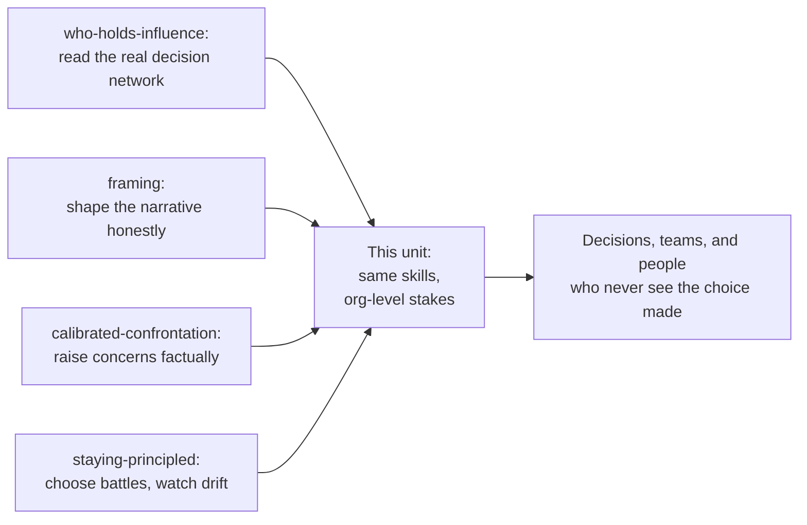
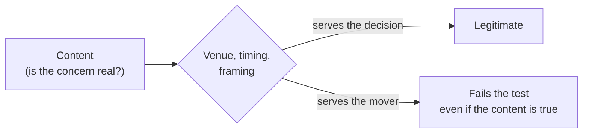

import LevelIntro from "../../../components/LevelIntro.astro";
import Checkpoint from "../../../components/Checkpoint.astro";
import PracticeCheck from "../../../components/PracticeCheck.astro";

export const unit = {
  track: "corporate-politics",
  unitSlug: "influence-tool-org-s-good",
};

L1 left Marcus with one decision that can be narrated two ways: make the
launch better, or make himself safer. This level builds the model behind that
fork, step by step.

<LevelIntro
  items={[
    "Same skills, larger blast radius",
    "The two questions, applied to real moves",
    "Managing self-interest instead of denying it",
  ]}
/>

## Same skills, larger blast radius

**If this track already taught reading rooms, framing, and choosing battles,
what is new here?** Nothing in the skill set. What changes is who is downstream
of getting it wrong.

The demo back in L1 uses a simple teaching model, not measured data: people
affected by one bad-faith use of influence grow as scale to the power 2.1. At
scale 1 that is 1 person, at the default scale 8 it is 79, and at scale 10 it
is 126. The point is the shape: the curve bends upward, so the last few steps of
reach add far more affected people than the first few.

<Checkpoint question="Someone says the earlier units already cover everything a person with wide reach needs, so this unit is redundant. What is the gap?">

The skills are the same, but the earlier units were built around stakes that
mostly land on the person choosing. With wide reach, the same choice made the
same way lands on people who never see the conversation and cannot correct a
bad call the way a peer in the room could. The drift mechanism is identical;
the size of the bill is not, which is why this scale needs its own explicit test.

</Checkpoint>

<PracticeCheck
  track={unit.track}
  unitSlug={unit.unitSlug}
  topicId="scale-stakes"
/>

## A real test: two questions, not a feeling

**If both the quiet option and the vocal option feel justified, what actually
separates them?**

1. **Does this make the decision more likely to be right, or just more likely
   to go the way I want?** "Will it work" is useless here, because it works
   equally well for a good-faith concern and a self-serving one.
2. **Would I be comfortable if the real reasoning were fully visible to
   everyone it affects?** Not "would it be praised". A well-meant wrong call
   passes. The test fails when the visible reasoning reads as self-protective.

| Move                                                            | Makes the decision more right? | Survives full visibility?                                        | Verdict                         |
| --------------------------------------------------------------- | ------------------------------ | ---------------------------------------------------------------- | ------------------------------- |
| Raise a checkable risk to the deciders before the launch locks  | Yes                            | Yes: "I think it fails under X" holds up aloud                   | Legitimate                      |
| Stay quiet because the project's champion is useful to know     | No                             | No: "I did not want to spend capital" fails aloud                | Self-interest                   |
| Time a real risk to land just before your own promotion review  | The risk is real               | No: the timing reads as self-serving                             | Content passes, execution fails |
| Talk to affected people before proposing, so nobody is ambushed | Yes                            | Yes: "I checked with the people this affects" holds up in public | Legitimate                      |

**The third row is the one that does not resolve cleanly.** A concern can be
entirely legitimate and still be deployed in a way that fails the second
question. The test judges the execution (venue, timing, framing), not only the
content.

<Checkpoint question="A well-founded concern about a colleague's design is raised in a large cross-team meeting, where it visibly damages the colleague, instead of in the design review where the decision is made. The concern is valid. What does the test say?">

The content passes the first question, but the choice of venue does not pass
the second. Picking the room that maximizes the colleague's public
embarrassment serves visible standing, not decision quality, and the honest
reason ("I wanted more people to see this") would not survive being said
aloud. A legitimate concern does not legitimize every way of using it.

</Checkpoint>

<PracticeCheck
  track={unit.track}
  unitSlug={unit.unitSlug}
  topicId="two-questions"
/>

## The entanglement that does not resolve

**If the test works, why not stop at "apply the two questions"?** Because the
test assumes you can cleanly separate "good for the org" from "good for me",
and in this role that separation is permanently incomplete. A reputation for
good judgment is both what the job produces and what protects your career.

| Situation                            | How common       | Right response                                         |
| ------------------------------------ | ---------------- | ------------------------------------------------------ |
| Org's good and my interest align     | Most of the time | Proceed. This is a healthy incentive structure working |
| They diverge (the fork in L1)        | Rare             | Choose the branch that serves the decision             |
| I pretend there is no overlap at all | Never helpful    | Do not. It hides the fork from yourself                |

The demo on this level makes the second question concrete: confidence that a
move serves the org rises as the real reasoning becomes more visible. It is a
simple teaching curve, not measured data: at 0% visibility it shows 5%, at the
default 60% it shows 51%, and at 100% it shows 95%.

<Checkpoint question="A colleague says, 'I have no personal stake in how this launch turns out, so my judgment is clean.' Why is that claim less trustworthy than 'I have a stake, and here is the moment I will watch for'?">

Claiming no stake is almost never true for someone whose standing depends on
being effective, so it makes the overlap invisible to the person claiming it,
and a fork you cannot see is one you cannot notice. Naming the stake and the
specific moment of divergence turns a vague self-image into something the
person can actually check at the moment it matters.

</Checkpoint>

<PracticeCheck
  track={unit.track}
  unitSlug={unit.unitSlug}
  topicId="entanglement"
/>

L3 follows one person at exactly that fork, with a real cost attached.
