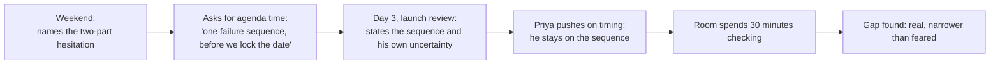

import Scenario from "../../../components/Scenario.astro";
import LevelIntro from "../../../components/LevelIntro.astro";
import Checkpoint from "../../../components/Checkpoint.astro";
import PracticeCheck from "../../../components/PracticeCheck.astro";

export const unit = {
  track: "corporate-politics",
  unitSlug: "influence-tool-org-s-good",
};

<Scenario label="Three days before a committed ship date, and the only person who has found the flaw is the one with the most to lose by saying so.">
  <Fragment slot="facts">
    

      
🧾 The flaw: a retry during a partial outage can double-process some renewals

      
📅 Days to the committed ship date: <strong>3</strong> (story assumption)

      
🛠️ Fix, if real: about <strong>4 days</strong> of engineering, so the date slips (story assumption)

      
🔬 Marcus has <strong>not</strong> reproduced it

      
🎙️ Priya publicly committed the date to her own leadership

    

  </Fragment>

L2 gave the model: reach raises the stakes, two questions sort the uses of
influence, and self-interest is managed rather than denied. Here it is applied
to one case, end to end.

Marcus has been at the company five years and is now the person design reviews
wait for. He believes the new idempotency scheme in the billing rewrite can
double-process a subset of subscription renewals under one retry sequence the
load tests do not cover. The rewrite belongs to Priya, a director with real
sponsorship above her.

**Before reading on: what, specifically, is pulling Marcus toward silence, and
which parts of that pull deserve a vote?**

</Scenario>

<LevelIntro
  items={[
    "Sorting the hesitation into its parts",
    "Choosing venue, timing, and framing",
    "An honest outcome, and what to extend",
  ]}
/>

## What is the hesitation actually made of?

Over a weekend Marcus notices his reluctance is two feelings tangled together.

| Part of the hesitation                                                | What it is                    | Does it get a vote?                         |
| --------------------------------------------------------------------- | ----------------------------- | ------------------------------------------- |
| "The sequence is narrow and I have not reproduced it"                 | Genuine technical uncertainty | Yes, on **how** he states the concern       |
| "Raising it this late may cost me with a director who decides things" | Self-protection               | No, it tracks his comfort, not the decision |

Applying L2's first question to his own hesitation, the second part is not
tracking whether the decision is more likely to be right. Once he names the
split, the self-protective part can no longer hide behind the genuine one.

<Checkpoint question="Marcus considers stopping at 'I am not certain the bug is real, so raising it is not worth the risk to me.' What is wrong with using uncertainty as the reason not to raise it at all?">

It conflates two separate questions: how confidently to state a concern, and
whether to raise it. Uncertainty is a reason to frame the concern as something
to check, not a declared fact. It is not a reason to withhold it, because the
point of surfacing it is to let people with more context check it before ship.
Used as cover for silence, a legitimate caution quietly does the work of a
self-protective motive.

</Checkpoint>

<PracticeCheck
  track={unit.track}
  unitSlug={unit.unitSlug}
  topicId="clean-execution"
/>

## Where, when, and how does he raise it?

He does not email Priya privately, and he does not wait for a steering review
two weeks out. He asks for fifteen minutes in the launch readiness review in
three days, the room where the date is actually finalized.

Using [`calibrated-confrontation`](/corporate-politics/calibrated-confrontation/),
he frames a specific sequence with a specific consequence, not an accusation of
carelessness, and says out loud that he has not reproduced it. When Priya
pushes on the timing, he neither escalates nor folds: "I don't know yet. That
is exactly what I think we need thirty minutes to find out before we lock the
date, not after."

| Element | What Marcus did                                       | Passes the two questions?                      |
| ------- | ----------------------------------------------------- | ---------------------------------------------- |
| Content | A checkable sequence, stated with his own uncertainty | Yes: improves the decision                     |
| Venue   | The review where the ship decision is made            | Yes: not a private aside, not a too-late forum |
| Timing  | Three days out, while it can still change the outcome | Yes: timed for information, not leverage       |
| Framing | A factual sequence, not blame                         | Yes: holds up said aloud to everyone present   |

<PracticeCheck
  track={unit.track}
  unitSlug={unit.unitSlug}
  topicId="clean-execution"
/>

## What does doing it right actually cost?

The fix takes about four days, so the date slips. Priya has to explain it
upward, and the explanation includes "an engineer flagged a risk three days
out." She is professional about it, but something between them stays cooler.
Marcus is not invited to the next planning session of her following initiative.
Nobody says why.

There is no public thanks. What he gets is quieter: customers did not see
double charges, two colleagues tell him privately they had spotted the same
risk and did not feel able to raise it that late, and his own honest check of
the move against the two questions comes out clean.

<Checkpoint question="A tidier version would have Priya publicly thanking Marcus with no damage to the relationship. Why does the version with a lasting chill teach more?">

A costless story implies that doing this correctly guarantees a good outcome.
The next person in Marcus's position, whose correct move does carry a cost,
would then read the cost as proof they handled it badly. The honest version
shows the test was never a promise that the org-serving choice is also the
safe one. It is a way of choosing correctly at the moments the two diverge,
knowing the divergence is sometimes permanent.

</Checkpoint>

<PracticeCheck
  track={unit.track}
  unitSlug={unit.unitSlug}
  topicId="entanglement"
/>

## This is one case, not the whole territory

Marcus's case resolved cleanly on the technical question. The questions below
change one thing at a time. Work each through before reading the discussion.

- **What if he had been wrong?** Suppose the thirty minutes found nothing and
  the launch slipped four days for a risk that was not real. The first question
  was never "is the bug definitely real". It asked whether raising a specific,
  honestly uncertain concern makes the decision better informed, and it does
  either way. What would fail the test is overstating confidence to force a
  delay, or timing a true concern for leverage.
- **What if the organization punishes this move every time?** If Marcus were
  the fourth person this year frozen out for a well-timed, well-framed concern,
  one cooled relationship is no longer an ordinary cost. It is evidence about
  the organization. The two questions still say how to act well in a moment;
  they were never built to say whether a place that punishes acting well is
  worth staying in. That is the older question from
  [`staying-principled`](/corporate-politics/staying-principled/).
- **Your turn:** what changes if Marcus were a peer on Priya's own team
  rather than someone outside it? What if the risk were to a colleague's
  reputation rather than to customers? What if the news were worse than a
  four-day slip? Each changes the venue, the cost, or the stake, and the
  two questions still apply to each.

This is the toolkit every earlier unit in the track was building: reading the
room ([`who-holds-influence`](/corporate-politics/who-holds-influence/)), banking
trust ([`favor-economy`](/corporate-politics/favor-economy/)), framing honestly
([`framing`](/corporate-politics/framing/)), raising a concern without
escalating ([`calibrated-confrontation`](/corporate-politics/calibrated-confrontation/)),
and staying recognizable to yourself a year later
([`staying-principled`](/corporate-politics/staying-principled/)), all drawn on
at once in one real decision.
