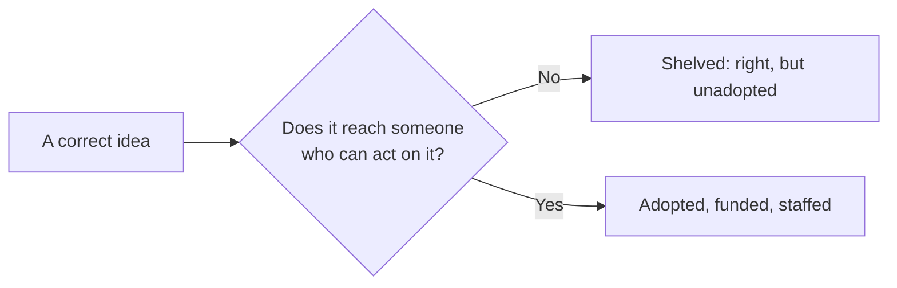

import Scenario from "../../../components/Scenario.astro";
import LevelIntro from "../../../components/LevelIntro.astro";
import PracticeCheck from "../../../components/PracticeCheck.astro";

export const unit = {
  track: "corporate-politics",
  unitSlug: "power-real-resource",
};

<Scenario label="The problem">
  <Fragment slot="facts">
    

      
👥 Group of 4 on a class poster about the water cycle

      
💡 Priya's idea (a labelled cross-section diagram) is the best one

      
🔇 She says it once, quietly, while the teacher is across the room

      
📣 Theo repeats it loudly when the teacher walks over

      
📝 The teacher writes down Theo's name next to the idea

    

    
Who the person deciding actually heard

    

      
Priya

0 of 1 ideas heard

      
Theo

1 of 1 ideas heard

    

  </Fragment>

Four students are making a poster about the water cycle. Priya suggests the
best idea in the group: a labelled cross-section showing rain, rivers and
evaporation in one picture. She says it once, quietly, while the teacher is
across the room. A few minutes later the teacher walks over, and Theo, the
loudest member, announces the same idea as his own. The teacher nods and writes
his name next to it.

Nobody lied, and the idea did not get worse. The idea simply reached the person
who decides through the wrong voice.

**If the best idea did not decide the outcome here, what did? And is that
something Priya could have changed without becoming Theo?**

</Scenario>

The same thing happens in offices, with more money attached. A proposal can be
correct, well written and visible, and still go nowhere because nobody who can
act on it has taken it on.

<LevelIntro
  items={[
    "Power as the ability to get things done",
    "Why being right is not the same thing",
    "Politics as coordination, not scheming",
  ]}
/>

## What is power, if it is not volume or rank?

**Priya was right, Theo was loud, and the teacher decided. Which of the three
had the power?** Only the teacher could actually say "yes, this is the idea we
use." Theo borrowed her attention. Priya never reached it.

- **Power** is the ability to get something adopted, funded, staffed and kept
  going. It is a resource, like time or budget, that some people hold more of
  in a given situation.
- It is **not** the same as being liked, having a high rank, or talking the
  most. Those can help, but none of them is the definition.
- It is **situational**: the teacher holds power over the poster, and a
  different person holds power over the lunch menu.

<PracticeCheck
  track={unit.track}
  unitSlug={unit.unitSlug}
  topicId="power-defined"
/>

## Is talking about politics the same as scheming?

**Priya could copy Theo, interrupt, and claim credit loudly. Or she could refuse
to "play games" at all. Are those the only two options?** No. There is a third:
making sure the person who decides learns, truthfully, whose idea it is and why
it matters.

- **Politics, in the neutral sense used here**, is how a group of people with
  different interests ends up agreeing on one decision.
- It is present in every group. Refusing to think about it does not remove it,
  it only leaves the decisions to people who did think about it.
- The abuses (stealing credit, spreading false claims, hiding information as
  leverage) are real, and they are the part of politics that deserves its bad
  reputation.

| Neutral skill                                          | Abuse of it                                      |
| ------------------------------------------------------ | ------------------------------------------------ |
| Telling the teacher, honestly, whose idea it was       | Taking credit for someone else's idea            |
| Finding out what the decision-maker is trying to solve | Inventing a problem to make your idea look vital |
| Asking a trusted classmate to back the idea            | Spreading rumours about a rival's idea           |
| Showing how the idea helps the whole class, truthfully | Exaggerating results the idea cannot deliver     |

This unit is descriptive. It names how decisions move so you can reason about it
on purpose, not so you can manipulate anyone.

<PracticeCheck
  track={unit.track}
  unitSlug={unit.unitSlug}
  topicId="politics-neutral"
/>
