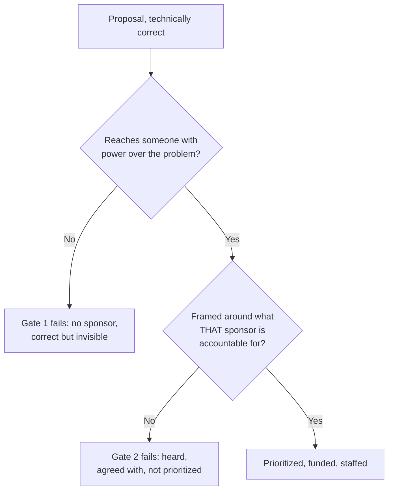

import LevelIntro from "../../../components/LevelIntro.astro";
import Checkpoint from "../../../components/Checkpoint.astro";
import PracticeCheck from "../../../components/PracticeCheck.astro";

export const unit = {
  track: "corporate-politics",
  unitSlug: "power-real-resource",
};

L1 showed that Priya's correct idea stalled because it never reached the teacher
in a way the teacher could act on. L2 breaks that into two reusable models: where
power comes from, and the exact steps a proposal has to clear. The workplace
example from here on is a stalled proposal for automated rollback, meaning an
automatic undo of a bad software release.

<LevelIntro
  items={[
    "Four sources of power compared",
    "The sponsor-plus-framing pipeline",
    "Why each gate fails differently",
  ]}
/>

## Where does the ability to get things done come from?

**Think of one person whose opinion reliably moves decisions in a group you are
in. Why do people listen: their title, their record, their friendships, or what
they know?** Most people can answer at once, which means they already reason
about these sources, just not on purpose.

| Source           | What it lets you do                                               | How it is built                                                   | Speed to build |
| ---------------- | ----------------------------------------------------------------- | ----------------------------------------------------------------- | -------------- |
| Formal authority | Directly allocate budget, people or priorities                    | Granted by a role; you do not control when                        | Can be instant |
| Information      | Frame a proposal around what decision-makers already care about   | Paying attention to context outside your own team                 | Weeks          |
| Relationships    | Get people to back you because they trust you, not just the pitch | Reliable, reciprocal follow-through long before you need a favour | Months         |
| Expertise        | Have your judgment accepted without re-checking                   | Being right, on the record, repeatedly                            | Longest        |

The "speed to build" column is an ordering from experience, not a measured
figure. The useful point is the shape: one source can arrive in a single
conversation, and the other three are patient investments, which is why they
are easy to neglect when a proposal feels urgent.

None of the four requires dishonesty. They are the same things that make
someone a good colleague, applied with intent instead of by accident.

<Checkpoint question="A new hire has no title and no track record here, but an experienced colleague who trusts them vouches for their proposal to a director. Which source is doing the work, and could the new hire have used expertise instead in week one?">

Relationships, specifically borrowed trust: the colleague is spending their own
accumulated credibility on the new hire's behalf, which is why the proposal
reaches the director at all. Expertise could not have done the job in week one,
because it is built by being right repeatedly and on the record, and there is no
way to already have that history at a place you just joined. Of the four sources,
relationships are the one that can be lent by someone else.

</Checkpoint>

<PracticeCheck
  track={unit.track}
  unitSlug={unit.unitSlug}
  topicId="four-sources"
/>

## What has to be true before a correct proposal is adopted?

**Two proposals have equal technical quality. One is adopted within a month and
one is shelved. If correctness alone decided, that gap could not exist, so what
is the missing variable?** Whether someone with the capacity to act has chosen to
spend it on the proposal.

Capacity here means money, people, calendar space, attention or authority. A
**sponsor** is someone with enough power over the problem to spend that capacity
or their own credibility on a proposal. **Framing** is how the proposal is
explained so the sponsor can see why it matters to what they are responsible for.

| Gate | Question                                              | If it fails                                  | Next move                      |
| ---- | ----------------------------------------------------- | -------------------------------------------- | ------------------------------ |
| 0    | Is the proposal technically sound?                    | Nothing else matters                         | Fix the proposal               |
| 1    | Does it reach someone who can act on it?              | Silence: likes and compliments, no follow-up | Find the right person          |
| 2    | Is it framed around that person's own accountability? | "Good idea, not this quarter"                | Reframe the same pitch to them |

From outside, a gate 1 failure and a gate 2 failure look identical: both are
"shelved". That is why "it got shelved" is not yet a diagnosis.

<Checkpoint question="A sponsor with budget authority has no obvious personal stake in your proposal's topic. What must you find out before pitching, and is a more thorough argument enough on its own?">

You need to know what that sponsor is currently measured or pressured on: their
team's goals this quarter, the metric their own manager keeps asking about, the
problem on their plate right now. A more thorough argument is not enough, because
the framing gate is passed by showing how the proposal moves something already on
their scorecard. A technically stronger case aimed at criteria the sponsor does
not own stalls just like a weaker one, since the gap was never about argument
quality.

</Checkpoint>

<PracticeCheck
  track={unit.track}
  unitSlug={unit.unitSlug}
  topicId="adoption-pipeline"
/>
