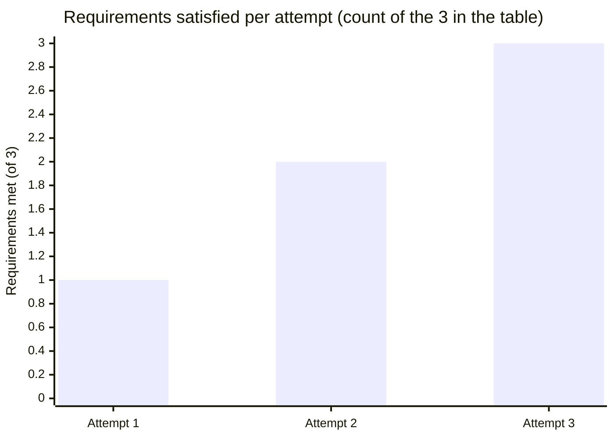

import Scenario from "../../../components/Scenario.astro";
import LevelIntro from "../../../components/LevelIntro.astro";
import Checkpoint from "../../../components/Checkpoint.astro";
import PracticeCheck from "../../../components/PracticeCheck.astro";

export const unit = {
  track: "corporate-politics",
  unitSlug: "power-real-resource",
};

<Scenario label="The scenario">
  <Fragment slot="facts">
    

      
⚠️ Risk: a bad release cannot be undone automatically; one outage ran 40 minutes longer than needed

      
🛠️ Fix: automated rollback, identical in all 3 attempts

    

    
Requirements met, per attempt (of 3)

    

      
Attempt 1

1: correct

      
Attempt 2

2: + sponsor

      
Attempt 3

3: + framing

    

  </Fragment>

Same cast as L2. A deploy is releasing a software change, a rollback is undoing
a bad release, and an outage is a period when the system is broken for users.
The engineer has a real, measured problem: the one time a bad release mattered,
someone had to work out the undo steps by hand, and the outage lasted 40 minutes
longer than necessary. The proposed fix is automated rollback.

The technical content is identical in all three attempts below, and nobody ever
disputes it. **If the idea never changes, what does? Is it the idea, the person
pitching, or something else?**

</Scenario>

Watch for what changes between the attempts, and just as important, what stays
exactly the same.

<LevelIntro
  items={[
    "Three attempts, diagnosed gate by gate",
    "Telling an honest reframe from a hollow one",
    "Failure modes, and how the pattern transfers",
  ]}
/>

## Why did each attempt end differently?

**Attempt 1 and Attempt 2 both ended in silence. Were they the same failure?**
They were not, and the difference decides what to do next.

1. **Attempt 1, correctness alone.** A thorough design doc goes to a general
   engineering channel with a link to the incident write-up. Two weeks later:
   a few "nice writeup" reactions, no funding, no staffing. Nobody who could
   prioritize infrastructure work against feature commitments saw it as theirs.
   Visible, correct and inert. Gate 1 failed: no sponsor.
2. **Attempt 2, a sponsor, wrong framing.** The engineer takes the same doc to
   the infrastructure manager, who does control budget for exactly this kind of
   work. The manager agrees it is a real risk and still says not this quarter,
   because their team is measured on infrastructure cost reduction and the
   proposal does not touch it. Gate 2 failed: framing aimed at the proposal's
   merit, not the sponsor's accountability.
3. **Attempt 3, a sponsor, matching framing.** Same doc, same person, same
   design, but now pitched around another true effect: every manual rollback
   needs one of the few engineers who know the steps, so incident response is
   bottlenecked on them. Reducing dependence on a few people is a metric the
   manager's own manager has been asking about. It is prioritized next cycle.

| Attempt | Correct | Sponsor found | Framed around the sponsor's accountability                 |
| ------- | ------- | ------------- | ---------------------------------------------------------- |
| 1       | Yes     | No            | Not applicable: it never reached anyone with power         |
| 2       | Yes     | Yes           | No: argued the proposal's merit, not their metric          |
| 3       | Yes     | Yes           | Yes: tied to on-call sustainability, already being tracked |

Use the interactive demo on this level to see how much weight the framing carries. The numbers
are teaching values, not a measured prediction: the sponsor's capacity to act is
held at 70%, and adoption likelihood is modelled as capacity times framing
alignment. Attempt 2 sits near 20% alignment (about 14% likelihood) and Attempt 3
near 90% (about 63%). The same sponsor, with the same power, produces very
different odds.

<Checkpoint question="From outside, Attempts 1 and 2 both ended in silence. Why does it matter for your own stuck proposal to tell them apart?">

Because the correct next move is different for each. No sponsor means the next
step is finding the right person to pitch. A framing mismatch means the next step
is re-pitching the same person around a different metric. Treating a framing
failure as a missing-sponsor failure throws away a relationship you already have
by walking off to find someone new, when what you actually needed was to adjust
the pitch.

</Checkpoint>

<PracticeCheck
  track={unit.track}
  unitSlug={unit.unitSlug}
  topicId="diagnose-stall"
/>

## When is a reframe honest, and when is it hollow?

**Attempt 3 changed what the engineer emphasized. How is that different from
telling the sponsor whatever they want to hear?** The on-call bottleneck was
already a real consequence of the proposal; Attempt 3 only said it out loud.

| Honest reframe                                      | Hollow reframe                                         |
| --------------------------------------------------- | ------------------------------------------------------ |
| The connection was true before anyone emphasized it | The connection is invented or inflated                 |
| Holds up if the sponsor asks to see the reasoning   | Falls apart when the sponsor checks it against reality |
| Chooses which true effect to name first             | Claims an effect the proposal does not have            |
| Keeps trust available for the next request          | Spends trust that is expensive to rebuild              |

The test is whether the claim would survive the sponsor checking it. A related
cost: a sponsor who backs your proposal is lending some of their own credibility,
so returning only with new asks and nothing in exchange (helping with their
priorities, keeping your commitments) wears down the relationship the next ask
depends on.

<Checkpoint question="Suppose the engineer had told the infrastructure manager that automated rollback would eliminate all future outages. Is that a reframe, and what is the likely cost?">

It is not a reframe, it is an overclaim. Automated rollback shortens recovery from
one kind of failure; it does not prevent outages in general. The claim would not
survive a basic question from the manager or their own manager, and once it
collapses the manager has spent credibility on a promise that failed. The damage
reaches past this proposal, because the engineer's next pitch now carries a
discount.

</Checkpoint>

<PracticeCheck
  track={unit.track}
  unitSlug={unit.unitSlug}
  topicId="honest-framing"
/>

## Where does this model stop working?

- **Concluding the organization is broken after Attempt 1 or 2.** Some
  organizations really are dysfunctional, but "it was shelved" alone does not
  show that. The same idea succeeded on Attempt 3 with identical technical
  content, which is direct evidence the organization could act on it through the
  right path. Check sponsor and framing before drawing a verdict.
- **Treating the pipeline as only for big proposals.** The same gates apply to a
  code review disagreement, a small process change or a one-off resource
  request. The scenario is large only to make each gate easy to see.
- **Assuming the sponsor's power is always budget.** Power can come from
  relationships or expertise too, so "no" may arrive as a lukewarm "I will
  mention it" instead of a clear refusal.

## Beyond this example

This rollback story is one case, not the whole territory. The questions below
test whether the model transferred, not whether you remember the scenario.

  🔄 This rollback proposal
  &rarr;
  💼 Whatever is stuck in your own queue right now

- What would Attempt 3 have needed to look like if the proposal had no true
  secondary effect to find, if it only benefited outcomes nobody who can sponsor
  it is measured on? Is there still an honest path, or does the model predict it
  waits until someone's incentives shift?
- Back in the school poster: which gate did Priya fail, and what is the honest
  version of passing it?
- Think of something you believe is correct and has not moved. Using the three
  columns of the table, which one is missing: the sponsor, or the framing?
