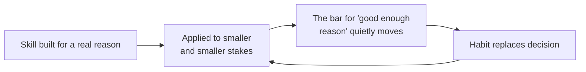

import Scenario from "../../../components/Scenario.astro";
import LevelIntro from "../../../components/LevelIntro.astro";
import PracticeCheck from "../../../components/PracticeCheck.astro";

export const unit = {
  track: "corporate-politics",
  unitSlug: "staying-principled",
};

<Scenario label="Fourteen months of learning to read rooms, build alliances, and choose when to push. One ordinary Thursday, an engineer lines up what those months added up to, and stops recognizing it.">
  <Fragment slot="facts">
    

      

        

          M4
          
Softens a real concern in a design review because the author is well-connected. Felt like: picking battles.

        

        

          M8
          
Lets a newer teammate's idea be presented upward under someone else's name, says nothing. Felt like: not my fight.

        

        

          M11
          
Times a piece of good news to land right before a headcount decision. Felt like: everyone plays the timing game.

        

        

          M14
          
Catches themself rehearsing how to frame a mistake instead of just reporting it. The moment it stops feeling reasonable.

        

      

      

        

          Modeled distance from original values at month 14
          42%
        

        

          

        

        
Teaching model from this unit's demo, not a measurement.

      

      
🪞 <strong>No single step looks like a betrayal; only the row of all four does</strong>

    

  </Fragment>

Fourteen months ago, this engineer, Dana, couldn't read a room at all. She said
the wrong thing in the wrong meeting more than once, lost an argument she was
right about because she picked the wrong moment, and got run over by people who
understood the org's real dynamics better. So she learned who holds influence,
when ambiguity beats a direct answer, how to build a coalition before she needs
one, how to frame a hard message so it lands. All real skill, all earned the
slow way, all defensible on its own.

Then, cleaning out old notes before a self-review, she lists four small things
from the last several months: softening a real concern, staying quiet while
credit drifted, timing good news for effect, rehearsing how to frame a mistake
before admitting it. **Each one alone still looks like the same reasonable
trade-off that got her out of being run over. Lined up, they don't.** The
question isn't whether any one was wrong. **It's what to do when you can no
longer tell, from inside, where the line is.**

</Scenario>

<LevelIntro
  items={[
    "Principle versus preference",
    "Identity drift: skill turning into habit",
    "Incident versus organization",
  ]}
/>

## Which fights are mine to take?

**Before any framework: Dana has a long list of things that bothered her this
year. Which of them deserved a fight?** Her gut says "the ones that annoyed me
most," but annoyance is a poor guide, because a real principle and plain
irritation can feel equally strong.

- **Fighting every battle** burns you out and teaches people to stop taking
  your objections seriously, including the one that matters.
- **Fighting none** erodes your own standards: enough "not worth it this time"
  and nothing is left that you reliably stand on.
- **The skill is a method** for telling the two kinds of situation apart, not a
  mood or a habit of avoidance.

| Situation                                                     | Principle or preference? | Why                                                  |
| ------------------------------------------------------------- | ------------------------ | ---------------------------------------------------- |
| Two equally workable naming conventions                       | Preference               | Both ways work; you'd just rather one                |
| A design that will charge some customers twice                | Principle                | Crossing it means signing off on real harm           |
| Your proposal wasn't chosen, but the chosen one is sound      | Preference               | The outcome is fine; your ego took the hit           |
| A teammate's work quietly presented under someone else's name | Principle (usually)      | It changes what you'll tolerate being done to people |

- **Principle:** a line that, if crossed, changes something true about what you
  will tolerate or who you are.
- **Preference:** how you'd rather things go.
- Treating a preference as sacred is one failure; treating a real principle as
  negotiable is the other.

<PracticeCheck
  track={unit.track}
  unitSlug={unit.unitSlug}
  topicId="principle-vs-preference"
/>

## How do you end up somewhere you don't recognize?

**If Dana never made one bad decision, how did she get here?** She didn't.
Identity drift is the gradual process by which political skill, learned for
real goals, starts being used for its own sake or for personal advantage,
through small steps that each look defensible.

- A single dramatic betrayal is at least visible. A hundred small ones produce
  the same destination with no moment that felt wrong.
- This unit's demo models it: distance from your original values is about 6%
  after 4 months, 33% after 12, 42% after 14, and 100% at 24. It starts slow and
  then accelerates, because each compromise makes the next easier to wave through.
- "I can justify every single one" is exactly what someone mid-drift would say.
  The honest test is the pattern across months, not any one decision.

<PracticeCheck
  track={unit.track}
  unitSlug={unit.unitSlug}
  topicId="drift-is-gradual"
/>

## Is it me, or is it the place?

Sometimes the honest answer to "why do I keep making these compromises" isn't
drift. It's that this environment makes the principled choice cost more than it
should, for anyone sitting in your seat. **Institutional toxicity** is when the
political environment itself, not a person or an incident, is incompatible with
the values you're trying to hold. No amount of individual skill applied from
inside fixes that, which is why L2 gives a short checklist for telling an
incident from an organization, and L3 follows Dana through that call without
pretending it resolves neatly.

## Key terms

- **Choosing battles:** deciding case by case, with a consistent method, whether
  a disagreement is worth real political capital.
- **Reversibility:** whether losing can be recovered from later, or forecloses
  something permanently.
- **Identity drift:** the slow slide from skill-in-service-of-values to
  skill-for-its-own-sake.
