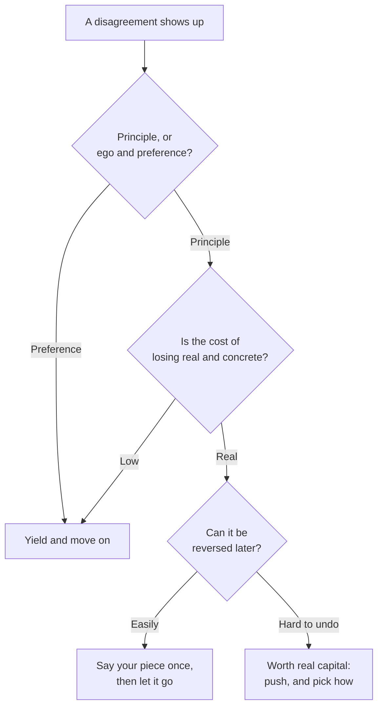
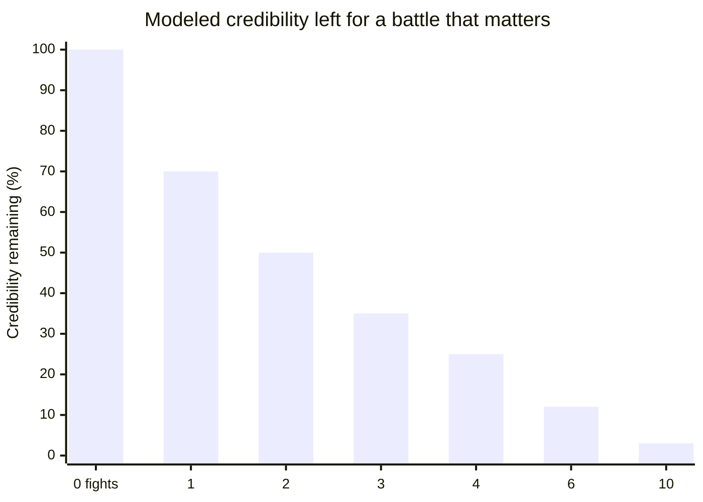
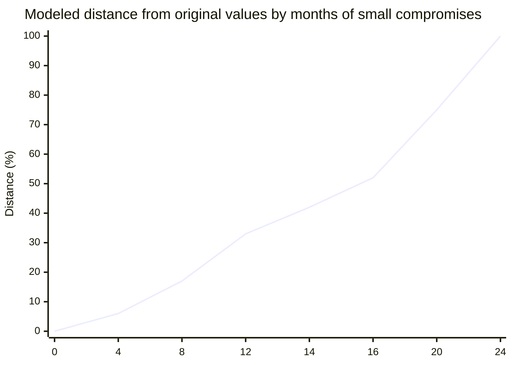

import LevelIntro from "../../../components/LevelIntro.astro";
import Checkpoint from "../../../components/Checkpoint.astro";
import PracticeCheck from "../../../components/PracticeCheck.astro";

export const unit = {
  track: "corporate-politics",
  unitSlug: "staying-principled",
};

L1 left Dana with four small compromises that only looked like a pattern once
they were lined up. This level builds the method for telling a battle worth
having from one that isn't, shows the mechanism that makes drift so hard to
catch from inside, and gives a short checklist for telling a bad incident from a
bad organization.

<LevelIntro
  items={[
    "Three questions for choosing battles",
    "Why the bar quietly moves",
    "A checklist for incident versus organization",
  ]}
/>

## What actually decides which battles I take?

**If you can't fight everything and can't fight nothing, what decides?** Not how
strongly you feel: real principles and mere annoyance produce equally strong
feelings. Three questions, asked in order, do better.

A battle worth having tends to score high on all three: a real principle, a real
cost, low reversibility. One that isn't tends to score low on at least two. The
same surface disagreement can land on either side, so surface similarity is the
wrong thing to check:

|                              | Worth having                                                                | Not worth having                                            |
| ---------------------------- | --------------------------------------------------------------------------- | ----------------------------------------------------------- |
| **Surface shape**            | A colleague disagrees with your approach in a design review                 | A colleague disagrees with your approach in a design review |
| **What's at stake**          | The design silently drops error handling on a payment failure path          | Which of two workable naming conventions to use             |
| **Principle or preference?** | Principle: you don't sign off on something you believe will cause real harm | Preference: both ways genuinely work                        |
| **Cost of losing**           | Real: payments fail silently for some users and are found late              | Low: a slightly less-preferred name                         |
| **Reversible?**              | Partly: the bug can be fixed, the harm already done cannot                  | Fully: a rename is a find-and-replace                       |

There's a second reason the "not worth having" column matters. This unit's demo
models credibility remaining for a battle that matters as it falls with each
low-stakes fight per month (a teaching model, not a measurement):

<Checkpoint question="A teammate wants to merge a change in a style you find ugly, but it follows the team's documented conventions and doesn't affect correctness, performance, or maintainability. Run the three questions: is this a battle worth having?">

No, on all three counts. It is aesthetic preference, so nothing you believe in
is being crossed. The cost of losing is close to zero, and it is fully
reversible because code gets restyled all the time. Fought repeatedly, this kind
of disagreement is exactly what teaches people to stop taking your objections
seriously, which is the real cost of getting the call wrong on the "fight it"
side.

</Checkpoint>

<PracticeCheck
  track={unit.track}
  unitSlug={unit.unitSlug}
  topicId="three-questions"
/>

## Why does the bar move without anyone moving it?

**If Dana cares about staying principled, how does she end up somewhere she
doesn't recognize?** Not through one decision, but through many small ones, each
passing something like the same three-question test, applied a little more
loosely each time in a direction that happens to be convenient.

1. A real skill is built for a real reason: being unable to read rooms was
   genuinely costing her.
2. The skill gets applied to smaller and smaller stakes. Each use still clears a
   low bar ("not really a principle, small cost, reversible"), so no alarm goes
   off.
3. The bar itself moves. Each pass makes the next easier to wave through, and a
   habit is not re-examined the way a decision is.
4. The gap between "skill in service of my values" and "skill because it works"
   closes with no moment marking the crossing.

The demo's drift curve shows the shape: slow early, then steep (modeled distance
from original values, not a measurement):

So the honest test is not "did I make one bad call." It's to list the actual
small choices from the last few months, not the principles you'd state if asked,
and see what they add up to. A gap between the two lists is the signal.

<Checkpoint question="Someone argues that if they can justify each individual political choice, they don't need to worry about drift. What is wrong with that reasoning?">

It mistakes local justification for global consistency. Each step in a slow
drift is, by construction, individually justifiable; that is the mechanism, not a
flaw in it. The problem only shows up in the pattern across time. "I can justify
each one" is necessary but not sufficient, and it is also exactly what someone
mid-drift would say.

</Checkpoint>

<PracticeCheck
  track={unit.track}
  unitSlug={unit.unitSlug}
  topicId="drift-mechanism"
/>

## When is the organization the problem, not the incident?

**What if the pattern isn't in your choices but in what the organization keeps
rewarding?** Then "I'm drifting" is the wrong diagnosis, and no amount of
self-discipline fixes it. Three questions help, none of them decisive alone:

| Question                                                                | A signal it is institutional                                                  |
| ----------------------------------------------------------------------- | ----------------------------------------------------------------------------- |
| Would an equally principled person in your seat face the same pressure? | Yes: the pressure is tied to incentives, not to your choices                  |
| Has raising it through legitimate channels ever changed anything?       | Repeated attempts, several people, nothing moved (one failure is an incident) |
| Is "winning" even a coherent goal here?                                 | No plausible path where staying changes the environment                       |

This is a judgment call, not a formula, and errors cost in both directions:
leaving too early abandons a fixable situation and the people in it; staying too
long in a genuinely corrosive environment costs something real and personal.
L3 follows one person weighing exactly that.

<PracticeCheck
  track={unit.track}
  unitSlug={unit.unitSlug}
  topicId="incident-vs-organization"
/>
