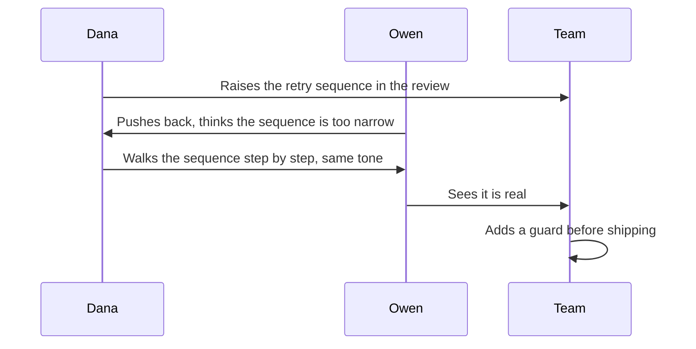

import LevelIntro from "../../../components/LevelIntro.astro";
import Checkpoint from "../../../components/Checkpoint.astro";
import PracticeCheck from "../../../components/PracticeCheck.astro";

export const unit = {
  track: "corporate-politics",
  unitSlug: "staying-principled",
};

L2 gave you the method: three questions for battles, a mechanism for drift, and
a checklist for incident versus organization. This level follows Dana, the
engineer from L1's Thursday list, through the weeks after she notices the
pattern, including one battle chosen deliberately and a reckoning with the
organization that does not resolve neatly.

<LevelIntro
  items={[
    "What Dana does once she has seen the list",
    "A real battle, chosen and raised deliberately",
    "The organization question, still open at the end",
  ]}
/>

## What does she do with the list?

**Dana now knows she drifted. Is the fix to resolve to be more direct?** Before
reading on, think about what that plan would and would not touch.

She does nothing dramatic that Thursday. She closes the notes, makes coffee, and
comes back that evening, because the discomfort doesn't fade the way a bad
meeting does. What unsettles her is that for each item she can reconstruct the
exact reasonable sentence she told herself at the time ("pushing wouldn't have
changed the outcome and it would have cost standing I need"), and each still
sounds true. What she can't do is point to when she started calculating about
things she once would have just said. **The habit of calculating has outpaced her
attention to what it is being spent on.**

Her conclusion is narrower and more useful than "I became a bad person." The
skill is neutral and often necessary. The fix is a recurring, deliberate check
of what the calculation is in service of, on a cadence, instead of only when
something forces the question.

<Checkpoint question="Dana briefly considers resolving to 'just be more direct from now on.' Using the drift mechanism, what is wrong with that plan?">

It treats the problem as a single decision to reverse, when the mechanism that
produced it was never a single decision. It was a long accumulation of
individually reasonable choices, each making the next easier to wave through. A
one-time resolution does not touch the habit doing the work. What she needs is a
recurring check against the pattern, not one correction against one moment.

</Checkpoint>

## How does she handle a real battle?

Three weeks later the test arrives. Her team is deciding whether to ship a change
to how a class of failed payments is retried. The proposal, championed by a
well-liked engineer named Owen, widens the retry window in a way Dana is fairly
sure will charge a small number of customers twice under one specific failure
sequence: rare, but real, and the kind of bug that surfaces as a support
escalation and a refund, not a stack trace.

She runs L2's three questions before the review, not during it:

| Question                 | Dana's answer                                                                    |
| ------------------------ | -------------------------------------------------------------------------------- |
| Principle or preference? | Principle: she won't sign off on a specific, avoidable harm to customers         |
| Cost of losing?          | Concrete: duplicate charges, each a ticket, a refund, and a small loss of trust  |
| Reversible?              | Partly: the bug can be fixed, the charges that already happened cannot be undone |

All three clear the bar, which settles _whether_ to push but not _how_. Drawing
on [calibrated-confrontation](/corporate-politics/calibrated-confrontation/),
she keeps the frame factual and raises it in the review itself, because that is
where the decision is being made: **"I think this reopens the double-charge case
we hit in Q1. Can we walk through the sequence where a retry lands after the
original settles?"** It is a specific, checkable claim, not an accusation and not
a deferral.

Owen pushes back at first, since he is invested in shipping and the sequence is
narrow. Dana does not match his tone. She walks the sequence until it is clear,
together, whether the risk is real. It is. The guard goes in before shipping, and
Owen is not embarrassed in front of anyone, because the conversation stayed in
the room where the decision was being made, while it was still a technical
disagreement. Afterwards Dana notices that her drifting habit would have
downgraded this to "Owen's well-connected, let it ride and flag it later." The
method didn't only tell her to push; it caught the version of herself that would
have quietly decided not to.

<PracticeCheck
  track={unit.track}
  unitSlug={unit.unitSlug}
  topicId="deliberate-raise"
/>

## What if the organization is the real problem?

**The retry battle resolved cleanly. Does that mean the underlying problem is
fine?** Dana realizes it is the third time in a year she has had to deliberately
override a habit of letting real correctness concerns go unraised, not because
she got worse at raising them, but because this team's director treats "smooth"
reviews as a proxy for competence, and someone who raises real problems more than
once or twice starts being read as "difficult" whether or not they are right.

She runs L2's checklist honestly:

| Checklist question                                                   | Dana's honest answer                                                                                      |
| -------------------------------------------------------------------- | --------------------------------------------------------------------------------------------------------- |
| Would a different, equally principled person face the same pressure? | Yes: she has watched it happen to two other engineers on the team                                         |
| Has raising it ever changed anything?                                | Once, narrowly, in the retry case; the pattern hasn't moved, even after raising it with her manager twice |
| Is winning even a coherent goal here?                                | Unclear: no evidence the director's incentives will change                                                |

She doesn't reach a clean answer. Staying means she stays effective at the
winnable battles, the team is better for her being on it, and she likes most of
the people she works with. It also means spending energy on a structural problem
she has decent evidence she cannot fix from inside, and needing the deliberate,
effortful override she used with Owen just to behave the way she used to by
default. **That override working once is not the same as it being sustainable.**

So she sets a concrete, dated check rather than an open-ended one: six months,
with one question to answer at the end. Not "should I quit," but "has anything
about the underlying pattern moved, or have I only kept winning individual
battles while the thing underneath stayed the same?" The unit ends with Dana
mid-decision, which is closer to the truth of this kind of call than a tidy
ending would be.

<Checkpoint question="Dana could have framed her six-month check as 'decide whether to quit.' Instead she framed it as 'has the underlying pattern moved.' Why does that difference matter?">

A quit-or-stay decision collapses a structural question into a single binary
event, which invites the same drift-prone reasoning: every individual day easily
clears the low bar of "not today." A concrete question about the pattern gives
her something to evaluate against evidence at a fixed point, instead of a
decision that is always easiest to defer by one more day. It also keeps the real
issue in view, whether the organization is capable of changing, rather than
letting the question quietly become about her tolerance.

</Checkpoint>

<PracticeCheck
  track={unit.track}
  unitSlug={unit.unitSlug}
  topicId="dated-check"
/>

## Beyond this scenario

Dana's case is one case, not the whole territory. She has options: enough savings
and enough demand elsewhere that walking away, if it comes to that, costs her
real but survivable disruption. That shapes the calculation more than the unit
has said so far. **Extend it yourself.**

**What changes if you don't have the financial safety net to make leaving a real
option?** The three-question method doesn't change. What changes is the exit side:
"winning isn't coherent here" can be true and still not actionable, because
leaving isn't available in the near term. That is a real constraint, not a moral
failing. It likely means being sharper about which battles are worth the capital,
and treating "I can't leave yet" as a reason to choose battles more
conservatively, never as a reason to stop choosing deliberately.

**What changes if the person drifting is someone you mentor, not yourself?**
Noticing is easier from outside, but raising it lands as a serious accusation even
when offered carefully. The move that worked for Dana on herself is the one to
offer: not a verdict but a specific pattern laid out side by side, and an open
question ("here are four small things I've noticed over the last few months; does
this look like a pattern to you, from outside the way I couldn't see mine?"),
offered once. The same mechanism that hides drift from inside means a person
generally has to recognize it themselves before an outside observation sticks.

Other variations worth working through: what if the battle's cost to someone else
is real but yours to bear is zero, what if the director who rewards smoothness is
also your only sponsor, or what if the pattern turns out to be one team, not the
whole company.

<PracticeCheck
  track={unit.track}
  unitSlug={unit.unitSlug}
  topicId="adapt-constraints"
/>
