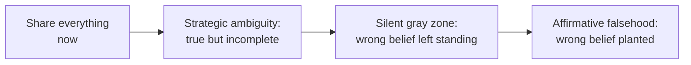

import Scenario from "../../../components/Scenario.astro";
import LevelIntro from "../../../components/LevelIntro.astro";
import PracticeCheck from "../../../components/PracticeCheck.astro";

export const unit = {
  track: "corporate-politics",
  unitSlug: "strategic-ambiguity",
};

<Scenario label="Two answers to the same question: 'is my job safe?'">
  <Fragment slot="facts">
    

      

        

          Days until Priya may speak
          14 of 14 still to go
        

        

          

        

      

      
🤐 <strong>What Priya knows</strong>: a reorg is coming that will likely cut Sam's role, not yet announced

      
❓ <strong>What Sam asks</strong>: "is my job safe?"

      
⚖️ <strong>The constraint</strong>: Priya is not authorized to confirm the reorg yet

    

  </Fragment>

Priya manages Sam. She has just learned, in confidence, that a reorg is
coming that will likely eliminate Sam's role, and she is not allowed to say
so until it is formally announced in two weeks. Sam, unaware, asks her
directly: "is my job safe?" Priya has two ways to answer: **"I can't get
into specifics about org plans right now, but if I were you I'd make sure
my recent work is visible"**, or **"Yes, totally safe, don't worry about
it."** **Both answers keep the secret. Only one of them is honest. What
actually separates them?**

</Scenario>

In plain language: Priya knows something important, she was trusted not to
announce it yet, and Sam is asking a question that affects what he should do
next. A **reorg** is a change in teams, jobs, or reporting lines. "In
confidence" means "I was told this as a secret, for now." The hard part is
whether Priya can protect the secret without making Sam believe something
false.

<LevelIntro
  items={[
    "The line between withholding and lying",
    "Why timing is a separate lever",
    "Four key terms for gray politics",
  ]}
/>

## Where does honest silence end and a lie begin?

**Is leaving Sam with an incomplete picture already dishonest?** No.
Withholding what you are not authorized to share is normal, and often
required. What turns an answer dishonest is not what it leaves out, but
whether it **plants a false belief**: Sam leaves thinking something specific
that is not true, because of what Priya said.

Think of a ladder, not one flat category:

| Situation                                           | What it means                                                   |
| --------------------------------------------------- | --------------------------------------------------------------- |
| "I cannot share that yet"                           | Incomplete, but honest if it does not create a false belief     |
| Seeing a dangerous wrong assumption and not helping | Gray zone: you may not have lied, but the person may walk blind |
| "Yes, totally safe" when you believe it is not      | A lie: you created the false belief yourself                    |

Read the diagram left to right as a slide from "most open" to "most
dishonest". For Priya, the first box is blocked by her confidence, and the
last box is a lie. The honest move is the second box, and the third box is
where good intentions go wrong.

<PracticeCheck
  track={unit.track}
  unitSlug={unit.unitSlug}
  topicId="honesty-line"
/>

## What are the four key terms?

**If someone says "that was just selective disclosure", how do you tell
whether they are describing discretion or deception?** Start by naming the
four moves precisely.

| Term                  | Simple meaning                                                                                   |
| --------------------- | ------------------------------------------------------------------------------------------------ |
| Strategic ambiguity   | Speaking truthfully but incompletely, without creating a false impression about what you did say |
| Selective disclosure  | Choosing which true information to share and which to withhold, based on authorization or timing |
| Affirmative falsehood | Actively stating something untrue, or something you do not believe, to steer someone's belief    |
| Timing information    | Deciding _when_ to disclose something true, separate from _whether_ to disclose it               |

Everyday version: if a teacher says a schedule may change but they cannot
announce the new time yet, that can be honest. If they say "the time
definitely will not change" while knowing it probably will, that creates a
false belief. If they stay vague after they are allowed to update you and
you are about to miss the event, timing becomes the problem.

<PracticeCheck
  track={unit.track}
  unitSlug={unit.unitSlug}
  topicId="four-terms"
/>

## What this unit covers

L2 works through the gray zone itself: a decision test for telling
legitimate ambiguity from deception, and why timing is its own axis. L3
walks through Priya and Sam's conversation four different ways and traces
what happens when an honest answer is left unrevisited. Nothing in this unit
teaches how to mislead anyone. It teaches where the line sits so you stay on
the honest side of it.

The simple question underneath: **how do you protect information you cannot
share yet without misleading someone who needs to make a real decision?**
