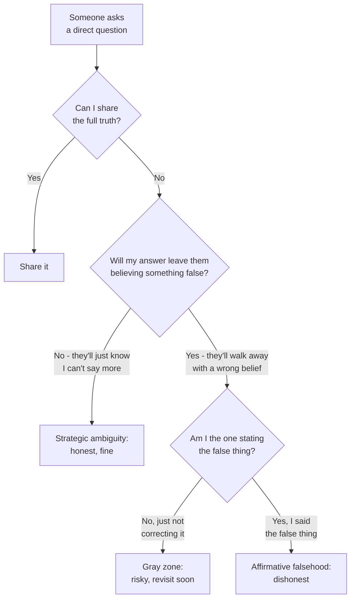

import LevelIntro from "../../../components/LevelIntro.astro";
import Checkpoint from "../../../components/Checkpoint.astro";
import PracticeCheck from "../../../components/PracticeCheck.astro";

export const unit = {
  track: "corporate-politics",
  unitSlug: "strategic-ambiguity",
};

L1 drew the basic line between withholding and lying using Priya and Sam's
"is my job safe?" question. L2 works out how to apply that line in practice:
a decision test for telling the two apart, what to do when silence starts
to mislead, and why timing is a second axis separate from truthfulness.

<LevelIntro
  items={[
    "The decision test: does it plant a false belief?",
    "Why the silent gray zone still needs care",
    "Timing as a lever independent of wording",
  ]}
/>

## Where does the line actually sit?

**Is any answer that leaves someone with an incomplete picture
dishonest?** No. Almost every workplace conversation leaves things out, for
confidentiality, relevance, or brevity. "I can't discuss specifics" leaves
Sam without an answer. "Yes, totally safe" gives Sam a wrong one. The first
is silence about the truth; the second is a manufactured falsehood, and that
difference is the entire line.

"Plants a false belief" means the listener leaves thinking something
specific that is not true, because of what you said. The test is not "did I
say every fact?" It is: "will they reasonably walk away believing X, and do
I know X is false?"

Read the diagram as a story. First ask whether you are free to say the whole
truth. If not, your job is to avoid creating a wrong picture. If the other
person invents a wrong conclusion on their own, that is not automatically
the same as you lying, but once you can see the conclusion forming and they
may act on it, you owe a redirect as far as your constraint allows.

|                                   | Withholding (strategic ambiguity)           | Lying (affirmative falsehood)                       |
| --------------------------------- | ------------------------------------------- | --------------------------------------------------- |
| What is said                      | True, but incomplete                        | Untrue, stated as fact                              |
| What the listener walks away with | "I don't have the full picture yet"         | A specific false belief they will act on            |
| Reversible if it comes out later  | Yes: "I wasn't free to say more" holds up   | No: the person was told something false, on purpose |
| Trust cost if discovered          | Low to moderate, usually read as discretion | High, read as a deliberate betrayal                 |

**Reversible** means that when the full story comes out, your earlier answer
can still be explained honestly: "I could not say more then, but I did not
tell you the opposite." A lie cannot be explained that way.

<Checkpoint question="Priya tells Sam 'I can't get into specifics about org plans right now.' Two weeks later the reorg is announced and Sam finds out Priya knew the whole time. Using the 'reversible' idea above, is Priya's earlier answer still defensible, and why?">

Yes, because what she said was true and did not create a false belief. It
only signaled that she had more she could not share. When the full story
comes out she can honestly say "I wasn't free to say more at the time, but I
never told you the opposite was true", and that holds up because nothing in
it turns out to have been false. Contrast "yes, totally safe": if Sam later
learns that was untrue, there is no honest way to walk it back, because the
words themselves manufactured the false belief.

</Checkpoint>

<PracticeCheck
  track={unit.track}
  unitSlug={unit.unitSlug}
  topicId="false-belief-test"
/>

## Why does the silent gray zone still need care?

**If silence is not a lie, is silence always fine?** Not quite. Silence
becomes risky the moment you can see the other person forming a specific
wrong conclusion and you say nothing to redirect them, especially when they
are about to act on it. Priya is not lying if she simply declines to answer.
But if Sam says "okay, so I probably don't need to update my resume then?"
and Priya lets that stand, she is permitting a false belief to guide a real
decision. She never said an untrue sentence, yet she is closer to the false
side of the line.

So the gray zone is not a permission slip. It is an alert: "I may not have
lied yet, but a false belief is becoming practically important." A safer
reply is: "I can't confirm specifics, but I would not assume you do not need
a plan B."

Gray situations get worse when you improvise under pressure. If you know
someone may ask about something you cannot fully discuss, prepare one
sentence that is true, incomplete, and does not create false comfort:

| Prepared line                                                                      | What it protects                                   |
| ---------------------------------------------------------------------------------- | -------------------------------------------------- |
| "I can't discuss that plan yet, but I wouldn't decide as if nothing could change." | The confidence, and the listener's ability to plan |
| "I can't confirm specifics, but this is worth keeping on your radar."              | The confidence, without false comfort              |
| "I don't want to give you false certainty, and I cannot say more yet."             | Honesty about the limit itself                     |

Preparing the line is not manipulation. It is how you avoid panicking into
either disclosing too much or reassuring someone falsely. The line only
works if it is true: it must never be used to steer someone toward a
conclusion you know is wrong.

<PracticeCheck
  track={unit.track}
  unitSlug={unit.unitSlug}
  topicId="gray-zone-silence"
/>

## Is timing a separate question from truthfulness?

**Does it matter when true information gets shared, even if every
individual statement along the way was honest?** Yes. The same fact,
disclosed the moment you are free to share it versus held back for weeks
past that point, can be responsible in one case and harmful in the other.

There are two separate questions, and passing one does not pass the other:

| Question                                                         | Failing it looks like                                  |
| ---------------------------------------------------------------- | ------------------------------------------------------ |
| Is what I said true and not misleading when I said it?           | A false statement, or a wrong belief left standing     |
| Did I update the person soon enough for the decision they faced? | A true statement left standing after the facts changed |

<Checkpoint question="Priya gives Sam an honest, non-misleading answer on the day he asks. Three weeks later, nothing has been said since, and Sam has made a major decision without knowing what Priya knows. Did Priya's original answer stop being true, or did something else go wrong?">

Her original answer did not stop being true: nothing about the wording
changed, and it was not misleading when she said it. What went wrong is the
second, separate question: whether she updated Sam promptly enough for the
decision he actually had to make. Truthfulness and timing are independent
obligations, and satisfying one does not automatically satisfy the other. An
answer that was responsible the day it was given can still leave someone
worse off later if it is left standing past the point where circumstances,
or the listener's need to decide something, have moved on.

</Checkpoint>

<PracticeCheck
  track={unit.track}
  unitSlug={unit.unitSlug}
  topicId="timing-axis"
/>

## Does this generalize beyond Priya and Sam?

It generalizes to any situation where you know something you cannot yet
fully share: a pending decision, a confidential negotiation, an unfinished
plan. A pending decision could be "the club trip date may change." A
confidential negotiation could be "two teams are discussing a move, but it
is not final." An unfinished plan could be "the budget is being reviewed."
Different setting, same two questions every time: does what I am about to
say create a false belief, not just an incomplete one, and once I am free
to disclose, am I doing it promptly?
