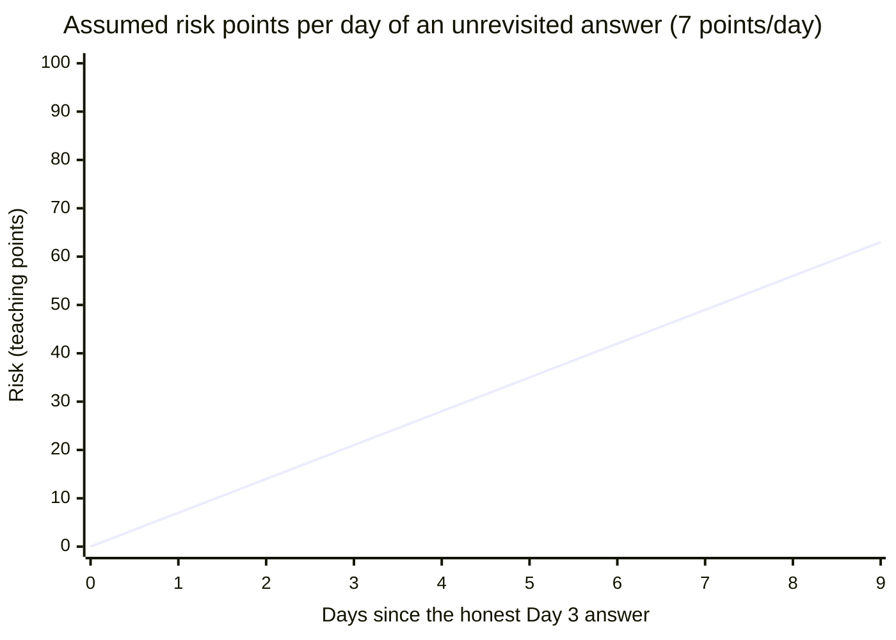

import Scenario from "../../../components/Scenario.astro";
import LevelIntro from "../../../components/LevelIntro.astro";
import Checkpoint from "../../../components/Checkpoint.astro";
import PracticeCheck from "../../../components/PracticeCheck.astro";

export const unit = {
  track: "corporate-politics",
  unitSlug: "strategic-ambiguity",
};

<Scenario label="The same question, four different answers">
  <Fragment slot="facts">
    

      
📅 <strong>Day 0</strong>: Priya learns the reorg will likely cut Sam's role

      
❓ <strong>Day 3</strong>: Sam asks Priya directly, "is my job safe?"

      
📨 <strong>Day 8</strong>: a recruiter contacts Sam with a competing offer

      
⏰ <strong>Day 12</strong>: Sam's deadline to answer the recruiter

      
📢 <strong>Day 14</strong>: the reorg is announced and Priya is free to speak

    

  </Fragment>

**Before reading the four versions below, predict: of "share everything
now," "strategic ambiguity," "silent gray zone," and "affirmative
falsehood," which one is not actually available to Priya at all on Day 3,
and why?**

</Scenario>

<LevelIntro
  items={[
    "Four possible answers, ranked honest to dishonest",
    "Why a true answer still goes stale",
    "Judging honesty by what was known then",
  ]}
/>

## Four ways the Day 3 conversation could go

| Version                  | What Priya says                                                                                        | Verdict                                                                                                    |
| ------------------------ | ------------------------------------------------------------------------------------------------------ | ---------------------------------------------------------------------------------------------------------- |
| 1. Share everything now  | "There's a reorg coming that will likely cut your role."                                               | Not available: Priya is not authorized to disclose yet, and saying this breaks a confidence given in trust |
| 2. Strategic ambiguity   | "I can't get into specifics about org plans right now, but I'd make sure your recent work is visible." | Honest: true, incomplete, and Sam correctly knows something is unsaid                                      |
| 3. Silent gray zone      | Sam says "so I'm probably fine then?" and Priya just nods and changes the subject.                     | Risky: Priya said nothing false, but let a specific wrong belief stand uncorrected                         |
| 4. Affirmative falsehood | "Yes, totally safe, don't worry about it."                                                             | Dishonest: Priya actively manufactured a false belief rather than withholding a true one                   |

The predicted answer is version 1: full disclosure is not on the table on
Day 3, which is why versions 2 to 4 are the real choice. Version 2 is the
only one of the three that keeps Priya both within her constraint and
honest.

This can feel strange, because version 1 is the full truth. But truth is not
the only obligation in the room. Priya was trusted with information before
it could be announced. Telling Sam early would spare him ambiguity, but it
would break a legitimate confidence. The honest option has to be truthful
_and_ respectful of the constraint. None of this makes version 4 a
"strategic" choice: it is a lie, and the constraint never required it.

<PracticeCheck
  track={unit.track}
  unitSlug={unit.unitSlug}
  topicId="four-versions"
/>

<Checkpoint question="A colleague suggests Priya could have said nothing at all on Day 3, just changing the subject the way version 3 does. Why does that rank as riskier than version 2's strategic ambiguity, even though Priya states nothing false in either one?">

Because the two versions leave Sam in very different places. In version 2,
Priya's words signal that there is something she cannot get into, so Sam
walks away knowing his picture is incomplete. In version 3, Sam states a
specific wrong conclusion out loud, "so I'm probably fine then?", and Priya
lets it stand by changing the subject. Nothing she says is false, but she
had the chance to redirect a belief she knows is wrong and did not take it.
Once the wrong belief has been spoken aloud, Sam cannot tell "Priya said
nothing" apart from "Priya agreed".

</Checkpoint>

## Why did timing make the gap costly, not just the wording?

**Suppose Priya gives Sam the honest version 2 answer on Day 3. Does the
story end there?** Not necessarily. A recruiter contacts Sam on Day 8, and
Sam must answer by Day 12, still without knowing about the reorg, because
Priya has not followed up. Nothing changed on her side since Day 3. The
honest wording from Day 3 simply does not cover Sam once new, time-sensitive
facts enter the picture.

| Day | What is true                                       | What Sam knows                            | Risk of an avoidable, costly decision    |
| --- | -------------------------------------------------- | ----------------------------------------- | ---------------------------------------- |
| 3   | Reorg likely, Priya not yet authorized to disclose | "Something is unsaid, stay visible"       | Low: no active decision pending          |
| 8   | Same as Day 3, a recruiter reaches out to Sam      | Still only the Day 3 answer               | Rising: a real decision is now in play   |
| 12  | Same as Day 3, Sam must decide on the offer        | Still only the Day 3 answer               | High: decision made on stale information |
| 14  | Reorg announced, Priya now free to speak           | The full truth, too late for the decision | Realized: Sam already decided blind      |

The risk numbers below are an **illustrative teaching model, not a
measurement**. Assume (an assumption, not data) that every day an honest
answer goes unrevisited while a real decision is pending adds 7 risk points,
capped at 100. Counting from Day 3, Day 8 is 5 days away and Day 12 is 9
days away.

At Day 8 the model reads 35, and at Day 12 it reads 63. The exact numbers
are not the lesson. The lesson is the shape: risk rises while a real
decision sits on top of an answer nobody has revisited.

The honest answer on Day 3 did not fail Sam. What failed Sam was Priya
treating "I gave a truthful answer once" as the end of her responsibility.
Priya still does not need to reveal the secret before Day 14. Once she
learns Sam has a deadline, she can say a more protective sentence: "I still
can't confirm specifics, but I would not make this decision as if your
current role is guaranteed to stay unchanged." That keeps the confidence and
reduces the false comfort.

<PracticeCheck
  track={unit.track}
  unitSlug={unit.unitSlug}
  topicId="stale-answer"
/>

<Checkpoint question="Priya never learns that Sam has a recruiter deadline on Day 8, since she has no way of knowing his situation changed. Does she still owe him an update before Day 14, the way the table above suggests?">

Not in the same way. The obligation to revisit a stale answer starts once
you can actually see a new decision forming. Priya's responsibility from Day
8 to Day 12 comes from noticing that Sam now has a deadline riding on old
information. If she has no signal that anything changed for him, she has no
new fact to act on and has not failed him by not re-raising the Day 3
conversation. Timing is not "always follow up after a fixed number of days";
it is "revisit an answer once you can see it has become load-bearing for a
real decision", and that depends on what you can observe, not a calendar.

</Checkpoint>

## Is honesty judged by the outcome?

**Suppose that on Day 10 leadership scraps the reorg and Sam's role was
never actually at risk. Does Priya's Day 3 answer retroactively become
dishonest, now that the thing she was vague about never happened?** Walk
through it: was the statement true and non-misleading _at the moment she
said it_, given what she reasonably knew then?

The answer: Day 3 does **not** become dishonest because the reorg was
cancelled. Honesty is judged by what Priya knew and communicated at the
time. But Day 10 creates a new obligation: once the situation changes and
Priya can safely reduce Sam's uncertainty, she should update him. The old
answer was honest when given; it should not be left stale after the facts
change.

The same logic runs in the other direction. If Priya had said "yes, totally
safe" on Day 3 and the reorg were then cancelled on Day 10, the lie would
not become honest by luck. She stated something she believed false when she
said it, and a happy outcome does not repair that.

<PracticeCheck
  track={unit.track}
  unitSlug={unit.unitSlug}
  topicId="judged-at-the-time"
/>

## Failure modes

| Failure mode                                          | What it gets wrong                                                                                                 |
| ----------------------------------------------------- | ------------------------------------------------------------------------------------------------------------------ |
| Treating "I didn't technically lie" as sufficient     | Letting a specific false belief stand uncorrected, once you can see it forming, is closer to lying than to silence |
| Treating a truthful answer as valid indefinitely      | New facts (a decision deadline, a recruiter, a deal) can make a stale-but-once-true answer newly harmful           |
| Confusing "vague" with "dishonest"                    | Vagueness that leaves the listener knowing they lack the full picture is honest; vagueness is not the problem      |
| Disclosing early to avoid the discomfort of ambiguity | Breaking a confidence you were given because holding the line felt uncomfortable is its own trust violation        |
| Judging Day 3's honesty by what happened on Day 10    | Whether a statement was honest is judged by what was known and said at the time, not by later outcomes             |

This is one case, not the whole territory. Priya and Sam are one path
through the line between withholding and lying; change the facts and the
right moves change too. **What if Sam had never asked, and Priya simply
watched him sign a long lease on Day 6? What if the confidence came from a
legal obligation rather than a manager's request, so Priya had even less
room? What if it were Sam who held the secret and a teammate who asked?**
Work out where each version lands on the ladder and which part of the
decision test changes before assuming the Priya-and-Sam answer is the only
one that fits.
