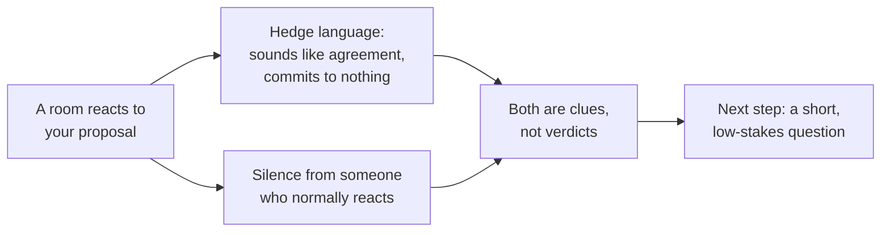

import Scenario from "../../../components/Scenario.astro";
import LevelIntro from "../../../components/LevelIntro.astro";
import PracticeCheck from "../../../components/PracticeCheck.astro";

export const unit = {
  track: "corporate-politics",
  unitSlug: "subtext",
};

<Scenario label="Five friends, one question, and the word 'fine'">
  <Fragment slot="facts">
    

      
🍽️ <strong>Question</strong>: "Where should we eat?"

      
🗣️ <strong>Said by everyone</strong>: "Fine, anywhere works."

      
🤐 <strong>Not said by one friend</strong>: the person who is always the first to name a restaurant

      
❓ <strong>Open question</strong>: did the dinner just get decided, or only appear to?

    

  </Fragment>

Five friends are choosing a restaurant. Four of them say "fine, anywhere
works." The fifth, who normally names a place before the question is even
finished, says nothing at all. Someone picks the closest restaurant, and
everyone walks there. Halfway through the meal the quiet friend says they
would not have chosen it, because they had been craving something else all
week.

Nobody said anything unkind. Nobody objected. **So what did the group
miss, and what could one friend have done in the first ten seconds to
find out?**

</Scenario>

The same thing happens in meetings, only with more at stake. People say
"interesting, let's take it offline," or say nothing, and the person who
proposed the idea walks away believing it was approved.

<LevelIntro
  items={[
    "Subtext versus the transcript",
    "Hedge language and silence as carriers",
    "A clue is a prompt to ask, not proof",
  ]}
/>

## What is the difference between what was said and what was communicated?

**If you wrote down every word of the dinner conversation, would the quiet
friend's disappointment appear anywhere in it?** No. The record of words
and the real message can differ, and that gap is what this unit is about.

|                  | Transcript                           | Subtext                                           |
| ---------------- | ------------------------------------ | ------------------------------------------------- |
| What it is       | The words that were literally spoken | The real message sitting under or instead of them |
| Where to find it | In a recording or in notes           | In who reacted, who did not, and how              |
| Can you quote it | Yes, word for word                   | No, you can only infer it from clues              |
| Typical risk     | Taking it at face value              | Treating a guess as a fact                        |

- **Subtext** is the real message a speaker or a room is conveying, which
  may sit underneath the literal words or replace them.
- **Unstated agenda** is a goal or concern someone brings into a
  conversation without saying it out loud, but which still shapes how they
  respond.
- What a person has **at stake** is what they might gain, lose, protect,
  or be blamed for: budget, time, reputation, authority, or control over a
  decision.

**A clue is not proof.** A hedge or a silence tells you there is enough
reason to ask a careful follow-up. It does not tell you what anyone secretly
thinks.

<PracticeCheck
  track={unit.track}
  unitSlug={unit.unitSlug}
  topicId="subtext-basics"
/>

## Where does subtext usually hide?

**In the dinner, which was easier to spot: the four people who said
"fine," or the one who said nothing?** Neither was loud. Two carriers show
up again and again in real meetings, and both are almost invisible if you
only listen for content.

| Term              | Simple meaning                                                                                     |
| ----------------- | -------------------------------------------------------------------------------------------------- |
| Hedge language    | Phrases like "let's take it offline" or "worth exploring" that avoid both agreeing and disagreeing |
| Silence as signal | A missing reaction from someone whose usual reaction you know                                      |
| Reading the room  | Comparing what was said against who said it, who stayed quiet, and what each person has at stake   |

Back to the opening meeting idea: an engineer proposes a new direction.
Two directors say "interesting, let's sync up separately," and the one
peer who always asks the hard question says nothing. The words were all
mild. The room's real reaction may not have been.

<PracticeCheck
  track={unit.track}
  unitSlug={unit.unitSlug}
  topicId="two-carriers"
/>

## What does this unit cover?

L2 builds a short catalog of hedge phrases and what they usually signal,
the one condition that makes silence meaningful, and the one move that keeps
a read honest: turning it into a question. L3 walks a full meeting line by
line, without accusing anyone and without acting on a guess as if it were
confirmed.
