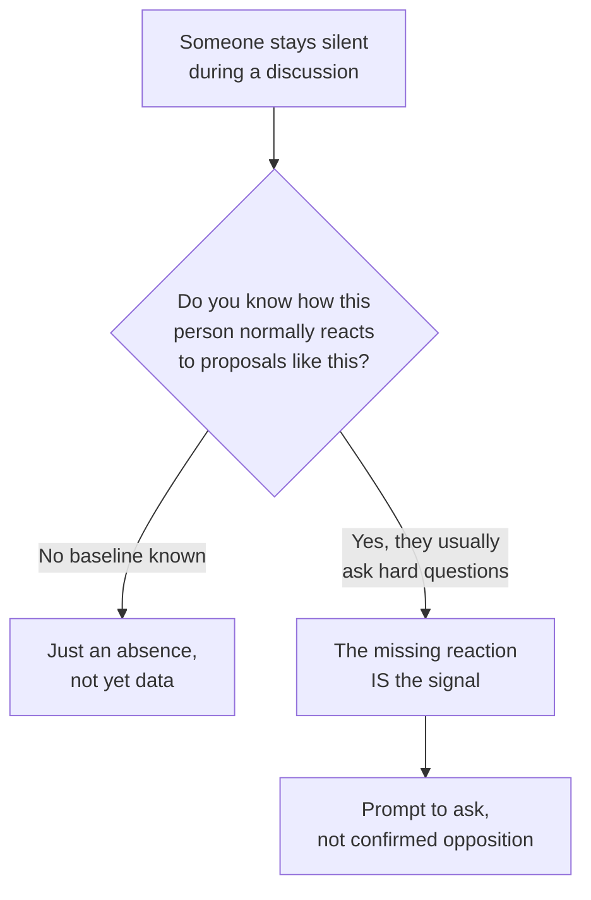

import LevelIntro from "../../../components/LevelIntro.astro";
import Checkpoint from "../../../components/Checkpoint.astro";
import PracticeCheck from "../../../components/PracticeCheck.astro";

export const unit = {
  track: "corporate-politics",
  unitSlug: "subtext",
};

L1 named two carriers of subtext, hedge language and silence, and one rule:
a clue is not proof. L2 shows how to read each carrier without turning a
guess into an accusation, ending with the one move that keeps a read honest.

<LevelIntro
  items={[
    "Which hedge phrases signal and which do not",
    "The condition that makes silence meaningful",
    "Turning a read into a question",
  ]}
/>

## Why does hedge language exist at all?

**If a director has real doubts, why not just say so in the room?** Because
saying "I don't think this is right" in front of the proposer's peers creates
open conflict, and most people would rather avoid that, especially when their
doubts are not fully formed yet. Hedge language lets someone avoid committing
to a position without creating conflict.

Do not treat the next table as a secret dictionary. A useful read needs three
pieces together: the phrase, the lack of a concrete next step, and the
reaction you would have expected instead.

| Phrase                                      | Common subtext                                                    | What it usually is not                            |
| ------------------------------------------- | ----------------------------------------------------------------- | ------------------------------------------------- |
| "Let's take it offline"                     | "I won't debate this here, and may not follow up"                 | A guaranteed follow-up conversation               |
| "Interesting" (alone, no specific question) | Polite acknowledgment without endorsement                         | Enthusiasm, which usually asks something specific |
| "Worth exploring"                           | Mild interest that commits to nothing concrete                    | Approval to proceed                               |
| "I'd want to think about that"              | Real hesitation, deferred instead of stated                       | A formality before agreeing                       |
| "Let me loop in someone else"               | Passing the decision, or the risk of saying no, to another person | Simple information sharing                        |

**Is every use of these phrases a hedge?** No. "Interesting" sometimes just
means interesting. The signal is a hedge appearing in place of a specific
reaction that the proposal would normally get.

<Checkpoint question="A colleague answers your proposal with 'worth exploring,' and immediately asks 'what would the migration timeline look like if we started next quarter?' Is 'worth exploring' working as a hedge here?">

No. The test is the phrase combined with whether something specific came with
it. A concrete question about the migration timeline is what real interest
looks like, so the phrase is only polite framing here. The same words read as
a hedge only when nothing concrete follows them.

</Checkpoint>

<PracticeCheck
  track={unit.track}
  unitSlug={unit.unitSlug}
  topicId="hedge-reads"
/>

## When does silence mean something?

**If someone says nothing, is that meaningful by itself?** Only relative to
what they would normally do. Silence is data only when you know the person's
baseline.

| Person                               | Silence in this meeting | Read                                        |
| ------------------------------------ | ----------------------- | ------------------------------------------- |
| Quiet in every meeting you have seen | Says nothing            | Matches the pattern, tells you little       |
| Always asks the first hard question  | Says nothing            | Breaks the pattern, worth a gentle check    |
| Joined the team two meetings ago     | Says nothing            | No baseline yet, so nothing can be inferred |

Even a broken pattern has innocent explanations: the person was distracted,
already raised the concern privately, or is saving a bigger objection for a
smaller setting.

<Checkpoint question="A new hire who has attended exactly two meetings says nothing when your proposal comes up. Does the baseline precondition for reading silence apply?">

No. The precondition is knowing this person's normal reaction, and two
meetings is not enough to know that about anyone. They may be naturally quiet,
still finding their footing, or someone who will push back hard once
comfortable. Without a baseline, the silence is an absence and not evidence
about your proposal.

</Checkpoint>

<PracticeCheck
  track={unit.track}
  unitSlug={unit.unitSlug}
  topicId="silence-baseline"
/>

## Once you suspect a hedge or a meaningful silence, what is the next move?

**Should you confront the person or quietly assume the worst?** Neither. The
useful move is a direct, low-stakes question that turns an ambiguous clue into
information. It works whether the read was right or wrong: if there was a real
concern it usually surfaces when asked privately, and if there was not, asking
cost almost nothing.

| Situation                   | Example follow-up                                                                                 |
| --------------------------- | ------------------------------------------------------------------------------------------------- |
| General unease              | "We didn't get many concrete questions. Is there a risk I should check before I go further?"      |
| A named but vague concern   | "When you mentioned cost, which cost worries you most: infrastructure, maintenance, or priority?" |
| Someone with more authority | "You were quieter than usual on this, and I value your read. Is there anything I'm missing?"      |

Three failure modes to avoid at this level:

1. Treating every hedge as proof of hidden opposition, which burns trust over
   false signals.
2. Reading silence from someone with no known baseline.
3. Acting on a read as if it were confirmed, either by dropping the idea or
   by escalating, instead of asking.

<PracticeCheck
  track={unit.track}
  unitSlug={unit.unitSlug}
  topicId="read-to-question"
/>
