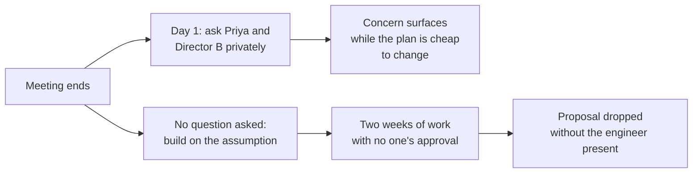

import Scenario from "../../../components/Scenario.astro";
import LevelIntro from "../../../components/LevelIntro.astro";
import Checkpoint from "../../../components/Checkpoint.astro";
import PracticeCheck from "../../../components/PracticeCheck.astro";

export const unit = {
  track: "corporate-politics",
  unitSlug: "subtext",
};

<Scenario label="Ten minutes of discussion, nothing hostile, and a dead proposal two weeks later">
  <Fragment slot="facts">
    

      
📋 <strong>Proposal</strong>: move the notification service onto its own infrastructure

      
🗣️ <strong>Director A</strong>: "Interesting. Let's take it offline."

      
💬 <strong>Director B</strong>: "Worth exploring. I'd want to think about the cost implications."

      
🤐 <strong>Priya</strong>: usually asks the first pointed question, says nothing for the entire discussion

      
💀 <strong>Two weeks later</strong>: the proposal is no longer on the agenda

    

  </Fragment>

L2 built two tools in the abstract: reading a hedge against what real
engagement would look like, and reading silence against a known baseline. L3
applies both to one full meeting, the same one as in the opening of L1.

**Before reading on: what do you think the engineer should have done on the
afternoon of the meeting, and what would it have cost?**

</Scenario>

<LevelIntro
  items={[
    "The meeting, line by line",
    "From a read to a specific next move",
    "What generalizes and what is specific to this room",
  ]}
/>

## What did the transcript actually contain?

Read as a recording, nothing in this meeting is negative:

> Engineer: "The proposal is to move the notification service off the shared
> queue and onto its own dedicated infrastructure. Here is the rough plan..."
>
> Director A: "Interesting. Let's take it offline and sync up on the details."
>
> Director B: "Worth exploring. I'd want to think about the cost implications,
> but interesting direction."
>
> _(Priya, who usually has the first and most pointed question in any
> architecture discussion, says nothing for the entire ten-minute
> discussion.)_
>
> Engineer, afterward: "That went fine. Two directors sound interested and
> nobody objected."

**Is the engineer's takeaway unreasonable on the transcript alone?** No, and
that is exactly why subtext is easy to miss. The information that mattered was
in the gap between what a real "let's build this" reaction would sound like and
what actually happened.

## How should each response be decoded?

**What would substantive interest from Director A have looked like?** A
question that touches a concrete part of the plan, such as the effect on the
on-call rotation or the migration timeline. "Interesting, let's take it
offline" touches nothing specific. It is a closing phrase, not an opening one.

| Response        | What it contains                     | Most likely read                                           | Confidence in the read |
| --------------- | ------------------------------------ | ---------------------------------------------------------- | ---------------------- |
| Director A      | A hedge and no concrete content      | Non-committal, possibly avoiding debate in front of others | Low                    |
| Director B      | A hedge plus one named concern: cost | A real reservation, softened                               | Medium                 |
| Priya's silence | A break from her known pattern       | Something is probably on her mind, but what is unknown     | Low on content         |

Here, "substantive" does not mean "excited". It means the person touches a
concrete part of the plan. A calm question about timeline, cost, risk,
ownership, or maintenance is often a stronger sign of engagement than a warm
but generic "interesting".

<Checkpoint question="Of the three reactions, which carries the most concrete information to act on, judged by this unit's own tools rather than by which feels most alarming?">

Director B's, because it names an actual concern, cost. Director A's response
is a hedge with nothing underneath, so it tells you only that nothing
substantive happened. Priya's silence is the strongest reason to investigate,
but a pattern break says that a concern probably exists, not what it is.
Director B's comment already points at a specific question to ask, which is why
the "turn a read into a question" move applies most cleanly to it.

</Checkpoint>

<PracticeCheck
  track={unit.track}
  unitSlug={unit.unitSlug}
  topicId="decode-room"
/>

## What should the engineer do next, and when?

**Given this read, what is the actual move?** Not treating "let's take it
offline" as permission to keep building, and not confronting Priya in front of
the group. A private, direct question: "Priya, you were quiet on the
notification service idea. Anything I should think about before I go further?"
A matching question for Director B: "When you said cost implications, which
cost worries you most?"

Timing matters because the cost of a wrong read grows with how much is built on
it. Assume, for illustration only, that the engineer builds full time at five
working days per week, so the two weeks in the scenario are ten working days:

| When the doubt is checked | Working days built on an unverified assumption |
| ------------------------- | ---------------------------------------------- |
| End of day 1              | 1                                              |
| End of week 1             | 5                                              |
| End of week 2             | 10                                             |

<Checkpoint question="Wouldn't the same misread, caught a week later, have led to the same outcome? Why does the timing matter as much as the misread itself?">

The cost of a wrong read is not fixed. A misread caught the next day costs a
private question and almost no work. The same misread left for two weeks means
ten days of effort went into a direction nobody approved, and the decision to
drop it happened without the engineer in the room to respond. The read being
wrong is half the problem; nothing checking it before the cost accumulated is
the other half.

</Checkpoint>

<PracticeCheck
  track={unit.track}
  unitSlug={unit.unitSlug}
  topicId="follow-up-timing"
/>

## What generalizes, and what does not?

The core moves generalize to almost any meeting where people have reasons not
to disagree openly: notice when a hedge replaces a substantive reaction, and
notice when silence breaks a known pattern. What is specific here are the exact
phrases and the exact baseline (Priya usually asks first). The same phrase can
mean something different from another speaker, on another team, in another
company.

**This is one case, not the whole territory.** Change the facts and the right
move changes. **What if Priya had spoken first, with detailed enthusiasm, and
the two directors' words were unchanged?** Likely the overall read shifts from
"two unverified hedges and one odd silence" to "one real supporter plus two
people who still need a follow-up", even though the directors' literal words are
identical. **And what if the person who stayed silent were the engineer's own
manager, or a stranger from another team?** Work out which parts of the read
survive before assuming this sequence fits every room.

## Failure modes

| Failure mode                                                                   | What it gets wrong                                                                                |
| ------------------------------------------------------------------------------ | ------------------------------------------------------------------------------------------------- |
| Treating "let's take it offline" as a commitment and waiting for the follow-up | The phrase guarantees nothing; if it matters, the proposer schedules the conversation             |
| Confronting Priya publicly about her silence in the next meeting               | Turns an ambiguous private signal into a public accusation, which produces defensiveness          |
| Dismissing Director B's "cost implications" as politeness                      | It is the one specific concern in a hedge-heavy room, usually the most real information available |
| Waiting until the proposal quietly disappears before checking in with anyone   | The value of a private follow-up falls fast as work piles up on the unverified assumption         |
| Announcing "Priya opposes this" to colleagues based on her silence             | Spreads a guess as a fact and can damage a relationship over something she never said             |

<PracticeCheck
  track={unit.track}
  unitSlug={unit.unitSlug}
  topicId="limits-of-a-read"
/>
