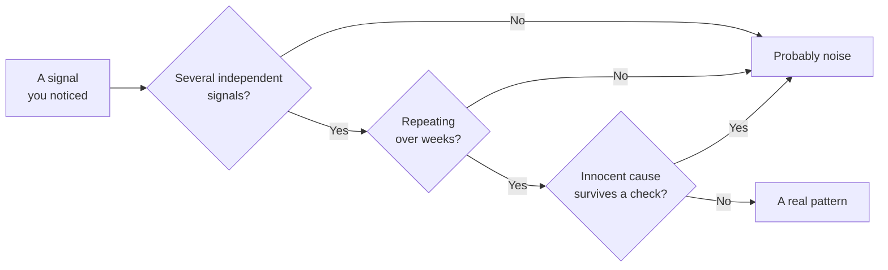

import Scenario from "../../../components/Scenario.astro";
import LevelIntro from "../../../components/LevelIntro.astro";
import PracticeCheck from "../../../components/PracticeCheck.astro";

export const unit = {
  track: "corporate-politics",
  unitSlug: "warning-signs",
};

<Scenario label="Six weeks ago you were the person everyone looped in. This week you found out about a decision on your own project from a hallway comment.">
  <Fragment slot="facts">
    

      
📧 <strong>Week 1</strong>: quietly dropped from a thread you used to be central to

      
🗣️ <strong>Week 3</strong>: 1:1s with your manager get shorter and vaguer

      
🎯 <strong>Week 5</strong>: the agreed scope is redefined twice, never told to you directly

      
📉 <strong>Week 6</strong>: you write it all on one timeline

    

  </Fragment>

For six weeks, nothing that happened to Priya looked like an attack. She
stopped being cc'd on a thread she used to be central to, and busy people
forget to loop people in all the time. Her manager's 1:1s got shorter and
vaguer, and maybe he is just stretched thin this quarter. A project scope
that everyone had agreed to in writing got quietly redefined, twice, and
scope changes happen.

Any one of these has a completely innocent explanation. But she only sees
all three when she finally writes them on one timeline. **So which is it:
is she imagining a pattern that is not there, or missing one that is?**

</Scenario>

<LevelIntro
  items={[
    "The three warning-sign categories",
    "Why one signal rarely means anything",
    "What separates a pattern from noise",
  ]}
/>

## What do the three warning signs look like?

**If every signal has an innocent twin, what are you even looking for?** The
shape of the behavior, repeated, rather than any single instance of it.

- **Shifting goalposts**: a target for success that keeps moving further out
  of reach, without a stated reason.
- **Exclusion from key threads**: being cut out of the meetings, decisions or
  conversations that affect your own work, so you hear about them afterwards.
- **Sudden isolation**: people who were warm toward you become shorter, less
  inclusive and harder to reach, with no incident behind the change.

Nobody sends a message saying "I am now excluding you". These show up as
small changes that each look deniable on their own.

| Category                   | Priya's version                           | An ordinary twin of the same thing           |
| -------------------------- | ----------------------------------------- | -------------------------------------------- |
| Exclusion from key threads | Dropped from the incident thread (week 1) | A cc line was mis-addressed once             |
| Sudden isolation           | 1:1s shrink from 30 to 10 minutes         | Her manager is in back-to-back budget talks  |
| Shifting goalposts         | Scope redefined twice (week 5)            | A genuine new requirement, communicated late |

<PracticeCheck
  track={unit.track}
  unitSlug={unit.unitSlug}
  topicId="three-signs"
/>

## Why does one signal rarely mean anything?

**If any single signal could be innocent, what turns a few of them into
something worth acting on?** Three checks, run honestly and together.

- **Multiplicity**: several independent signals pointing the same way.
- **Duration**: repetition over weeks, not one bad day.
- **Alternative explanation**: a reorg, a deadline crunch or a manager's bad
  quarter that explains the same facts just as well.

The payoff is time. A pattern recognized at week six can still be handled with
a calm conversation. The same pattern, left unnamed for four months, has
usually hardened. The opposite error also costs something: treating every
ambiguous moment as an attack burns trust with colleagues who did nothing.

## What the next levels cover

L2 builds the model behind the three categories and the three checks,
including the case where three signals are still just noise. L3 follows Priya
through the self-check that nearly talks her out of a real pattern, and the
first prudent step once it is confirmed.
