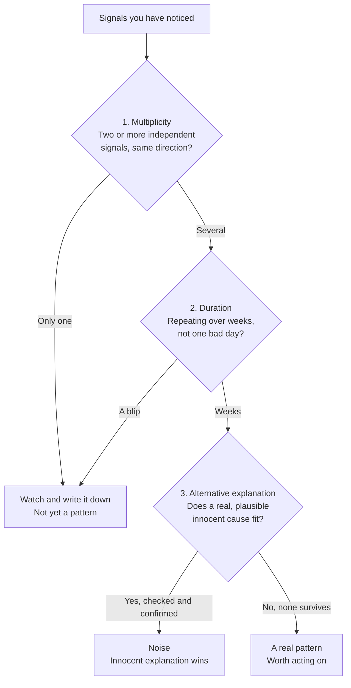

import LevelIntro from "../../../components/LevelIntro.astro";
import Checkpoint from "../../../components/Checkpoint.astro";
import PracticeCheck from "../../../components/PracticeCheck.astro";

export const unit = {
  track: "corporate-politics",
  unitSlug: "warning-signs",
};

L1 laid out Priya's six weeks as one timeline. This level builds the model
behind it: the three categories her signals fall into, and, more importantly,
how to tell a real cluster from three unrelated, innocent coincidences.

<LevelIntro
  items={[
    "The three categories with their ordinary twins",
    "Multiplicity, duration and alternative explanation",
    "Why three signals can still be noise",
  ]}
/>

## What do the three warning signs actually look like?

**Two people see the same missed invite. One shrugs, one worries. What would
make either of them right?** The category by itself cannot say, because each
one has a harmless version that happens constantly.

| Category                   | What a worrying version looks like                                                                               | An ordinary version of the same surface behavior                               |
| -------------------------- | ---------------------------------------------------------------------------------------------------------------- | ------------------------------------------------------------------------------ |
| Shifting goalposts         | "Ship by Q3" becomes "also X", then "also handle Y", each arriving after the previous target was nearly met      | A new requirement surfaces once, with a stated reason, and the date moves      |
| Exclusion from key threads | A recurring meeting stops including you; a decision that changes your scope is made and you hear it secondhand   | You were away for one meeting, or a thread narrowed for one specific topic     |
| Sudden isolation           | A peer who grabbed coffee weekly stops answering within a day; 1:1s shrink from real discussion to status-checks | A colleague is heads-down on their own deadline and slower to reply than usual |

The right-hand column is not "this never happens for bad reasons". It says the
same behavior also has an ordinary, non-hostile version that appears in every
organization. That overlap is why the category alone cannot tell you which one
you are looking at.

<Checkpoint question="Your manager cancels your 1:1 twice in one month because of back-to-back exec meetings. Is that, by itself, a sudden-isolation warning sign?">

Not by itself. Two cancellations with a stated, plausible reason is a single
ambiguous signal with a reasonable alternative explanation, which is exactly
what this unit warns against over-reading. It becomes worth attention only if
it is one signal among several, or if the cancellations continue long after
the stated reason should have passed, with no new explanation.

</Checkpoint>

## What separates a real pattern from noise?

**You have noticed three odd things. What do you test before you let yourself
conclude anything?** Three checks, and all three have to run.

Here is how the checks read different profiles of signals.

| Signal profile                                                                                                                                                                | Read on it                                                                   |
| ----------------------------------------------------------------------------------------------------------------------------------------------------------------------------- | ---------------------------------------------------------------------------- |
| One missed cc, explained by a busy week, gone by next week                                                                                                                    | Noise. Let it go.                                                            |
| A missed cc, a shorter 1:1 and a scope change, each with a clear, checked innocent cause (a reorg told to everyone, a manager's workload spike, a change that hit every team) | Still noise, even with three signals: the explanation check clears all three |
| Three or more signals, sustained for weeks, with no innocent explanation surviving a real check                                                                               | A real pattern, worth taking seriously                                       |

The middle row is the one people skip past. **Three signals are not
automatically a pattern.** Multiplicity raises the question and does not
answer it. The alternative-explanation check still has to run on each signal,
and it has to be a real check, not a formality on the way to a conclusion you
had already reached.

<Checkpoint question="You have confirmed all three checks: several independent signals, six weeks, no plausible innocent explanation survives. What should you not do next?">

You should not jump straight to an explosive confrontation, and you should not
keep quietly absorbing it either. Confirming the pattern is the point where you
start a written record and move toward a direct, calibrated conversation with
the person best placed to explain it. L3 shows what that first step looks like.

</Checkpoint>

<PracticeCheck
  track={unit.track}
  unitSlug={unit.unitSlug}
  topicId="three-checks"
/>

## Why does getting this distinction right matter so much?

- **Overreading noise as an attack** costs something even when you are wrong.
  It burns trust with colleagues who did nothing, makes you harder to work
  with, and trains you to see hostility in ordinary friction, which makes the
  next real pattern harder to trust your own read on.
- **Underreading a real pattern as noise** costs differently. By the time the
  evidence is undeniable, you may have lost months of runway to respond.
- The three checks keep you honest in both directions. They are not a hurdle
  that talks you out of a real concern, and not a shortcut to a suspicion you
  had already decided was true.
