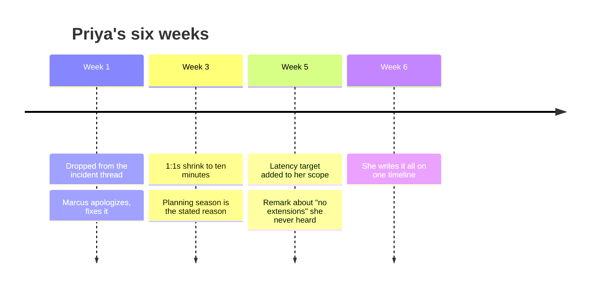
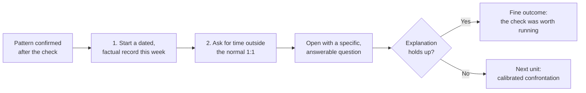

import Scenario from "../../../components/Scenario.astro";
import LevelIntro from "../../../components/LevelIntro.astro";
import Checkpoint from "../../../components/Checkpoint.astro";
import PracticeCheck from "../../../components/PracticeCheck.astro";

export const unit = {
  track: "corporate-politics",
  unitSlug: "warning-signs",
};

<Scenario label="The scenario">
  <Fragment slot="facts">
    

      
👩‍💻 Priya leads checkout reliability; Marcus is her director

      
🗓️ Four signals across six weeks

      
🔍 Two clear the innocent-explanation check, two do not

    

    

      

        2 of 4
        signals with a surviving innocent explanation
      

      

        

      

    

  </Fragment>

Same Priya as L1 and L2. Over six weeks she has been left off a thread, had
her 1:1s shrink, and found her project's scope changed without her. She has
also, honestly, found an innocent story for some of it. This level follows her
through the moment she tests those stories against facts she can check, and
what she does once the pattern is confirmed.

**Before reading on: if two of her four signals turn out to be innocent, does
the pattern disappear?**

</Scenario>

<LevelIntro
  items={[
    "Six weeks told in full, with each check",
    "Arguing against her own first conclusion",
    "The first prudent move once it is confirmed",
  ]}
/>

## Weeks one to five: how the signals arrive

**What does a real pattern look like while it is still happening?** Mostly
like ordinary work, with small details that do not add up.

- **Week 1: a thread goes quiet.** For a year Priya has been on the
  "checkout-incidents" email thread her director, Marcus, uses to loop in
  whoever is relevant. A partial outage happens during a flash sale and she is
  not on it. She learns about it two days later, secondhand, in standup. She
  sends a neutral note asking to be looped in next time. Marcus replies within
  the hour: "ah sorry, my bad, will do." That is a complete, ordinary
  resolution.
- **Week 3: the 1:1s change shape.** Her weekly 1:1s, which ran thirty
  minutes and covered real trade-offs, shrink to about ten minutes of
  "anything blocking you? no? great." It is planning season, Marcus is in
  budget meetings all month, and she files it under "probably the crunch."
- **Week 5: the scope moves, twice.** The Q3 scope she and Marcus agreed in
  writing in week one was "error rate below 0.5%, ship by end of Q3." She
  finds, only because she has edit access to the OKR doc, that it now also
  says "and cut p99 latency by 30%." Days later a stray Slack message from
  another team's engineer reveals that a leadership sync described her deadline
  as "end of Q3, no extensions, unlike last time", implying a slip that never
  happened. She was not in that meeting and nobody sent her notes.

<Checkpoint question="At the end of week five Priya has three kinds of signal in five weeks. By L2's framework, is that automatically enough to call this a real pattern?">

No. That satisfies multiplicity and plausibly duration, but the
alternative-explanation check has not run yet. Each signal arrived with an
innocent story attached: a mis-addressed cc, a busy planning season, a scope
conversation she might have missed. Several signals raise the question and do
not answer it. The check is what she does next.

</Checkpoint>

## How does she argue against her own conclusion?

**Where do most people go wrong at this point?** They skip the check and
either overreact or talk themselves into "nothing is wrong", or they run it
dishonestly on the way to a conclusion they already reached.

Priya writes out the innocent version of each signal, then tests it against
something she can verify.

1. **The thread.** Could Marcus simply have forgotten, as he said? Yes. He
   has done it before and owned it immediately and specifically. This signal
   still looks innocent.
2. **The 1:1s.** Is planning season real for everyone, or only an excuse used
   with her? She asks two peers on other teams and both describe the same
   squeeze in their own 1:1s. Still innocent.
3. **The scope change and the leadership-sync remark.** Is there a reasonable
   version where this is a broad directive communicated badly? She asks a peer
   who was in the sync. No other team's Q3 scope changed this quarter. The
   latency target exists only on her project, was added without her, and was
   discovered only because she checked the document.

If she stopped after the first two, she would correctly conclude that nothing
is wrong with either one. What changes the read is not any signal getting
worse. It is a signal with no surviving innocent explanation, aimed at her
project alone, sitting inside the same six weeks as two signals that were each
harmless.

| Week | Signal                                  | Innocent explanation, checked               | Result  |
| ---- | --------------------------------------- | ------------------------------------------- | ------- |
| 1    | Dropped from the incident thread        | Marcus acknowledged and fixed it right away | Cleared |
| 3    | 1:1s shrink from 30 to 10 minutes       | Planning season, confirmed with two peers   | Cleared |
| 5    | Latency target added to her scope       | No other team's scope changed this quarter  | Failed  |
| 5    | Remark in a sync she was not invited to | Tied to the same unexplained scope change   | Failed  |

Multiplicity: four signals, two of them unexplained. Duration: six weeks, not
one bad day. Alternative explanation: cleared where it was real, failed where
it was not. By L2's framework this clears the bar, and it does so specifically
because she ran the check instead of skipping it.

<PracticeCheck
  track={unit.track}
  unitSlug={unit.unitSlug}
  topicId="alternative-check"
/>

## What does she do once the pattern is confirmed?

**Is confirming a pattern the end of the story?** No. It is the start of a
narrower, more deliberate one, and it is neither an immediate blowup nor
silence.

1. **She starts documenting.** From now on every verbal instruction, scope
   conversation and meeting she is left out of gets a short note: dated,
   factual, no editorializing. This is the habit the [documentation
   discipline](/corporate-politics/documentation-discipline/) unit covers.
   She starts the week she confirms the pattern, because a record only
   protects the events it actually covers.
2. **She asks for a direct, calibrated conversation.** She requests time
   outside the usual slot and opens with something close to: "I want to check
   something directly rather than guess. The Q3 scope now includes the latency
   target and I wasn't part of that conversation. Can you walk me through how
   that decision was made?" That question is factual, specific and answerable.
   It is not an accusation, and it does not require her to say "I think you
   are setting me up" in the first sentence. It gives Marcus room to explain,
   and if the explanation is real, that is a fine outcome.

How to hold that conversation if the explanation does not hold up is its own
skill, covered in the next unit on calibrated confrontation. This unit's job
ends at recognizing the pattern and taking the first prudent step.

<Checkpoint question="Why does Priya start documenting before the conversation with Marcus, rather than waiting to see how it goes?">

Because a written record only covers what happens after it starts. If she waits,
she permanently loses contemporaneous notes of exactly the events she just
spent six weeks piecing together from memory and secondhand messages. Starting
the record does not assume the conversation will go badly. It means that
whichever way it goes, she is not relying on memory alone for what comes next.

</Checkpoint>

<PracticeCheck
  track={unit.track}
  unitSlug={unit.unitSlug}
  topicId="first-response"
/>

## Beyond this scenario

Priya's case is one worked example, not the whole territory. It has a clean
shape: one manager, a clear set of signals, a straightforward first move. Real
situations are messier, so try changing the case before treating it as a
template.

**What changes if the exclusion comes from a peer, not a manager?** A peer
cannot shrink your 1:1 or change your scope, but can quietly leave you out of
the informal conversations where decisions are pre-negotiated. That is
exclusion from key threads through a different channel. The multiplicity and
duration checks apply the same way. What may change is the first response: you
probably do not owe a peer the formal, scheduled conversation you would
request with a manager, but the underlying move of recording it and then
raising it directly and specifically does not change.

**What changes if you cannot tell whether it is aimed at you or is
organization-wide dysfunction?** This is what the alternative-explanation
check exists to catch, and "this might be everyone's problem" deserves to be
treated as a serious candidate answer, not a cop-out. Check with peers, as
Priya did for her 1:1s. If two or three colleagues on unrelated projects
describe the same thing, you are looking at an organizational problem worth
raising as one, while the discipline of writing it down and asking a specific
question stays the same.

**Questions to try on your own.** What if all four of Priya's signals had
cleared the check? What if the unexplained scope change had come from a
leadership directive that Marcus himself opposed? What would you do differently
if the person you most needed to ask were the one doing it?
