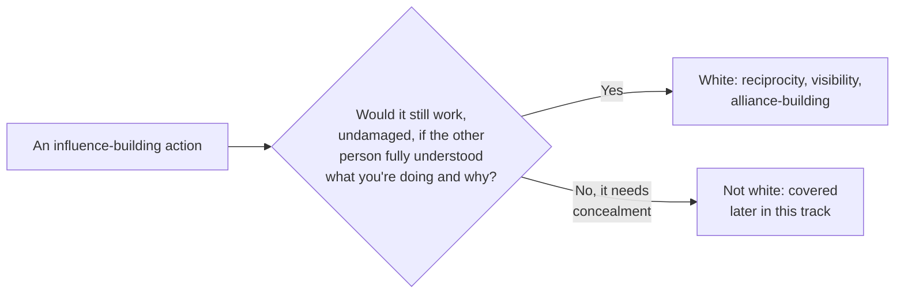

import Scenario from "../../../components/Scenario.astro";
import LevelIntro from "../../../components/LevelIntro.astro";
import PracticeCheck from "../../../components/PracticeCheck.astro";

export const unit = {
  track: "corporate-politics",
  unitSlug: "white",
};

<Scenario label="The problem">
  <Fragment slot="facts">
    
Months of help before the ask

    

      

        
🙋 Engineer A12 months

        

      

      

        
😐 Engineer B1 month

        

      

    

    

      
✅ Neither ever said anything untrue

      
🙋 A: 3 people offer to back the proposal, unprompted

      
😐 B: polite, lukewarm, "networking with an agenda"

    

  </Fragment>

Two engineers each want the same thing eventually: a big proposal that needs
real organizational trust behind it to get adopted. Both spend time helping
colleagues and building relationships. Neither ever says anything untrue or
manipulative in any single conversation.

One of them ends up with three people offering to back the proposal before
they even ask. The other gets polite silence, and a private comment that the
outreach felt like "networking with an agenda."

**If neither engineer lied, what single variable explains why only one of
them got spontaneous, unprompted support?**

</Scenario>

It was not honesty, because both were honest. It was **timing and pattern**:
whether the help stood on its own for months with no ask attached, or arrived
compressed into the weeks right before the request. Engineer A's help looked
like help. Engineer B's looked like preparation for a request.

<LevelIntro
  items={[
    "The transparency test for white influence",
    "Reciprocity, visibility, and alliance-building",
    "Why timing changes how help reads",
  ]}
/>

## What makes influence "white" instead of something darker?

Engineer B also had a personal goal, and so did Engineer A. If having a goal
does not separate them, what does?

"White" politics is influence built through mechanisms that are transparent,
reciprocal, and would survive being said out loud. This unit builds on
`corporate-politics/power-real-resource` and its four sources of power
(formal authority, expertise, relationships, information), and focuses on the
legitimate ways to build relationships and the trust that comes with them.

The test is mechanical, not a feeling. All politics involves awareness of
relationships and some self-interest, so "does this involve strategy?" cannot
be the line. The line is whether the mechanism needs the other person **not**
to know what is happening. A common misconception is that white politics
means having no self-interest. It does not; wanting your proposal to succeed
is compatible with every mechanism below.

<PracticeCheck
  track={unit.track}
  unitSlug={unit.unitSlug}
  topicId="transparency-test"
/>

## What are the three legitimate mechanisms?

If the test rules out concealment, what is left that actually builds
influence?

| Mechanism             | What it is                                                                        | What it builds                                 |
| --------------------- | --------------------------------------------------------------------------------- | ---------------------------------------------- |
| **Reciprocity**       | Helping people consistently: reviewing work, sharing context, covering for them   | Goodwill that people repay later, on their own |
| **Being visible**     | Making real work legible: a write-up, a share-out, a clearly explained trade-off  | Trust from people who never worked with you    |
| **Alliance-building** | Investing in relationships with people whose support you will need, before you do | A foundation an eventual ask can land on       |

Being useful is not the same as being **visibly** useful. Good work that
nobody outside your team hears about builds skill but not influence.

Quick vocabulary: a **proposal** is an idea that needs approval or support;
**backers** are people willing to defend or recommend it; an **ask** is a
concrete request such as "please support this."

<PracticeCheck
  track={unit.track}
  unitSlug={unit.unitSlug}
  topicId="three-mechanisms"
/>

Two ways the same help can be given, and only one builds durable trust:

| &nbsp;                                          | What it produces                                                        |
| ----------------------------------------------- | ----------------------------------------------------------------------- |
| Help given with an explicit "in exchange for X" | Settles one transaction. Builds no ongoing trust.                       |
| Help given consistently, no immediate ask       | Accumulates as goodwill. The other person tends to repay it unprompted. |

The practical skill is to build influence through help that is genuinely
given, work that is genuinely made visible, and relationships genuinely
invested in before they are needed. It is not the "nice" option so much as the
durable one: it survives scrutiny and keeps compounding.
