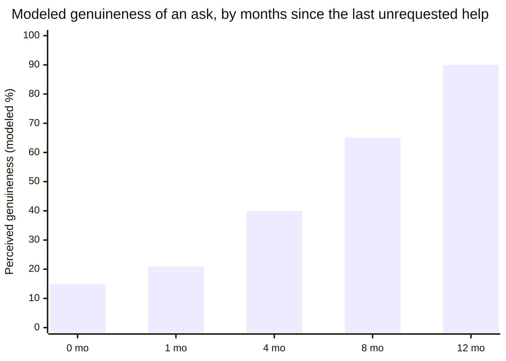
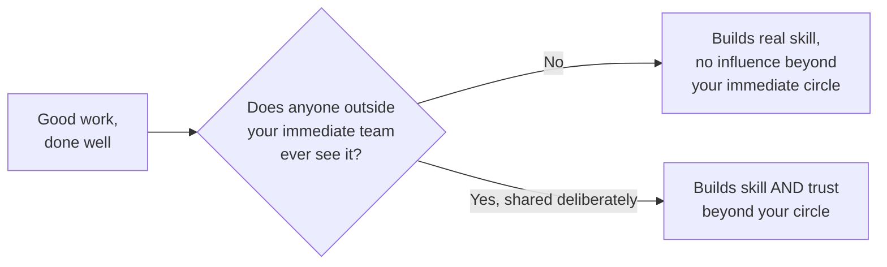

import LevelIntro from "../../../components/LevelIntro.astro";
import Checkpoint from "../../../components/Checkpoint.astro";
import PracticeCheck from "../../../components/PracticeCheck.astro";

export const unit = {
  track: "corporate-politics",
  unitSlug: "white",
};

L1 introduced two engineers and the single variable, timing and pattern
rather than honesty, that explained why only one got spontaneous backers. L2
works that variable out as a precise test and explains how each of the three
mechanisms passes it.

<LevelIntro
  items={[
    "Why genuine help compounds and called-in help does not",
    "Visibility as legibility, not exaggeration",
    "Alliance-building before the ask",
  ]}
/>

## Why does the same help build trust for one person and suspicion for another?

Two people can each spend a year helping colleagues, and one ends up trusted
while the other is quietly resented once people notice a pattern. Both were
"being strategic about relationships." **What actually differs?**

Reciprocity built through real help works the same whether or not the other
person notices the pattern. Telling them "I help you because I value working
with you" does not break it. What changes the meaning of help is **when an ask
shows up relative to it**:

| Approach                                             | What it produces                                                                                               |
| ---------------------------------------------------- | -------------------------------------------------------------------------------------------------------------- |
| Help with an explicit, immediate "in exchange for X" | A transaction. Settles the exchange, builds no ongoing trust.                                                  |
| Help given consistently, no immediate ask            | Goodwill that is not owed anywhere specific but accumulates; the person looks to repay it on their own, later. |
| Help given, then called in as a favor right after    | Reads as having had an ulterior motive all along, recoloring the earlier help as transactional.                |

The middle row is the real mechanism. It needs patience, because the payoff is
neither immediate nor guaranteed, and genuine investment, because help given
only when it will be noticed is a different pattern. That is why it is slower
than manipulative alternatives and also why it lasts.

The gap between help given and the ask changes how the ask reads. This unit's
demo uses a teaching model, not a measurement: a base reading of 15% for a
same-month ask, rising 6.25 points per month of daylight, capped at 12 months.

The trend is the point, not the exact values. The same help and the same
eventual ask read very differently depending on the daylight between them.
Compressing the gap does not make the help less real, but it makes the pattern
legible as timed, and "timed to precede an ask" is exactly what reads as
transactional.

<Checkpoint question="Someone gives a colleague genuine, unprompted help for 11 straight months, then in month 12 says 'remember when I helped you with X' while making an ask. Does that one reminder change how the previous 11 months read?">

Yes, and that is the third row of the table. The help itself did not change;
calling it in at the moment of the ask makes the whole pattern look aimed at
this ask all along, even if it was not. That is why the middle row depends on
patience: the payoff has to arrive on the other person's initiative, not be
extracted by naming the debt, or the goodwill gets recolored as a transaction
that was merely slow to close.

</Checkpoint>

<PracticeCheck
  track={unit.track}
  unitSlug={unit.unitSlug}
  topicId="reciprocity-timing"
/>

## When does good work actually turn into influence?

Two colleagues do equally strong work for a year. Only one is asked to weigh
in on decisions outside their own team. **What did the other skip?**

Visibility is not self-promotion in the sense of exaggerating results. It is
the deliberate step of making real work legible to people who would otherwise
never encounter it: a postmortem, a brief share-out of what a project involved,
a clear account of a hard trade-off. A **postmortem** is a short write-up after
something important happened (what happened, why, what was learned); a
**share-out** is a brief explanation to people who were not there; a
**trade-off** is a choice where you gain one thing and give up another.
Sharing those accurately is not bragging. Exaggerating them would be, and it
would fail the transparency test, because it only works while the audience
believes the inflated version.

<PracticeCheck
  track={unit.track}
  unitSlug={unit.unitSlug}
  topicId="visibility"
/>

## Why invest in someone before you need anything from them?

`power-real-resource` showed a sponsor lending credibility to one proposal,
and noted that sponsorship rests on a relationship built before the ask. If
you only meet that sponsor when you need them, what is the ask landing on?

A cold introduction: the first real contact happens only when you already need
something. **Alliance-building** is the opposite habit, treating relationships
with people whose future support might matter as worth continuous investment:
helping with their priorities, being reliable on commitments, showing up for
things that are not about your agenda. When a real ask eventually comes, it
lands on trust that already exists.

The three mechanisms are one pattern (genuine investment, no immediate payoff,
sustained over time) applied to three surfaces:

| Mechanism         | What it is applied to                               | What it builds                                           |
| ----------------- | --------------------------------------------------- | -------------------------------------------------------- |
| Reciprocity       | Individual acts of help, one relationship at a time | A felt obligation the other person repays voluntarily    |
| Visibility        | Work that already happened, shared deliberately     | Trust from people who never directly worked with you     |
| Alliance-building | An ongoing relationship, before any specific ask    | A foundation an ask can land on, not a cold introduction |

<Checkpoint question="Someone schedules regular coffee chats across the org because they think knowing people broadly is valuable, and would say exactly that, including that it will help their own career. Does that self-interested motive fail the transparency test?">

No. The test is not "is there any self-interest here," because almost every
relationship has some. It asks whether the mechanism needs the other person
not to know what is happening. These coffee chats would work and be received
the same way if the motive were stated aloud, so nothing depends on
concealment. Self-interest and transparency are not opposites; only
self-interest that has to hide in order to function fails.

</Checkpoint>

<PracticeCheck
  track={unit.track}
  unitSlug={unit.unitSlug}
  topicId="alliance-building"
/>
