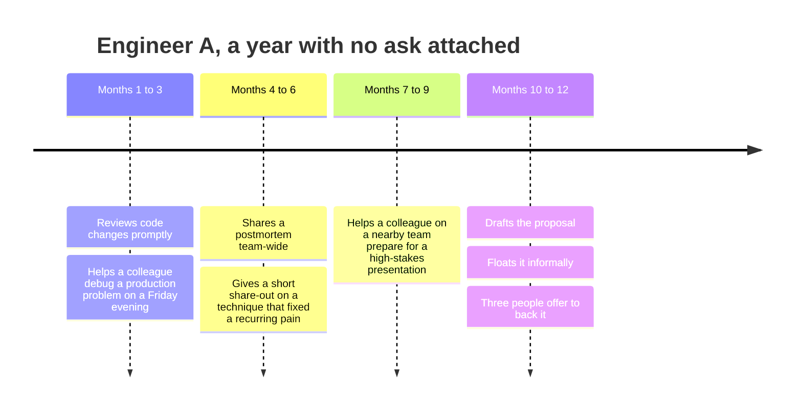
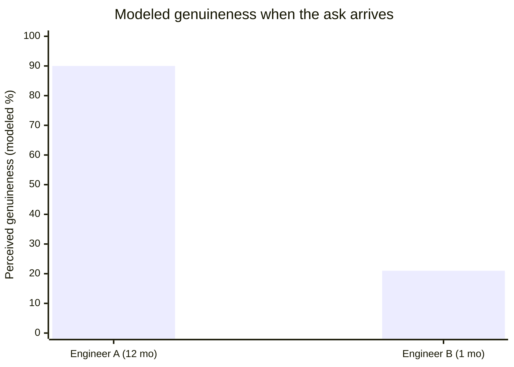

import Scenario from "../../../components/Scenario.astro";
import LevelIntro from "../../../components/LevelIntro.astro";
import Checkpoint from "../../../components/Checkpoint.astro";
import PracticeCheck from "../../../components/PracticeCheck.astro";

export const unit = {
  track: "corporate-politics",
  unitSlug: "white",
};

<Scenario label="The scenario">
  <Fragment slot="facts">
    
Both engineers

    

      
🎯 Same eventual goal: propose a big architecture change

      
✅ Every conversation honest, no lies, no manipulation

    

    
Engineer A

    

      
📅 12 months, help spread out, no immediate ask

      
🙋 3 unprompted backers when the proposal drops

    

    
Engineer B

    

      
📅 Months 1 to 9 within own team; outreach only in month 10

      
😐 Lukewarm reception, "networking with an agenda"

    

  </Fragment>

Engineer A and Engineer B both want to propose and lead a significant
architecture change, the kind that needs real organizational trust behind it
to get adopted, per `power-real-resource`'s adoption pipeline. Neither says
anything untrue or manipulative in any single conversation, at any point in
the year.

**Watch how they spend the year differently, and predict before reading on: if
both are equally honest throughout, what single variable can still produce two
completely different receptions?**

</Scenario>

<LevelIntro
  items={[
    "A year of legitimate investment, month by month",
    "Why the compressed version fails without any dishonesty",
    "Failure modes and how far the model generalizes",
  ]}
/>

## What does a year of legitimate investment look like?

Is it a plan, or just a habit? For Engineer A it is closer to a habit, and it
happens to produce four visible things.

A **PR** is a proposed code change that someone else reviews; **debugging**
means finding and fixing the cause of a problem; a **production issue** is a
real problem affecting the live service. A nearby team is one whose work
touches yours.

The important move in months 4 to 6 is not "look at me." It is "here is what
happened, what we learned, and how others can avoid the same problem." That
makes A's judgment visible to people outside A's team for the first time,
without inventing credit.

By months 10 to 12 the three backers are the Friday colleague, someone who
read the postmortem, and the presentation colleague. Each has their own
genuine reason to trust A's judgment, and each offers support independently.

<PracticeCheck
  track={unit.track}
  unitSlug={unit.unitSlug}
  topicId="year-of-investment"
/>

## Why did the same goal land so differently for Engineer B?

**Months 1 to 9:** B does solid work, kept mostly within their own team, with
no particular effort toward visibility or cross-team relationships. **Month
10:** realizing a big proposal is coming, B schedules coffee chats with several
people B has not had much relationship with, each steering quickly toward B's
upcoming proposal. **Month 11:** B shares the proposal. Several of those people
do not object but do not advocate, and one privately says it felt like
"networking with an agenda."

<Checkpoint question="Every one of B's chats was honest, and B did want better relationships, not just votes. Why did the outreach still read as 'networking with an agenda'?">

Because neither reciprocity nor the transparency test is about any single
conversation being honest. They are about the pattern across time. B's outreach
was compressed into the month right before the ask, which makes the whole
pattern legible as aimed at that ask, however genuine each chat felt. Per L2's
table, help that arrives suspiciously close to an ask is recolored as
transactional even when nothing said was false. The giveaway is not a lie; it
is the absence of months of daylight.

</Checkpoint>

Side by side, the two years are identical on every honesty measure and
completely different on one dimension:

| &nbsp;                               | Engineer A                           | Engineer B                              |
| ------------------------------------ | ------------------------------------ | --------------------------------------- |
| Any dishonest statement, ever?       | No                                   | No                                      |
| Months of investment before an ask   | About 12                             | 1 (outreach and ask in adjacent months) |
| Help framed as help, or as outreach? | As help, no ask attached at the time | As outreach, steered toward the ask     |
| Reception when the ask arrives       | 3 unprompted backers                 | Polite, lukewarm, one private remark    |

Using this unit's teaching model from L2 (15% base, plus 6.25 points per month
of daylight, capped at 12), A's 12 months read at 90% and B's 1 month at 21%.
It is a model of direction, not a measurement of any real office.

The transparency test makes it precise. A could fully explain the pattern ("I
invest in helping colleagues because it is the right way to work, and yes, it
also means people trust my judgment when I need that trust") and none of it
would stop working. B's compressed, ask-adjacent outreach reads differently
once its timing is visible, even though B said nothing false.

<PracticeCheck
  track={unit.track}
  unitSlug={unit.unitSlug}
  topicId="pattern-over-statement"
/>

## What can go wrong, and where does the model stop?

**What would a careful reader still get wrong after this example?** Four
failure modes.

- **Starting only once you need it.** B's mistake was timing, not dishonesty.
  The same actions spread across years would read completely differently,
  because reciprocity depends on not being tightly coupled to a visible payoff.
- **Avoiding visibility out of discomfort.** Sharing real, useful work
  accurately is making true information available. Avoiding it just means good
  work stays invisible to the people who could trust it.
- **Confusing "genuine" with "unstrategic."** A plausibly understood that this
  pattern builds trust over time. Genuine and strategic are not opposites; the
  test asks whether the mechanism needs the other person not to understand it.
- **Assuming a guaranteed outcome.** Unprompted support is a plausible result,
  not a certainty. Legitimate influence-building improves the odds that a good
  proposal gets a fair hearing; it does not rescue a proposal that is wrong.

<Checkpoint question="A's choices were not random acts of kindness with zero awareness of their broader value. Does that make A just as calculating as B, only spread over more months and better disguised?">

No. Spreading a tactic over more time does not change whether it depends on
concealment, and that is the actual test, not how much self-awareness someone
had. A could explain the reasoning behind every month and none of it would
stop working once said aloud. B's outreach reads differently because of its
compression into one month before the ask, a difference in pattern and timing
and not in how well either engineer understood their own motives. Awareness of
a mechanism's benefits does not make it fake.

</Checkpoint>

<PracticeCheck
  track={unit.track}
  unitSlug={unit.unitSlug}
  topicId="limits-and-failure-modes"
/>

## Beyond this example

This is one case, not the whole territory. A and B are two points on a range;
the same model applies wherever someone will eventually need backing.

  🏗️ This architecture proposal
  &rarr;
  💼 Whatever you're building toward right now

- What if A's year had gone almost unnoticed, with no postmortem getting
  attention and no presentation landing well? Does reciprocity still work if
  the visibility half never lands, or is A in the same place as someone who
  did good work with no influence beyond their immediate circle?
- B was late and compressed, not malicious. What would the same one-month
  outreach look like from someone who really was manipulative, picking targets
  by formal power alone with no intention of reciprocating? Would the outward
  pattern look different from B's, or just take longer to become visible?
- Think of a real ask you will eventually need to make: a promotion case, a
  proposal, a request for public support. How many months of genuine,
  no-strings investment do you currently have banked with the people whose
  backing you would need, and is there time to close the gap before the ask?
