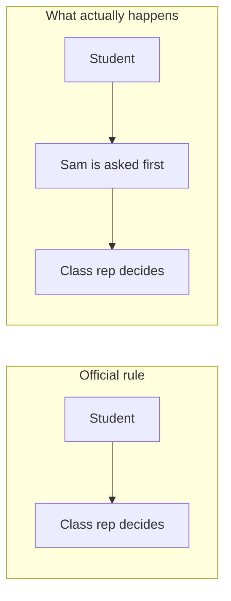

import Scenario from "../../../components/Scenario.astro";
import LevelIntro from "../../../components/LevelIntro.astro";
import PracticeCheck from "../../../components/PracticeCheck.astro";

export const unit = {
  track: "corporate-politics",
  unitSlug: "who-holds-influence",
};

<Scenario label="Where does the class eat? The list says one thing, the room does another.">
  <Fragment slot="facts">
    

      
Illustrative numbers: the last 5 group choices in one class

      

        

          Class rep decided
          5 of 5
        

        

          

        

      

      

        

          Sam was asked first
          4 of 5
        

        

          

        

      

      
📋 <strong>Official rule</strong>: the class rep chooses

      
👂 <strong>Real habit</strong>: the rep checks with Sam before choosing

    

  </Fragment>

A class of twenty-five has to pick a restaurant for the end-of-term outing. The
posted rule is simple: the class rep decides. Yet every time a choice comes up,
the rep quietly turns to Sam, who has no title and no vote, and asks, "What do
you think?" When Sam says "that place is too slow for a group," the rep
crosses it off. A newcomer who writes a long, careful message to the rep
about a restaurant gets no reply. A classmate who mentions the same place to
Sam at lunch hears back by the afternoon.

**The posted rule was followed correctly and still did not work. Where was the
choice really being made?**

</Scenario>

The rule shows who is allowed to decide. It does not show whose opinion the
decider checks first. Organizations at work have the same two layers: an
official one on paper and a real one in practice.

<LevelIntro
  items={[
    "The formal chart vs. the informal network",
    "Why influence does not follow title",
    "The skill of mapping who shapes a call",
  ]}
/>

## What is the difference between the two charts?

**If both layers exist at once, what exactly is each one recording?**

The same pattern appears at work. A formal org chart records reporting lines:
who approves your time off, who writes your review, whom you escalate to. It
was never designed to record whom a decision-maker consults, trusts, or defers
to before making a call.

|                  | Formal org chart              | Informal decision network                       |
| ---------------- | ----------------------------- | ----------------------------------------------- |
| What it shows    | Who reports to whom           | Whose judgment a decider checks before deciding |
| How it is set    | Assigned by title, documented | Built through repeated, observed good judgment  |
| Where to find it | Org chart tool, HR system     | By watching who is consulted, cited, and cc'd   |

Both charts are real, and neither is the "fake" one. They answer different
questions, and the skill is knowing which one governs the decision in front of
you.

<PracticeCheck
  track={unit.track}
  unitSlug={unit.unitSlug}
  topicId="two-charts"
/>

## Does influence follow title?

**Maya writes a careful infrastructure proposal and sends it up the chain, from
her manager to the director. Three weeks pass with no reply. A teammate has a
short chat with an engineer on another team, someone with no reports and no lead
title, and the director approves a similar change within days. What did the
teammate have that Maya did not?** (The three weeks and "within days" are
illustrative.)

The engineer was not on the director's chain at all. But the director had
learned, over years of infrastructure calls that kept turning out right, to
weigh that engineer's judgment. Trust like that is built through repeated
interaction, not assigned by a title, so it can sit with someone who has no
authority on paper, and it usually sits in one category of decisions, not all of
them.

Three consequences follow:

- A stalled proposal does not mean the idea was bad. The formal channel may
  simply not be where this kind of decision is judged.
- The informal network is not a flaw. It is what trust looks like when it forms
  by experience and not by assignment.
- The skill this unit builds is observing and mapping who shapes a given kind of
  decision. The goal is not bypassing legitimate process. It is knowing where a
  decision is really made.

<PracticeCheck
  track={unit.track}
  unitSlug={unit.unitSlug}
  topicId="influence-vs-title"
/>
