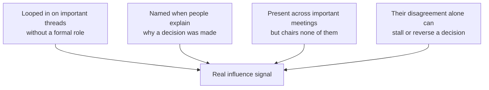
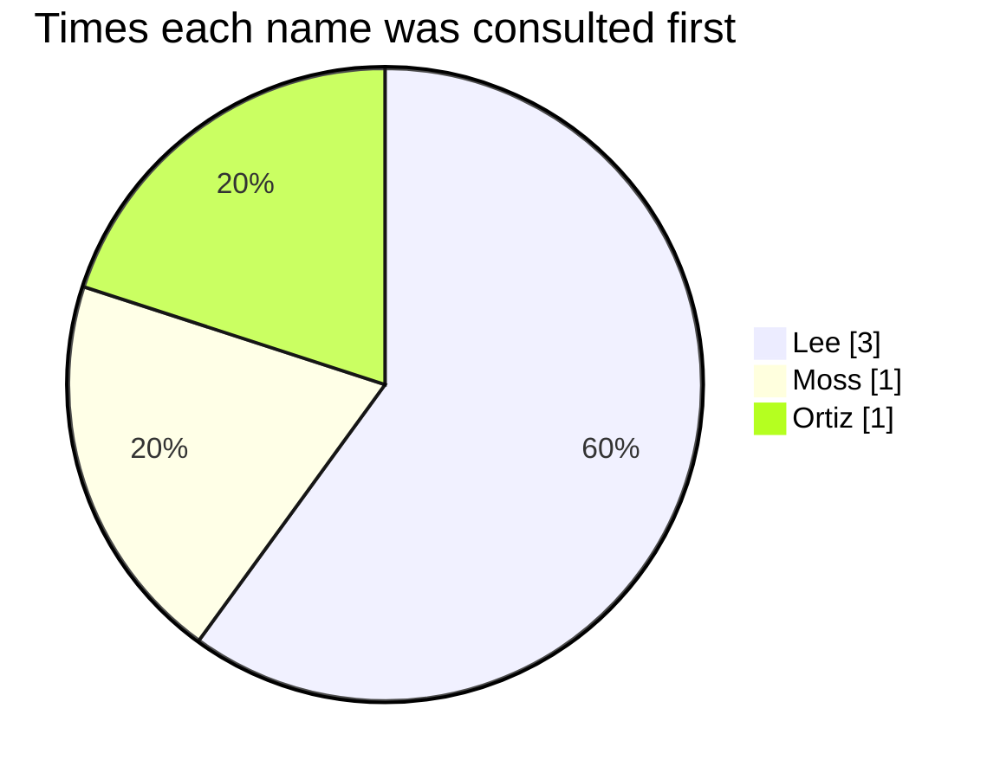
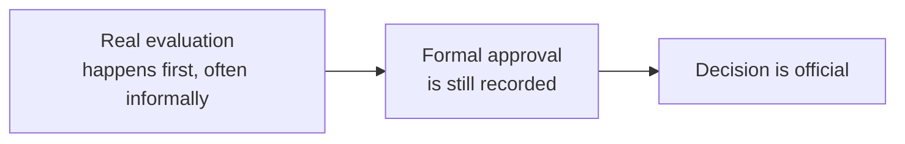

import LevelIntro from "../../../components/LevelIntro.astro";
import Checkpoint from "../../../components/Checkpoint.astro";
import PracticeCheck from "../../../components/PracticeCheck.astro";

export const unit = {
  track: "corporate-politics",
  unitSlug: "who-holds-influence",
};

L1 showed that the official chart and the real decision network can be two
different maps of the same organization. This level gets concrete: what the
informal network looks like when you go looking for it, and how to trace it
yourself without guessing.

<LevelIntro
  items={[
    "The four observable signals",
    "Tracing the last three decisions",
    "A map to use, not to exploit",
  ]}
/>

## If nothing is written down, how do you find the network?

It is invisible on every chart, but it is not invisible in practice. Influence
leaves four consistent traces in how decisions happen:

Plain terms: to be looped in or cc'd is to be included in a conversation without
owning it. A thread is a written conversation. To chair a meeting is to officially
lead it. One trace alone can have an innocent cause. Several landing on the same
person are hard to explain any other way.

<Checkpoint question="Someone is invited to every planning meeting but never speaks, is never named when a decision is explained, and has never changed an outcome. Do the four signals count them as influential?">

No. Attendance by itself is not one of the signals. The signals describe what
happens around a person's involvement: being included in threads they do not
own, being named as a reason, appearing across meetings without leading them,
or being able to stall a call. A silent, uncited, outcome-neutral presence
satisfies none of them. The signals exist to separate "in the room" from "their
judgment shapes what happens in the room."

</Checkpoint>

<PracticeCheck
  track={unit.track}
  unitSlug={unit.unitSlug}
  topicId="four-signals"
/>

## Rather than guessing, what is a doable way to check?

**Pick the last three significant decisions in your area. For each, write down
not who signed off but who was actually consulted before it was made.** The
table below uses invented names and decisions to show the shape.

| Decision                 | Formally approved | Actually consulted first |
| ------------------------ | ----------------- | ------------------------ |
| Switch a test vendor     | Director A        | Lee, Moss                |
| Reorganize two teams     | VP                | Lee, Ortiz               |
| New service architecture | Director A        | Lee                      |

Lee appears in 3 of 3 consulted lists, while Moss and Ortiz appear once each,
and the formal approvers differ. A name repeating across otherwise unrelated
decisions is the strongest signal this exercise can produce. It is not a
one-off relationship. It is a consistent pattern of being checked before a call
is made.

The same exercise works outside a company. List the last three decisions in a
class project, club, or family business and write whose opinion people checked
before the choice felt safe.

<PracticeCheck
  track={unit.track}
  unitSlug={unit.unitSlug}
  topicId="trace-three"
/>

## Once you can see the network, what is a legitimate use for it?

**Is this just "build relationships with important people"?** No. The exercise is
diagnostic, not aspirational. It tells you where evaluation really happens for a
kind of decision, so you know whether to take your case through the formal channel,
an informal conversation first, or both.

<Checkpoint question="A colleague decides the lesson is to book coffee chats with everyone the trace turns up, even when there is no proposal to discuss. Is that the skill described here?">

No. The map answers where a real case should be evaluated. Scheduling chats with
influential people regardless of any proposal is the aspirational, networking
version, and it uses access as a substitute for merit. The map is the same
either way. What separates healthy use from misuse is whether the case itself is
sound and whether the formal process is still respected afterward.

</Checkpoint>

| Use of the map                                                  | Healthy?                  |
| --------------------------------------------------------------- | ------------------------- |
| Share a sound draft early with people who shape the call        | Yes, it improves the case |
| Ask the same people to find flaws before the formal review      | Yes                       |
| Win favor regardless of whether the case has merit              | No, it replaces substance |
| Route around the people whose approval you are supposed to earn | No, it dodges evaluation  |

To curry favor means to win someone over with flattery or favors instead of the
strength of the case. Mapping influence is legitimate when it brings better
feedback and the formal decision is still respected. It turns unhealthy when it
becomes a way to avoid the people or standards that should still judge the work.

<PracticeCheck
  track={unit.track}
  unitSlug={unit.unitSlug}
  topicId="map-not-strategy"
/>
