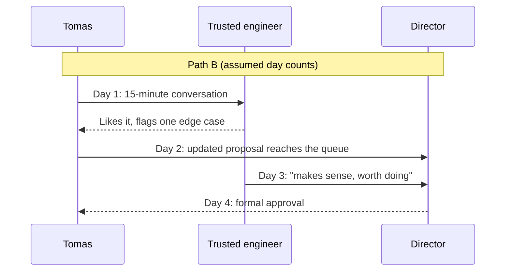
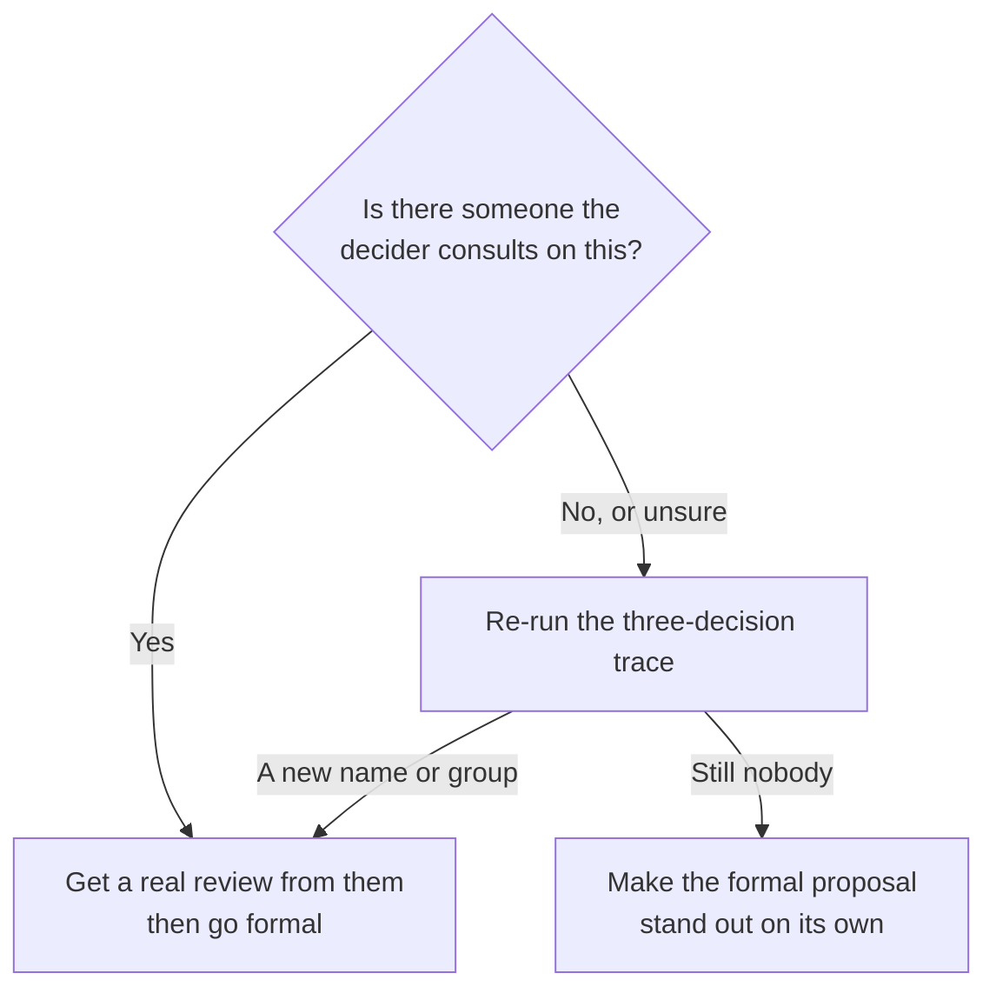

import Scenario from "../../../components/Scenario.astro";
import LevelIntro from "../../../components/LevelIntro.astro";
import Checkpoint from "../../../components/Checkpoint.astro";
import PracticeCheck from "../../../components/PracticeCheck.astro";

export const unit = {
  track: "corporate-politics",
  unitSlug: "who-holds-influence",
};

<Scenario label="Same proposal, same director, 21 days vs. 4">
  <Fragment slot="facts">
    

      
Assumed timings for illustration

      

        

          Path A, formal chain only
          21 days, still waiting
        

        

          

        

      

      

        

          Path B, trusted check first
          4 days, approved
        

        

          

        

      

      
🔁 Both paths end at the <strong>same director's sign-off</strong>

    

  </Fragment>

Two engineers, Maya and Tomas, need the same change to their shared tooling. Maya
submits it through the documented chain and, 21 days later, has heard nothing.
Tomas starts with a 15-minute conversation with an infrastructure engineer
who has no title, and the director approves on day 4. **Before reading the
trace, predict: did Tomas skip the director's approval, or did he go through the
same director in a different order?**

</Scenario>

<LevelIntro
  items={[
    "Both paths traced side by side",
    "Why the same formal sign-off still happened",
    "What changes when the network shifts",
  ]}
/>

## What actually happened on each path?

Maya's path is exactly what the process describes: write a clear proposal, send
it to the manager, who forwards it to the director. Nothing in it is wrong. It
simply lands in a queue of a dozen similar requests, none prioritized and none
rejected. The director's real bottleneck is not reading. A bottleneck is the
narrow point that slows everything else, and here it is deciding which of many
requests deserves careful attention.

Tomas does not skip the director. He just does not start there.

The engineer found a real edge case the first draft missed, so the proposal got
better, not just faster. When it reached the director, it came already vetted,
meaning reviewed by someone the director has learned to trust. Day 4 minus day
1 is 3 days of working time after the conversation, against Maya's 21 days with
no answer.

|                            | Path A (Maya)                        | Path B (Tomas)                                 |
| -------------------------- | ------------------------------------ | ---------------------------------------------- |
| Formal approval needed     | Yes                                  | Yes, same step, same director                  |
| Who judged soundness first | Nobody, so the proposal sat unjudged | The trusted engineer                           |
| What the director saw      | One unvetted request among many      | A proposal a trusted person had already vetted |

The gap was not process. Both paths needed the same sign-off. The gap was that
Maya's path had no real evaluation upstream of the queue, and Tomas's did.

<PracticeCheck
  track={unit.track}
  unitSlug={unit.unitSlug}
  topicId="path-a-vs-b"
/>

<Checkpoint question="A new hire hears this and concludes: always skip your manager and go straight to whoever has informal influence. Where does that conclusion break?">

It breaks on the table above. Tomas went through the same director at the same
formal step as Maya. What he added was a real evaluation before that step, from
someone the director already trusted. The informal step is an addition to the
formal one, not a replacement. Advising someone to skip their manager confuses
the two, and it discards what actually closed the gap: a trusted check, not the
absence of a chain.

</Checkpoint>

## Extend the scenario: what happens when the network shifts?

**Six months later the trusted engineer moves to a different organization. Does
"loop in that engineer" still work?** Mechanically, no. The specific trust
relationship that made Tomas's path work is gone. But the underlying skill
survives: observe who currently gets consulted and whose name comes up when
decisions are explained, and repeat the three-decision trace from L2. The
informal network is a living structure, not a map you learn once. Someone else
may take on a similar role, or several people may, or a new working group that
did not exist before.

**A second question: what if no single person has yet built that kind of trust,
because the team is new or flat?** Then the formal channel may be the only real
evaluation that exists. The fix looks different: make the proposal itself
strong enough to earn priority on its own, since there is no informal vetting
step to lean on.

This is one case, not the whole territory. Try changing it yourself: what if the
decider were not a director but a committee that votes? What if the trusted
person disagreed with your proposal? What if the news you carried were bad news,
such as a delay, and not a request? Work out which parts of the two-path trace
still hold and which would need to be rebuilt.

<PracticeCheck
  track={unit.track}
  unitSlug={unit.unitSlug}
  topicId="network-shifts"
/>

<Checkpoint question="Six months after the engineer leaves, a colleague still tells new hires to just loop in that engineer. What is wrong with the advice, and what replaces it?">

The advice names a person instead of a method, so it expires the moment that
person leaves or changes roles. The transferable version is to repeat the
observation itself: notice who is looped in on the relevant threads now, whose
name comes up when decisions are explained, and who was actually consulted in
the last few decisions. That process keeps working even when the name it used to
point to does not.

</Checkpoint>

## Failure modes

| Failure mode                                           | What it gets wrong                                                                            |
| ------------------------------------------------------ | --------------------------------------------------------------------------------------------- |
| Treating the formal chain as the only evaluation step  | In many orgs a real evaluation happens first and the formal step ratifies it                  |
| Using the informal step to skip formal approval        | Both paths needed the director's sign-off. The informal step supplements, it does not replace |
| Mapping the network once and trusting it forever       | The network is built from trust, which shifts as people join, leave, and move                 |
| Courting influential people when the case has no merit | The map is diagnostic. The endorsement mattered because the judgment is reliable              |
| Concluding that a stalled proposal was a bad idea      | Maya's proposal was never evaluated, which is different from being judged poor                |
