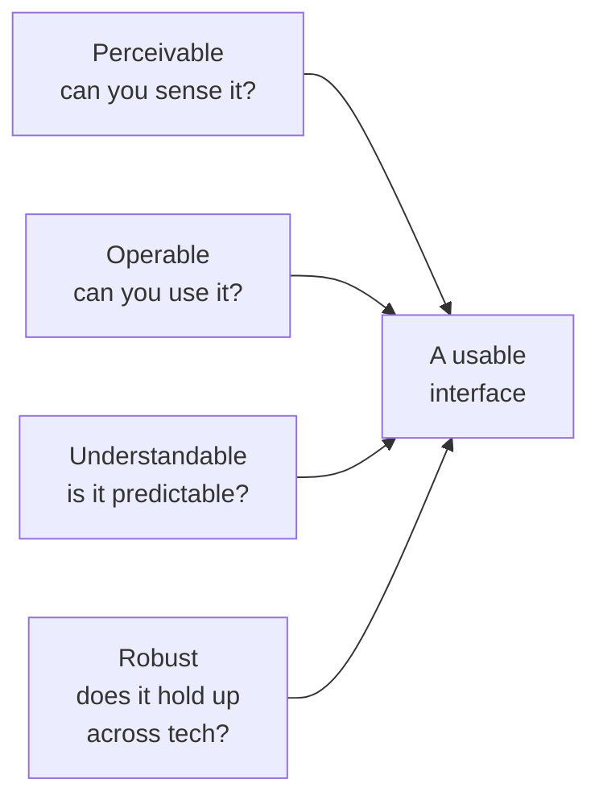
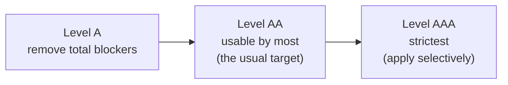

import Scenario from "../../../components/Scenario.astro";
import LevelIntro from "../../../components/LevelIntro.astro";
import PracticeCheck from "../../../components/PracticeCheck.astro";

export const unit = {
  track: "design",
  unitSlug: "accessibility-by-design",
};

<Scenario label="Three barriers, one checkout">
  <Fragment slot="facts">
    
Three barriers, one checkout

    

      
✕ <strong>Close button</strong> — icon only, no accessible name

      
🏷️ <strong>Email field</strong> — placeholder text used as the only label

      
🎨 <strong>Error text</strong> — light red on white, 2.3:1 contrast

    

    
Each barrier ships invisibly — the page looks completely normal on a screen with a mouse and good vision.

  </Fragment>

A team ships a checkout redesign. It looks great, QA signs off, launch goes fine — for a few weeks. Then support tickets start arriving: "I can't tell what this button does," "my screen reader just says 'button' over and over," "I can't read the error message, it's too faint." None of these are bugs in the usual sense — nothing crashed, nothing is `undefined`. The `×` button really is a button. The email field really does have a placeholder that says "Email." The error text really is red.

**If every element technically works, why can some people not complete checkout at all?**

</Scenario>

Because "works" quietly meant "works for one specific way of using a computer" — a mouse, full color vision, fine motor control, no assistive technology in the loop. The moment any of those assumptions stops holding, the same markup that passed QA becomes a wall.

<LevelIntro
  items={[
    "The four qualities every accessible interface needs (POUR)",
    "What different abilities actually need from a design",
    "WCAG conformance levels as a checkable claim",
  ]}
/>

## Why does a working checkout still lock people out?

**Is there a short list of questions that would have caught all three barriers before launch?** Yes. WCAG (the Web Content Accessibility Guidelines) files every requirement under four principles, nicknamed **POUR**:

| Principle          | Plain question                                                         | Fails when...                                                                                |
| ------------------ | ---------------------------------------------------------------------- | -------------------------------------------------------------------------------------------- |
| **P**erceivable    | Can it be sensed at all — seen, heard, or felt?                        | An icon-only button has no text alternative for a screen reader                              |
| **O**perable       | Can it be used without a mouse, or without fine motor control?         | A dropdown only opens on `mouseover`, with no keyboard equivalent                            |
| **U**nderstandable | Is the content and behavior predictable?                               | An error message says "Invalid input" with no hint what is actually wrong                    |
| **R**obust         | Does it keep working across browsers, zoom levels, and assistive tech? | A custom checkbox built from a styled `
` that no screen reader recognizes as a checkbox |

All four are load-bearing at once. The checkout fails Perceivable (icon button, faint error) and Understandable (a placeholder-as-label vanishes once you start typing) from two unrelated root causes.

<PracticeCheck track={unit.track} unitSlug={unit.unitSlug} topicId="pour" />

## Does "accessibility" mean one kind of user?

**Picture the person the checkout fails. Is it one person or several?** The usual mental image is a fully blind screen-reader user. That is one real case among several, each needing a different fix:

| Category                                      | What the person needs                                          | What design has to provide                                                   |
| --------------------------------------------- | -------------------------------------------------------------- | ---------------------------------------------------------------------------- |
| Visual (blind, low vision, color blindness)   | A way to perceive content without sight, or with altered sight | Text alternatives, sufficient contrast, meaning never carried by color alone |
| Auditory (deaf, hard of hearing)              | A way to get audio content without hearing it                  | Captions, transcripts, visual alerts instead of audio-only cues              |
| Motor (tremor, limited control, no mouse use) | A way to operate everything without precise pointing           | Full keyboard operability, large enough tap targets, no strict time limits   |
| Cognitive (memory, attention, reading)        | Predictable, simple, forgiving interactions                    | Clear language, consistent navigation, error messages that say what to fix   |

Map the checkout onto the table: the icon-only button hits Visual (no text alternative) and Cognitive (no plain-language cue), the placeholder-only label hits Cognitive (the hint vanishes exactly when it is needed), and the faint error hits Visual. One redesign, several unmet needs.

The same choices also help people who are not disabled at all: a sprained wrist, glare on a phone in the sun, a noisy room, a child on your lap. The World Health Organization estimates that well over a billion people live with some disability, before counting these situational and temporary cases.

**Why does "we'll add it later" fail?** Because accessibility is not one feature to bolt on. It is dozens of small decisions made on day one: is this a `<button>` or a `
`, does this color pass contrast, can this modal be left by keyboard. Retrofitting means reopening shipped components under a deadline nobody budgeted for, instead of making the same decision once, correctly.

<PracticeCheck
  track={unit.track}
  unitSlug={unit.unitSlug}
  topicId="ability-needs"
/>

## What does "accessible" mean as a claim someone can check?

**If a vendor says "our site is accessible," what could you ask them to prove it?** WCAG replaces the vibe with three **conformance levels**, each a stricter bar than the last:

| Level   | What it means                                                                 | Example criterion                     |
| ------- | ----------------------------------------------------------------------------- | ------------------------------------- |
| **A**   | Minimum: without it some users are completely blocked                         | Every image has alternative text      |
| **AA**  | The common legal and procurement target: usable for most assistive technology | Text contrast ratio of at least 4.5:1 |
| **AAA** | Strictest; rarely required site-wide because some criteria are very hard      | Text contrast ratio of at least 7:1   |

A good question to ask the vendor is "which level, against which WCAG version, and tested how?" Most organizations aim for **AA**; AAA is usually applied to specific high-stakes content rather than a whole brand palette, since 7:1 contrast alone rules out many color schemes.

<PracticeCheck
  track={unit.track}
  unitSlug={unit.unitSlug}
  topicId="conformance-levels"
/>
