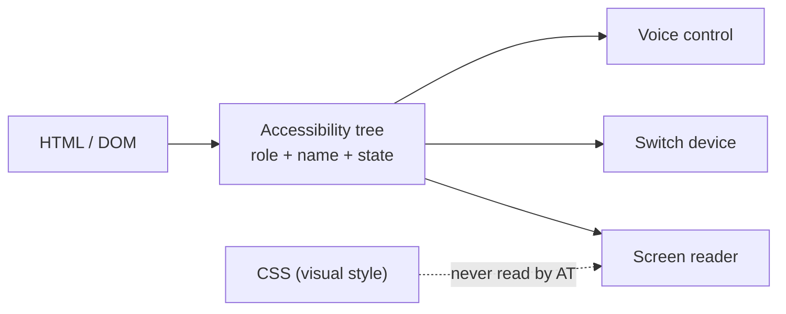
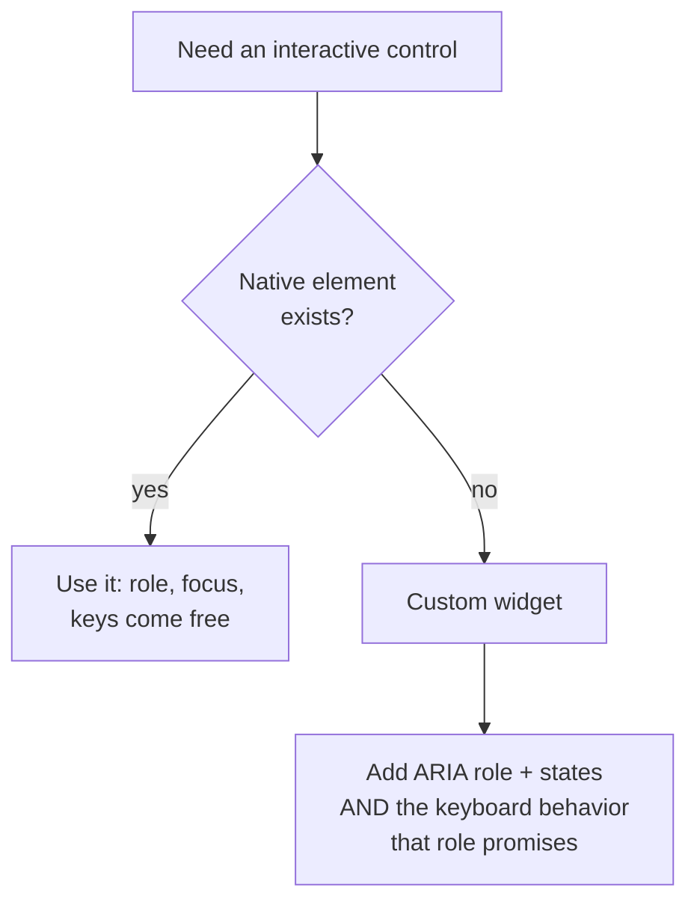

import Scenario from "../../../components/Scenario.astro";
import LevelIntro from "../../../components/LevelIntro.astro";
import Checkpoint from "../../../components/Checkpoint.astro";
import PracticeCheck from "../../../components/PracticeCheck.astro";

export const unit = {
  track: "design",
  unitSlug: "accessibility-by-design",
};

<Scenario label="Same pixels, different markup">
  <Fragment slot="facts">
    
Two "buttons"

    

      

        
&lt;div onclick&gt;Save&lt;/div&gt;

        
Screen reader hears: nothing clickable announced

      

      

        
&lt;button&gt;Save&lt;/button&gt;

        
Screen reader hears: "Save, button"

      

    

  </Fragment>

A designer hands off a mockup with a styled `
` that looks exactly like a button — right color, right padding, right hover state — and an engineer wires up an `onclick` handler on it. Visually, it is indistinguishable from a real `<button>`. It responds to a mouse click identically.

**A screen reader user tabs through the page. Do they ever land on this "button" at all?**

</Scenario>

They do not. A `
` is not focusable or interactive by default, so Tab skips straight past it, and even if a screen reader user landed on it, nothing would announce that it can be clicked. The pixels lied about what the element is.

L1 named the four qualities (POUR) and the needs behind them. This level asks what the machinery underneath actually reads, since that decides whether the Perceivable and Operable qualities are met.

<LevelIntro
  items={[
    "The accessibility tree: what assistive tech reads instead of pixels",
    "Native HTML first, ARIA only to patch a real gap",
    "Keyboard operation as the universal test",
  ]}
/>

## Where does "Save, button" come from?

**When a screen reader announces "Save, button," is it reading the CSS, the DOM, or something else?** Something else. The browser builds a parallel structure called the **accessibility tree**. For every element it computes a **role** ("button," "link," "checkbox"), an **accessible name** (the label a person would use to refer to it), and a **state** (checked, expanded, disabled). Screen readers, switch devices, and voice control read _that_ tree, never the CSS.

A native `<button>` gets `role: button` from the HTML spec automatically. A `
` gets a generic role, which is effectively nothing. Same pixels; one exists in the tree as an interactive control and the other does not.

Every interactive control needs all three properties, whatever markup produced it:

| Property            | Answers                                                         | Common failure                                                                                           |
| ------------------- | --------------------------------------------------------------- | -------------------------------------------------------------------------------------------------------- |
| **Role**            | What kind of thing is this? (button, checkbox, link, dialog...) | A clickable `
` with no role: announced as nothing interactive                                       |
| **Accessible name** | What do I call this when I refer to it?                         | An icon-only button with no text and no `aria-label`: announced as "button," full stop                   |
| **State**           | What condition is it in right now?                              | A custom checkbox that changes color when checked but never updates `aria-checked`: always "not checked" |

The browser follows a lookup order for the name: `aria-labelledby` wins outright, then `aria-label`, then an associated `<label>`, then the element's own text, then `title` as a last resort. One consequence: adding `aria-label` to a button that already has clear visible text overrides that text for screen reader users, so the two can end up saying different things.

<PracticeCheck
  track={unit.track}
  unitSlug={unit.unitSlug}
  topicId="a11y-tree"
/>

## If a `
` can be given a role, why not just do that?

**The specification itself says "no ARIA is better than bad ARIA." Why?** ARIA attributes (`role`, `aria-label`, `aria-expanded`, and more) exist to describe custom widgets that have no native HTML equivalent, like a tab panel or a combobox. They can retrofit a role onto a `
`, but then every behavior has to be rebuilt by hand:

| Behavior a real button gives you free | Retrofitted `
` must add by hand |
| ------------------------------------- | -------------------------------------------------- |
| Role "button"                         | `role="button"`                                    |
| Reachable with Tab                    | `tabindex="0"`                                     |
| Name from its own text                | Visible text or `aria-label`                       |
| Activates on Enter **and** Space      | A key handler covering both keys                   |
| Disabled state                        | `aria-disabled` plus ignoring input                |

Miss any row and you have a plausible-looking button that is silently broken. Adding `role="button"` without the keyboard behavior is worse than a plain `
`, because it _claims_ to be a button to assistive tech while failing to act like one.

<Checkpoint question="A component library ships a custom dropdown built from styled `
` and `` elements, with `role='listbox'` and `role='option'` added to each, and no keyboard handling. Is it more or less trustworthy to a screen reader user than the same dropdown with no ARIA at all?">

Less trustworthy. The roles make the accessibility tree claim this is a list that can be navigated with arrow keys and chosen with Enter, and the screen reader announces exactly that promise. When nothing responds to the keys, the user has been told how to use it and then fails. With no roles, at least no false expectation is set. An ARIA role is a contract about behavior, not just a label.

</Checkpoint>

<PracticeCheck
  track={unit.track}
  unitSlug={unit.unitSlug}
  topicId="native-first"
/>

## Why does "unplug the mouse" catch so many bugs at once?

**What single test reveals problems for keyboard-only users, screen-reader users, and switch users alike?** Trying the whole task with Tab, Shift+Tab, Enter, Space, and arrow keys. Keyboard operability is not only a motor concern: it is also _how screen readers navigate_. Anything that only responds to `mouseover` or a click with no keyboard equivalent is invisible to all of those users for the same reason, because none of them generate mouse events.

| Check         | Question                                        | Typical failure                                      |
| ------------- | ----------------------------------------------- | ---------------------------------------------------- |
| Reach         | Is every control in the Tab order exactly once? | A clickable `
` that Tab skips                   |
| Visible focus | Can you see where focus is at every step?       | `outline: none` with no replacement style            |
| Escape        | Can you leave every panel by keyboard?          | A keyboard trap: focus cycles inside with no way out |

<Checkpoint question="A settings panel opens as an overlay, and everything inside it is reachable and operable by keyboard. Does that alone show it is not a keyboard trap?">

No. A trap is about _leaving_. If Tab cycles endlessly through the panel's own controls and there is no Escape handling or path back to the page, a keyboard-only user can open the panel and then be stuck in it. The check has to include "and can I get back out," not just "can I use what is here."

</Checkpoint>

<PracticeCheck
  track={unit.track}
  unitSlug={unit.unitSlug}
  topicId="keyboard-test"
/>

L3 walks one real audit end to end: an icon-only button with no name, a modal that is not a real dialog, a contrast failure, and a placeholder standing in for a label.
