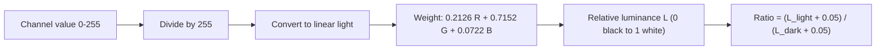
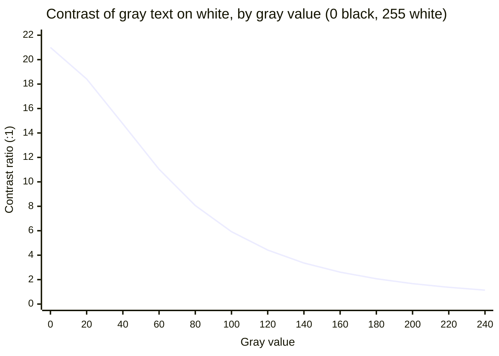
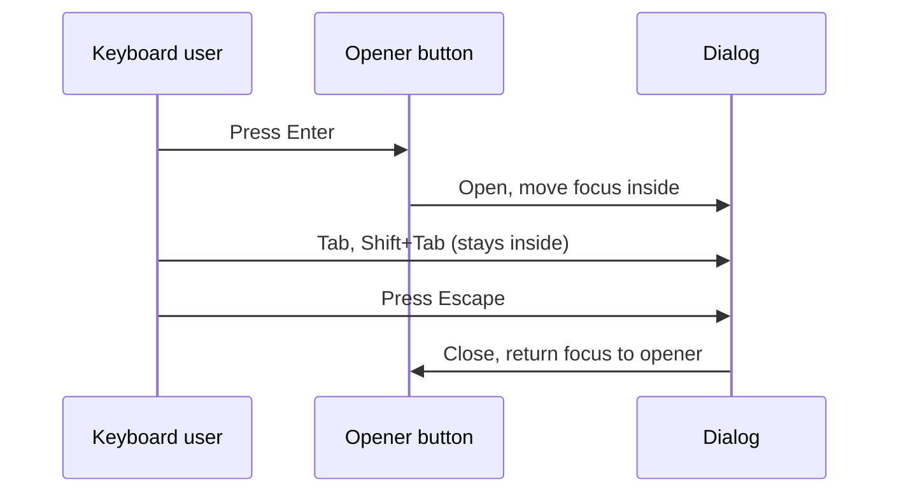
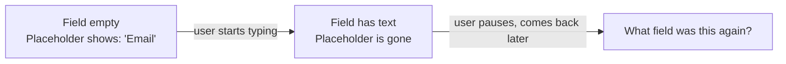

import Scenario from "../../../components/Scenario.astro";
import LevelIntro from "../../../components/LevelIntro.astro";
import Checkpoint from "../../../components/Checkpoint.astro";
import PracticeCheck from "../../../components/PracticeCheck.astro";

export const unit = {
  track: "design",
  unitSlug: "accessibility-by-design",
};

<Scenario label="The audit">
  <Fragment slot="facts">
    <p class="not-prose mb-1 text-xs font-semibold tracking-wide text-slate-400 uppercase">4 findings — "Notify me" signup modal</p>
    <div class="not-prose flex flex-col gap-1.5 text-sm text-slate-700 dark:text-slate-300">
      <div>1. Close button — no accessible name (Perceivable)</div>
      <div>2. Modal — no dialog role, no focus management (Operable)</div>
      <div>3. Error text — 2.3:1 contrast, fails AA (Perceivable)</div>
      <div>4. Email field — placeholder used as label (Understandable)</div>
    </div>
    <p class="not-prose mt-3 text-xs text-slate-500 dark:text-slate-400">All four passed visual QA and a mouse-driven manual test. None were caught until an audit tested with keyboard and a screen reader.</p>
  </Fragment>

A product team asks for an accessibility audit of a "Notify me when back in stock" modal before a launch. It looks finished: clean layout, on-brand colors, a close `×` in the corner, a single email field, inline validation. Manual QA — click through it with a mouse, check a few screen sizes — passed clean.

**The auditor's first move is not reading the code. It is unplugging the mouse and turning on a screen reader. What does that surface that a visual pass never would?**

</Scenario>

Four separate, unrelated failures, each invisible unless you test the exact thing it breaks. This level walks them the way the audit found them, with the numbers behind the one that is pure arithmetic.

<LevelIntro
  items={[
    "Contrast as arithmetic you can compute",
    "Dialogs: what the markup promises vs. what must be built",
    "Triage: ordering fixes by who is blocked",
  ]}
/>

## Why is "it looks readable to me" not a contrast test?

**The error text looks fine on the designer's monitor. How would anyone prove it fails?** By computing it. WCAG defines contrast as a ratio of the **relative luminance** of two colors: each color channel is converted from its stored value to linear light, the channels are weighted (green counts most), and the lighter and darker luminances are compared.



Worked on the finding. White has luminance 1. The audit's error red `#f28d8d` has luminance about 0.40, so its ratio is (1 + 0.05) / (0.40 + 0.05), roughly 2.3. The fix `#c02626` has luminance about 0.127, giving 1.05 / 0.177, roughly 5.9.

| Element             | Foreground | Background | Ratio   | AA text (4.5:1)? |
| ------------------- | ---------- | ---------- | ------- | ---------------- |
| Error text (before) | `#f28d8d`  | `#ffffff`  | 2.3 : 1 | Fails            |
| Error text (after)  | `#c02626`  | `#ffffff`  | 5.9 : 1 | Passes           |

The fix is not a markup change at all: same `<p class="error">`, just one color value. A "friendly" light red can look intentional and on-brand while sitting far too close to white in luminance.

How fast does the ratio fall as a gray text darkens or lightens on white? Not evenly, which is why eyeballing misleads:



Gray 118 (4.54:1) is the lightest gray that still passes AA for body text; gray 120 (4.42:1) already fails, and gray 89 (7.00:1) is the lightest that reaches AAA. Two grays that look nearly identical sit on opposite sides of the line. Large text (about 24 px regular, or about 18.7 px bold) only needs 3:1 at AA, and UI component boundaries and focus indicators also need 3:1.

<Checkpoint question="A designer picks body-text gray 120 on white because it looks the same as 118. By the numbers above, does it pass AA, and what does that say about checking by eye?">

It fails: 120 gives 4.42:1, just under the 4.5:1 line, while 118 gives 4.54:1. The two are visually indistinguishable, which is exactly why the check has to be computed. A threshold is a hard edge; perception is not.

</Checkpoint>

<PracticeCheck
  track={unit.track}
  unitSlug={unit.unitSlug}
  topicId="contrast-math"
/>

## Finding 1: what does the icon-only close button announce?

The auditor tabs to the close control and hears one word: **"button."** Not "close," not "dismiss." The name lookup from L2 ran out of places to look: no `aria-labelledby`, no `aria-label`, and the element's own text is empty, since an SVG's path data is not text.

```html
<!-- Before: no text for the name to fall back to -->
<button onclick="closeModal()"><svg viewBox="0 0 24 24">...</svg></button>

<!-- After: a name, and the decorative icon hidden from the tree -->
<button onclick="closeModal()" aria-label="Close">
  <svg viewBox="0 0 24 24" aria-hidden="true">...</svg>
</button>
```

The announcement becomes **"Close, button."** Visible text would help even more people (someone with low vision who cannot decode a small `×`); `aria-label` is the right tool when space truly does not allow text.

## Finding 2: why is a positioned `<div>` not a dialog?

Tab moves through the modal and then out into the page behind it. A sighted mouse user is blocked by the backdrop's CSS; a screen reader user navigates the accessibility tree, which CSS does not block.

| Layer             | What it must do                            | Who supplies it                                              |
| ----------------- | ------------------------------------------ | ------------------------------------------------------------ |
| Role and name     | Announce "Get notified, dialog"            | `role="dialog"` plus `aria-labelledby`, or native `<dialog>` |
| Modality          | Treat the page behind as unavailable       | `aria-modal="true"` hints; real blocking is behavior         |
| Focus in          | Move focus into the dialog on open         | Script, or native `showModal()`                              |
| Focus contained   | Tab and Shift+Tab stay inside              | Script, or native `showModal()`                              |
| Escape and return | Escape closes; focus returns to the opener | Script, or native `showModal()`                              |



The key point: `aria-modal` describes the _intended_ behavior but does not implement it. A native `<dialog>` opened with `showModal()` supplies the containment, Escape handling, and inert background itself, which is the same "native first" lesson from L2 applied to a bigger widget.

<Checkpoint question="A team adds `role='dialog'` and `aria-modal='true'` to the modal's `<div>` and ships. Focus still starts on the page behind it and Escape does nothing. Which of the five layers in the table did the markup actually cover?">

Only the first, role and name, plus a hint about modality. Focus in, focus containment, and Escape-and-return are behavior that someone has to build (or get free from a native `<dialog>`). The attributes tell assistive tech what to expect; they cannot make it true.

</Checkpoint>

<PracticeCheck
  track={unit.track}
  unitSlug={unit.unitSlug}
  topicId="dialog-focus"
/>

## Finding 4: why does a placeholder fail as a label?



A placeholder is a hint that disappears the instant there is content, which is exactly when anyone who looked away needs the reminder. Some screen readers announce placeholders inconsistently; it is never a substitute for a programmatic label.

```html
<label for="email">Email</label>
<input type="text" id="email" placeholder="you@example.com" />
```

The fix keeps the placeholder as a format _example_ and adds a real `<label>` tied to the input's `id`: always visible, found directly by the name lookup.

## Which finding do you fix first when you cannot fix them all?

**Four findings, one week before launch. What decides the order: effort, or who is blocked?** Who is blocked, and how completely.

| Finding                    | Blocks                                                   | Severity                                | Fix effort                              |
| -------------------------- | -------------------------------------------------------- | --------------------------------------- | --------------------------------------- |
| Close button has no name   | Screen reader users cannot tell what it does             | High: confusing, not fully blocking     | Trivial: one attribute                  |
| Modal is not a real dialog | Screen reader users wander into content the modal blocks | High: breaks the core interaction model | Moderate: role, state, focus management |
| Error text contrast        | Low-vision users may not perceive the error at all       | High: can fully block task completion   | Trivial: one color value                |
| Placeholder-as-label       | Anyone who pauses mid-form loses the field's identity    | Medium: recoverable, adds friction      | Trivial: one `<label>`                  |

Three of four fixes are a single attribute or color. The expensive part was never the fix; it was that none of the four showed up in a mouse-driven visual pass. That is the real cost of "later": finding the problems requires keyboard and assistive-tech testing that a deadline-driven QA pass skips unless someone built it in from the start.

<PracticeCheck
  track={unit.track}
  unitSlug={unit.unitSlug}
  topicId="audit-triage"
/>

**This modal is one worked case, not the whole territory.** The same four failure families (missing names, broken focus management, insufficient contrast, vanishing labels) appear in a sortable data table, a multi-step wizard, or a custom date picker. Extend it: if this had been a banking app's password-reset flow, used by an older population with more low vision and reduced fine motor control, would the priority order change, and which finding would you refuse to ship without? And if the error text had been an icon-only red circle with no text at all, which principle (and which row of the audit) would that fall under?
