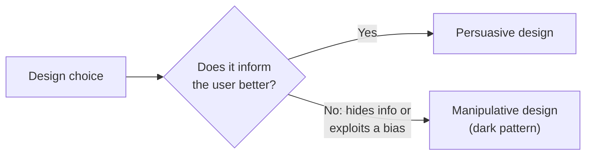

import Scenario from "../../../components/Scenario.astro";
import LevelIntro from "../../../components/LevelIntro.astro";
import PracticeCheck from "../../../components/PracticeCheck.astro";

export const unit = { track: "design", unitSlug: "dark-patterns-ethics" };

<Scenario label="Joining took one tap. Leaving took four pages. Nothing on them was a lie.">
  <Fragment slot="facts">
    

      

        
✍️ Join: 1 step

        

      

      

        
🚪 Leave: 4 pages

        

      

    

    

      
😔 Page 2 shames the decline button

      
🙈 The cancel link is tiny, grey and last

    

  </Fragment>

You want to cancel a streaming subscription. The "Cancel" button is not on the account page; it is under "Manage plan", then "Billing", then a submenu with no obvious name. When you find it, a full-screen page says **"Wait, are you sure? You'll lose everything you've watched."** There is a huge bright "Keep my subscription" button and a tiny grey "No thanks, cancel anyway" link. The next page offers a discount, and the one after demands a written reason before the final button appears.

Signing up took one tap. Cancelling took four pages. **Every sentence on those pages was true, so what exactly went wrong?**

</Scenario>

Each screen is defensible alone: a retention offer is normal marketing, a confirmation prevents accidents, feedback is common. The trouble is the whole flow: fast in the direction that helps the company, slow and discouraging in the direction that helps the user, without ever lying.

<LevelIntro
  items={[
    "Persuasion versus manipulation as a spectrum",
    "Six recurring dark-pattern families",
    "Informed consent as the dividing test",
  ]}
/>

## What separates persuasion from manipulation?

A "Recommended for you" row and a fake "Only 2 left!" counter both try to change what you do next. One is normal design, one is a dark pattern. **If both influence, what is the difference?**

|                                   | Persuasive design                               | Manipulative design (dark pattern)                             |
| --------------------------------- | ----------------------------------------------- | -------------------------------------------------------------- |
| Information shown                 | True, relevant, helps the decision              | False, hidden, or irrelevant to the decision                   |
| Who benefits if it works          | Both sides, roughly                             | Mostly the business, at the user's expense                     |
| Would it survive being disclosed? | Yes: "we highlight best-sellers" is fine to say | No: "we hid the cancel button on purpose" damages trust        |
| Effect on the next choice         | The user still decides freely                   | Exploits a bias (urgency, shame, sunk cost) the user can't fix |

The line is not "does it influence". Nearly all design does. It is **whether the influence informs the user better or degrades their ability to choose freely.**

**Informed consent** is the practical test: a user's "yes" (to a purchase, a subscription, shared data) counts only if it was given with accurate information, freely, and without engineered friction pushing one way.

<PracticeCheck
  track={unit.track}
  unitSlug={unit.unitSlug}
  topicId="persuasion-vs-manipulation"
/>

## Which recurring shapes should you learn to spot?

**A new product ships tomorrow with a flow nobody has catalogued. How do you recognize a dark pattern in it?** By its family. Each family leans on one weakness, and new products keep inventing new surfaces for the same few moves.

| Family            | What it does                               | Weakness it leans on          |
| ----------------- | ------------------------------------------ | ----------------------------- |
| Roach motel       | Easy to get in, hard to get out            | Effort and fatigue            |
| Confirmshaming    | Guilt-trips the label of the "no" option   | Social shame                  |
| Forced continuity | Silently converts a trial into a paid plan | Forgetting                    |
| Hidden costs      | Shows the real price only at the last step | Sunk effort                   |
| Trick questions   | Wording flips the answer the user expects  | Misreading under time         |
| Nagging           | Repeats the ask until the user gives in    | Persistence wears people down |

In the opening story, the one-tap join and four-page exit is a roach motel, and the "No thanks, cancel anyway" wording is confirmshaming. Several of these are now directly regulated in many places, because a manipulated yes is not treated as real consent. Rules differ by jurisdiction and change over time, so check the current position before relying on any summary.

<PracticeCheck
  track={unit.track}
  unitSlug={unit.unitSlug}
  topicId="pattern-families"
/>
