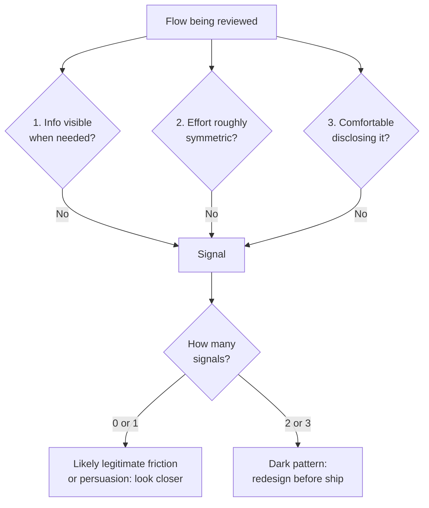

import Scenario from "../../../components/Scenario.astro";
import LevelIntro from "../../../components/LevelIntro.astro";
import Checkpoint from "../../../components/Checkpoint.astro";
import PracticeCheck from "../../../components/PracticeCheck.astro";

export const unit = { track: "design", unitSlug: "dark-patterns-ethics" };

L1 named the families and drew a line between persuasion and manipulation. L2 works out how to place a design on that line before it ships, instead of recognizing manipulation after the fact.

<LevelIntro
  items={[
    "A three-question test a design review can run",
    "Why one failed question is a signal, not a verdict",
    "How a growth metric quietly turns a nudge into a trap",
  ]}
/>

## Why does a flow with a "reminder" still feel wrong?

<Scenario label="The reminder did go out. So why does this feel like a line was crossed?">
  <Fragment slot="facts">
    

      
🏋️ Gym app: 7-day free trial, card required up front

      
📧 One reminder, sent 40 minutes before the trial ends (0.4% of the 7 days)

      
💳 First charge: the annual plan, 240 (a monthly equivalent of 20)

    

  </Fragment>

A fitness app offers a free 7-day trial and asks for a card up front, which is normal. On day 7 it sends exactly one email, 40 minutes before the trial converts. The subject is a generic "your trial is ending soon!", so it lands in the promotions tab. The card is then charged the full annual price of 240, not the monthly 20, with no refund window.

Taking assumptions as given: the trial is 7 days, which is 10,080 minutes, so a 40-minute warning covers 0.4 percent of it. **Every piece has a justification on its own. So why does the whole feel wrong?**

</Scenario>

The reminder exists, so this is not silent billing. But timing it to be missable, wording it not to read as billing, and charging the largest amount at the least refundable moment are three choices, all leaning the same way: away from the user noticing in time. One borderline choice might be an oversight. A cluster pointing one direction is a strategy.

<Checkpoint question="Is one reminder email, sent 40 minutes before the charge, enough to call the flow ethical because a reminder technically went out?">

No. What matters is what the reminder was built to do, not whether one existed. A plain "you will be charged 240 tomorrow" email, sent days earlier to the main inbox, would satisfy the same "we told them" claim while letting people act on it. The 40-minute window, vague subject and promotions-tab placement keep the technical disclosure while minimizing the chance anyone reads it in time. That is the same outcome as no disclosure, with an alibi attached.

</Checkpoint>

## What three questions can a review ask before shipping?

**Naming a pattern afterwards is easy. What test can run before launch?** Ask three questions of any flow that asks a user to say yes, pay, share data or leave:

| #   | Question                                                           | Fails when                                                               |
| --- | ------------------------------------------------------------------ | ------------------------------------------------------------------------ |
| 1   | Is the information visible at the moment the user decides?         | It is buried in terms or timed after the window closes                   |
| 2   | Is the effort roughly symmetric between the two choices?           | One path is a click, the other is four screens                           |
| 3   | Could the team say the mechanism out loud to the users it targets? | Saying it ("we time the reminder to be missed") sounds like an admission |

One "no" is a signal, not a verdict: a delete confirmation adds friction that protects users from mistakes, which is not the shape of a cancel flow with a shamed decline. **Two or three "no" answers together** mark a dark pattern.

<PracticeCheck
  track={unit.track}
  unitSlug={unit.unitSlug}
  topicId="three-question-test"
/>

## How does a growth target push a team across the line?

**Nobody sets out to build a trap, so how do they get built?** Usually through a legitimate number. A team measured on "retained subscribers" proposes making cancelling "3 screens instead of 1, to give people a chance to reconsider".

<Checkpoint question="Using the three-question test, what is the real concern with calling the extra cancel screens 'a chance to reconsider'?">

That label assumes the screens inform the user better, and the test shows that depends entirely on what they say. If they present new, true facts, such as unused benefits or a real cheaper plan, question 1 is met and it is legitimate persuasion. If they only repeat "are you sure?" with rising discouragement, effort is now asymmetric (question 2 fails) purely to protect a number, and a team that would not say "we added friction to hit our retention figure" aloud (question 3 fails) is describing a dark pattern with a friendly name.

</Checkpoint>

| Why the number went up                   | What the dashboard shows | What the three questions show         |
| ---------------------------------------- | ------------------------ | ------------------------------------- |
| A real cheaper plan was offered          | Retention up             | Information added, effort unchanged   |
| The cancel link moved three menus deeper | Retention up             | Information hidden, effort asymmetric |

A review that asks only "did the metric move?" waves through both rows. The three questions are what separate a better offer from a harder exit.

<PracticeCheck
  track={unit.track}
  unitSlug={unit.unitSlug}
  topicId="metric-pressure"
/>
