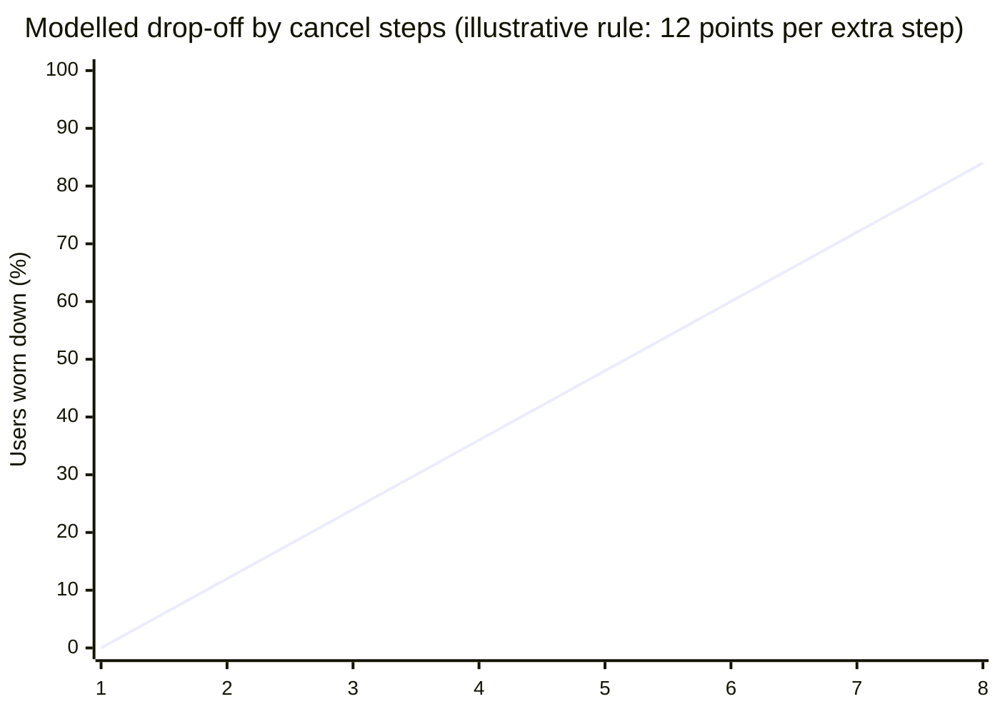
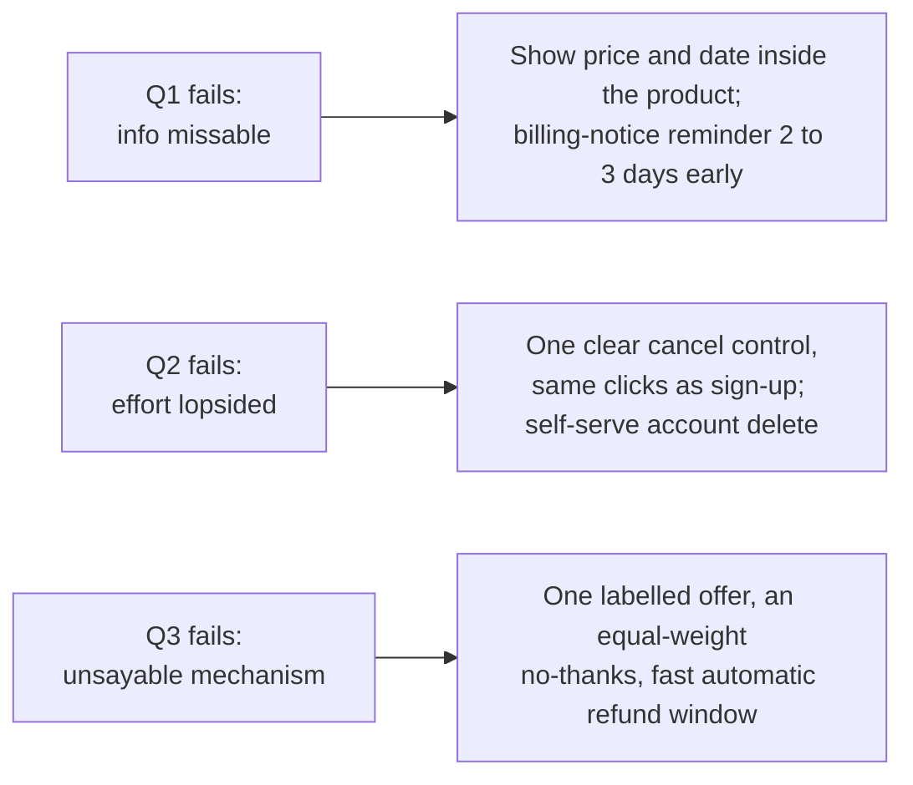

import Scenario from "../../../components/Scenario.astro";
import LevelIntro from "../../../components/LevelIntro.astro";
import Checkpoint from "../../../components/Checkpoint.astro";
import PracticeCheck from "../../../components/PracticeCheck.astro";

export const unit = { track: "design", unitSlug: "dark-patterns-ethics" };

L1 gave the vocabulary and L2 the three-question test. L3 runs the test on three invented but typical flows, measures how lopsided each one is, redesigns each, and then asks where regulators come in. The flows are described so they can be recognized and avoided, not copied.

<LevelIntro
  items={[
    "Measuring how lopsided a flow is",
    "Redesigning each failed question",
    "Why regulators describe the shape of a flow",
  ]}
/>

## Case 1: how lopsided is a cancel flow?

<Scenario label="Joining takes 2 steps. Leaving takes 4. Is that already a problem?">
  <Fragment slot="facts">
    

      

        
🖱️ Join: 2 steps

        

      

      

        
🚪 Leave: 4 steps, ratio 2.0

        

      

    

    
🪫 Modelled drop-off at 4 steps: 36% (an assumption, see the demo)

  </Fragment>

A streaming service lets you join in 2 steps. To leave you walk through 4 steps: find the control under account settings, see a retention offer, see a second "are you sure?" page, and confirm. Each page contains only true statements. **Is 4 steps against 2 a dark pattern, or just a careful flow?**

</Scenario>

The useful measure is the **exit-to-entry ratio**: cancel steps divided by sign-up steps, here 4 divided by 2, which is 2.0. The L2 slider demo models the share of users who give up and stay subscribed, not because they changed their mind but because the flow wore them down. Its rule is an assumption for exploring the idea, not measured data: 12 percentage points for every step beyond the first, capped at 85.

| Cancel steps | Ratio (sign-up is 2) | Modelled drop-off |
| ------------ | -------------------- | ----------------- |
| 1            | 0.5                  | 0%                |
| 2            | 1.0                  | 12%               |
| 4            | 2.0                  | 36%               |
| 6            | 3.0                  | 60%               |
| 8            | 4.0                  | 84%               |

Run the three questions on the full flow:

| Question                      | This flow                                                                  |
| ----------------------------- | -------------------------------------------------------------------------- |
| 1. Info visible when needed?  | Partly: the offers are real, but the cancel control comes last and is tiny |
| 2. Effort symmetric?          | No: ratio 2.0                                                              |
| 3. Comfortable disclosing it? | No: "we put the real exit behind four pages" is an admission               |

Two fail and one partly fails. The offers being true does not rescue it, because questions 2 and 3 are about the structure around the offers, not their content.

<Checkpoint question="The team cuts cancelling from 4 steps to 2 but keeps the guilt-worded decline button. What changes in the test result?">

Question 2 now passes (ratio 1.0), but the label is still a confirmshaming lever, so questions 1 and 3 are not clean. Even at a ratio of 1.0 the demo's rule still models 12 percent drop-off, which is a reminder that symmetry is the floor of fairness, not proof that nobody is worn down. A single fix reduces the signals; it does not clear the flow.

</Checkpoint>

<PracticeCheck
  track={unit.track}
  unitSlug={unit.unitSlug}
  topicId="friction-asymmetry"
/>

## Case 2 and Case 3: what do the other two flows look like?

**Is every dark pattern a long cancel flow?** No. Two more shapes show the same structure with different weaknesses.

**Case 2, the trial that becomes a bill.** A software tool offers a 14-day trial with a card up front. The renewal date appears once, in the day-one welcome email. No second reminder is sent. On day 15 the full monthly price of 49 is charged, and refunds go through a support queue promising a reply in 5 to 7 business days. This is forced continuity: nothing false was said, but the timing of the cost was hidden.

**Case 3, the loyalty account.** A retail chain's rewards sign-up is one tap at the till. Deleting the account needs a phone call, weekdays 9 to 5, and a member ID that appears nowhere in the app. Open hours are 5 days times 8 hours, which is 40 of the 168 hours in a week, about 24 percent. This is a roach motel applied to personal data instead of money.

```mermaid
xychart-beta
    title "Actions to join versus actions to leave (as described above)"
    x-axis ["Case 1: cancel", "Case 2: trial exit", "Case 3: rewards"]
    y-axis "Actions" 0 --> 6
    bar [2, 2, 1]
    bar [4, 3, 3]
```

In the chart, the first bar series is joining and the second is leaving, using the counts given in each case: Case 1 is 2 against 4, Case 2 is entering an email and card against finding the setting, confirming and waiting for a refund, and Case 3 is one tap against finding the ID, calling in office hours and confirming by phone. Ratios: 2.0, 1.5 and 3.0.

<Checkpoint question="Adding a plain day-13 reminder ('you will be charged 49 tomorrow') to Case 2 fixes which question, and is the flow now clean?">

It fixes question 1, the core failure, because the price and date are now visible when the user can act. It does not make the flow clean: if cancelling still needs a hard-to-find setting while the charge stays one click away, question 2 still fails. The three questions are independent checks, so a flow has to clear all of them.

</Checkpoint>

## How does each failed question get redesigned?

**What does a redesign keep, and what does it remove?** It keeps true offers and reminders. It removes the structure that made them work against the user.

- **Cancel:** a single, clearly labelled control reachable in the same number of clicks as sign-up. A retention offer may appear once, labelled as an offer, with a real "no thanks" that is not shamed or shrunk.
- **Trial:** the renewal date and price live inside the product, and a reminder worded as a billing notice arrives 2 to 3 days before the charge. Refunds requested within 24 to 48 hours are automatic, because a slow queue quietly bets that the user missed the charge.
- **Rewards account:** delete from the same app where the user joined.

<PracticeCheck track={unit.track} unitSlug={unit.unitSlug} topicId="redesign" />

## When does it become a legal question?

**A team says "legal hasn't told us to stop, so it's fine". Why is that not a test?**

<Checkpoint question="What is wrong with treating 'not yet flagged by legal' as 'acceptable'?">

Enforcement is a slow, late detector. User harm and reputation cost start the day the flow ships, and "not yet flagged" usually means "not yet caught". The three questions let a team catch the problem in design review instead of waiting for a regulator to be the review process.

</Checkpoint>

Regulators in several places have moved from treating dark patterns as a vague ethical area to describing specific mechanisms: cancellation harder than sign-up, disclosure timed to be missed, and consent obtained through confusion. Exact rules, scope and status differ by jurisdiction and change over time, and rules can be overturned for how they were made. **A rule that is not currently enforceable is a different claim from "fine to ship"**, so check current guidance for the markets you ship in.

| Shape regulators describe               | Case that shows it | Question that checks it |
| --------------------------------------- | ------------------ | ----------------------- |
| Exit harder than entry                  | 1 and 3            | 2                       |
| Disclosure timed or worded to be missed | 2                  | 1                       |
| Consent obtained through confusion      | trick questions    | 1 and 3                 |

None of these require reading anyone's mind. They look at the structure of the flow, which is exactly what the three-question test inspects.

<PracticeCheck
  track={unit.track}
  unitSlug={unit.unitSlug}
  topicId="regulatory-shape"
/>

## The cases are not the whole territory

Everything above was a subscription or a loyalty account, where the harm of a hard exit is a wasted charge. **What changes if the user is trying to leave a support group, a mental-health app or a political mailing list, where the harm cannot be refunded?** Would the same three questions be enough on their own, or would such a flow deserve a stricter bar before it ships? Try extending the table above with a fourth case and a fourth question of your own.
