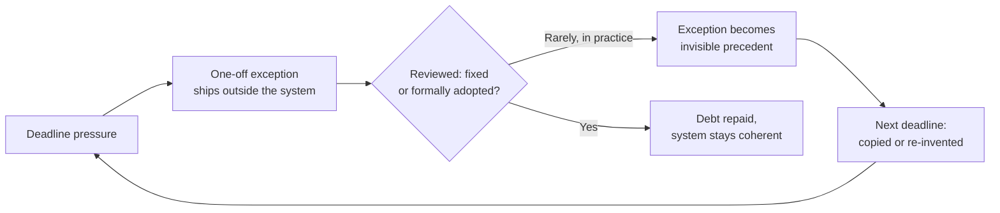

import Scenario from "../../../components/Scenario.astro";
import LevelIntro from "../../../components/LevelIntro.astro";
import PracticeCheck from "../../../components/PracticeCheck.astro";

export const unit = {
  track: "design",
  unitSlug: "design-debt-at-scale",
};

<Scenario>
  <Fragment slot="facts">
    

      

        37
        button implementations; the spec lists 3
      

      

        

      

      
34 of 37 (92%) are outside the spec

    

    

      
🗓️ System launched 4 years ago and was well adopted

      
🧩 34 extra variants, no single moment of failure

      
👻 11 of them: nobody on the team knows why they exist

    

  </Fragment>

Picture a shared shelf that started with exactly three official mugs. Every
time someone needed "a mug, but taller, just for this one event", they bought
one more and put it on the shelf. Nobody threw any away. Four years later the
shelf holds 37 mugs, the sign above it still says "3 mugs", and nobody
remembers why eleven of them are there.

That is Northwind Retail's button situation (an illustrative company, not a
real one). The system launched with three buttons, and the checkout
inconsistencies of year one disappeared within months. A new designer's
component audit now finds **37 button implementations**.

**Everyone agreed the system worked on day one. So how does a system that
worked get to 37 buttons, with no single moment anyone would call "where it
broke"?**

</Scenario>

<LevelIntro
  items={[
    "Design debt versus visual drift",
    "Four ways debt piles up over years",
    "Why governance must be a standing process",
  ]}
/>

## Is this the same problem a design system was meant to solve?

**If the system exists and is the source of truth, why is it still
inconsistent?** Because this is a different problem from the one the system
was built for. A design system prevents _accidental_ inconsistency: teams
reinventing a button because nothing shared exists. **Design debt** is what
builds up _inside_ a system that already exists, through many small,
individually justified departures from it.

| Term               | What it is                                                                   | When it shows up                               |
| ------------------ | ---------------------------------------------------------------------------- | ---------------------------------------------- |
| Visual drift       | Teams reinventing the same thing differently because no shared system exists | Before a system, or on screens it has not hit  |
| Design debt        | Deliberate exceptions and leftovers accumulating inside an existing system   | Years into a system, under sustained deadlines |
| Orphaned component | A component in the library that almost nothing still uses                    | Late-stage debt, the byproduct of unpaid debt  |

The word "debt" is deliberate. Each exception is a loan: it buys speed today
and charges interest later, in confusion and copy-paste. The problem is not
that debt exists, it is that nobody is scheduled to repay it.

<PracticeCheck
  track={unit.track}
  unitSlug={unit.unitSlug}
  topicId="debt-vs-drift"
/>

## How does debt actually pile up?

**Where does one "just this once" exception go after the deadline passes?**
Usually nowhere. It is forgotten, or worse, it gets copied: the next person
under pressure searches the codebase, finds it, and assumes it is sanctioned.

Four distinct mechanisms feed that loop:

| Mechanism             | What happens                                                                    |
| --------------------- | ------------------------------------------------------------------------------- |
| Unreconciled one-offs | A component built "just for this campaign" outlives it; nobody owns removal     |
| Orphaned components   | Pieces that shipped features have replaced stay in the library as false options |
| Governance decay      | The review step (a team, a lint rule, a sign-off) quietly stops being enforced  |
| Silent forking        | A squad copies a component locally to go faster; "later" never reconciles it    |

<PracticeCheck
  track={unit.track}
  unitSlug={unit.unitSlug}
  topicId="accumulation-modes"
/>

## What changes once the system is big?

For a small system, "governance" means the person who built it remembers
every decision. That stops working at scale. At scale governance is a
**standing process**: someone owns reviewing new exceptions, a written
threshold says when an exception becomes a first-class variant, and a regular
audit retires orphans before they become precedent.

Design debt does not mean the system failed. Any system under multi-year
deadline pressure accumulates some. What separates a coherent system from a
patchwork is whether something is paying the debt down on purpose, on a
schedule.
