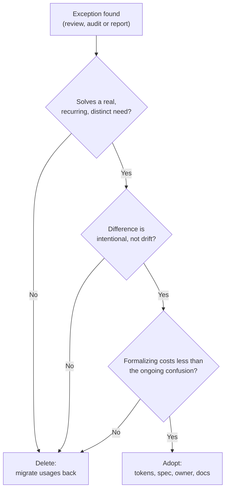

import Scenario from "../../../components/Scenario.astro";
import LevelIntro from "../../../components/LevelIntro.astro";
import Checkpoint from "../../../components/Checkpoint.astro";
import PracticeCheck from "../../../components/PracticeCheck.astro";

export const unit = {
  track: "design",
  unitSlug: "design-debt-at-scale",
};

L1 named four ways debt accumulates and said governance keeps it from
compounding. L2 works out what governance actually has to _decide_, because
"review every exception" is not an answer until there is a repeatable way to
sort exceptions into "keep" and "remove".

<LevelIntro
  items={[
    "The adopt-or-delete test",
    "Three governance models and their trade-offs",
    "Why orphans survive audits",
  ]}
/>

## Every exception needs one of two endings

<Scenario>
  <Fragment slot="facts">
    

      
🏷️ "Compact card" built for one promo, 14 months ago

      
📈 Now used on 9 screens across 3 squads

      
📋 Still no entry in the design system spec

    

  </Fragment>

A designer at Northwind, fourteen months ago, built a "compact card" for a
single promotional banner: smaller padding, no image, a different shadow. It
was left out of the spec because the plan was to remove it when the promo
ended. The promo ended. The card did not. It now appears on nine screens
across three squads, each of which found it by searching the codebase, saw it
in use elsewhere, and assumed it was approved.

**The card is not hidden; real teams use it. So why is "leave it, it is
clearly useful" still the wrong instinct?**

</Scenario>

Because usage does not tell you whether something is a good addition or a debt
that has spread. Nine screens on an unreviewed component show only that
unreviewed components get copied exactly like reviewed ones. The card needs a
decision, not more time to spread undecided.

## What is the test that forces the decision?

Every exception a review, audit or bug report surfaces ends in exactly one of
two outcomes. "Leave it as is" is not a third option: leaving it without a
decision is what produced the nine-screen spread.

| Question                                                                | Answer "no" means |
| ----------------------------------------------------------------------- | ----------------- |
| Does it solve a real, recurring need distinct from what already exists? | Delete            |
| Is its difference from the existing component intentional?              | Delete            |
| Does formalizing it cost less than leaving it informal?                 | Delete            |

Three "yes" answers mean **adopt**: tokens, a name, an owner and
documentation, like a component planned from the start. Any "no" means
**delete**: move its usages back to the existing component, however many
screens use it. A high usage count is not a reason to adopt; it is a sign the
decision is overdue.

<PracticeCheck
  track={unit.track}
  unitSlug={unit.unitSlug}
  topicId="adopt-delete"
/>

<Checkpoint question="The compact card passes the first two questions: the need is real and the difference is intentional. Formalizing it would take about two days (new tokens, usage docs, an owner). Is that alone a reason to delete it?">

Not on its own. The third question is whether formalizing costs less than
leaving the card informal, not whether formalizing is free. Two days is a
one-time cost. Leaving the card undecided is a recurring one: nine screens
rely on it, no spec says when to use it instead of the standard card, and no
owner will update it if the standard card's tokens change. That confusion
grows with every new screen that copies it. Delete only wins when formalizing
is expensive relative to a marginal or rare need, and this need is neither.

</Checkpoint>

## Who runs the test, and how often?

**Suppose the test is perfect. Who actually has the time to run it?** Three
models exist, and each fails in a different way.

| Model                      | How it works                                                          | Strength                                   | Weakness                                         |
| -------------------------- | --------------------------------------------------------------------- | ------------------------------------------ | ------------------------------------------------ |
| Centralized team           | A dedicated team reviews and decides every exception                  | Consistent decisions, clear ownership      | Bottleneck; first team cut under budget pressure |
| Federated stewardship      | Each product area has an owner who runs the test for their domain     | Scales with the org; survives one reorg    | Owners drift apart without a shared forum        |
| Community + automated gate | Anyone proposes; a lint or CI check flags undocumented new components | Catches exceptions when created, not later | Needs tooling; catches code, not judgment        |

No model removes the need for the test; each only changes who runs it and
when. A federated model with no shared forum produces three areas quietly
adopting three slightly different compact cards, which is drift again one
layer up. A gate with no human judgment behind it either blocks legitimate
components forever or gets bypassed the first time it is inconvenient.

<PracticeCheck
  track={unit.track}
  unitSlug={unit.unitSlug}
  topicId="governance-models"
/>

<Checkpoint question="A design system's three-person team was disbanded in a reorg 18 months ago and nobody runs the test now. Exceptions are still being built under deadlines. What happens to coherence in the meantime?">

Nothing stops the exceptions: building a one-off is always faster in the
moment than finding the sanctioned component, so they appear at the same rate
as before. What stops is the step that turned each into "adopt" or "delete".
Every exception in that gap defaults to neither, is found by search, and is
copied like the compact card was. The system does not visibly break during
this time, which is what makes it dangerous: debt stays invisible until an
audit finds a 37-button shelf.

</Checkpoint>

## Why do orphans survive audits that should catch them?

The adopt-or-delete test runs on _new_ exceptions as they appear. It does not
notice an old component quietly becoming unused. A component adopted
correctly five years ago, with a spec and an owner, becomes an orphan the day
the feature it served is redesigned and nothing removes it from the library.

| Check                 | Runs on                                | Catches                                   |
| --------------------- | -------------------------------------- | ----------------------------------------- |
| Adopt-or-delete test  | Each new exception, when it appears    | Unreviewed one-offs and silent forks      |
| Scheduled usage audit | Every component already in the library | Orphans, whatever their original approval |

So an audit needs a second, separate question on a schedule: for each
component in the library, is anything shipping still using it, and if not,
who retires it?

<PracticeCheck
  track={unit.track}
  unitSlug={unit.unitSlug}
  topicId="orphan-audit"
/>
