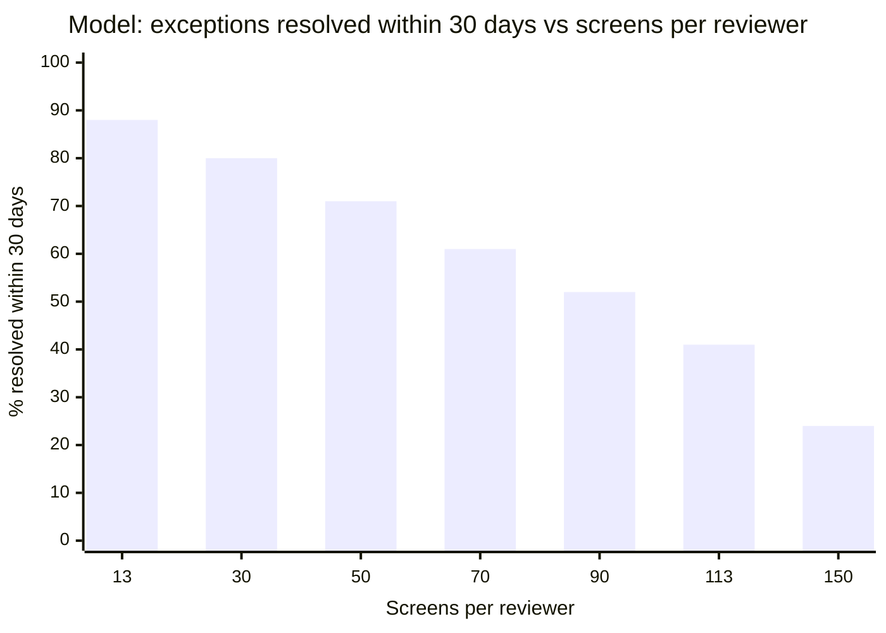
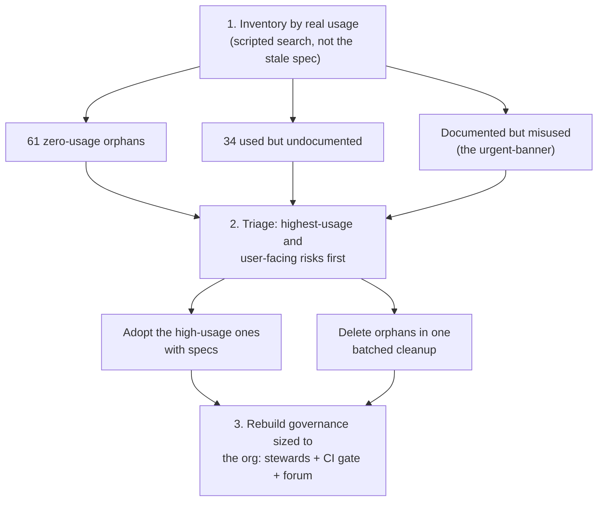

import Scenario from "../../../components/Scenario.astro";
import LevelIntro from "../../../components/LevelIntro.astro";
import Checkpoint from "../../../components/Checkpoint.astro";
import PracticeCheck from "../../../components/PracticeCheck.astro";

export const unit = {
  track: "design",
  unitSlug: "design-debt-at-scale",
};

<Scenario label="The year-one team">
  <Fragment slot="facts">
    

      

        13 → 113
        screens per reviewer, year 1 to year 3
      

      

        

      

      
exceptions resolved within 30 days: 88% down to 41%

    

    

      
👥 3 reviewers, centralized model, no headcount change

      
✅ Year 1: 22 exceptions, 14 deleted and 8 adopted

      
📱 Screens: 40 in year 1, 340 by year 3

    

  </Fragment>

Northwind (still an illustrative company) launched with a three-person
centralized team whose job was running the adopt-or-delete test. In year one,
across 40 screens, they resolved all 22 exceptions they met: 14 deleted
(usages migrated back), 8 adopted with specs, tokens and owners. That is
about 13 screens per reviewer (40 / 3).

**By year three the product had 340 screens and the team was still three
people, about 113 screens each (340 / 3). What does that growth do to a
process that depended on those three people having time?**

</Scenario>

This is one company's case, not the whole territory. The closing question asks
you to carry the same ideas into a different shape of pressure.

<LevelIntro
  items={[
    "How review capacity decays as screens grow",
    "The incident an orphaned component caused",
    "The remediation playbook and its sizing logic",
  ]}
/>

## Why did 88% turn into 41%?

The process did not change; the load did. Reviewers still tried to read every
exception, but eleven squads produced them faster than three people could
clear, and a backlog behaves like no governance for everything sitting in it:
each waiting exception can be found and copied unreviewed. The unit's model
(in the interactive demo) fits the two known points with a straight line, then
extends it. These values are the model's output, not measurements.

The orphan side of the story has its own rate. The demo models roughly 2 new
orphans per year while governance runs and 11 per year once it lapses:

| Governance gap | Orphans with governance | Orphans without governance |
| -------------- | ----------------------- | -------------------------- |
| 12 months      | 2                       | 11                         |
| 18 months      | 3                       | 17                         |
| 36 months      | 6                       | 33                         |
| 48 months      | 8                       | 44                         |

Northwind's 18-month gap after its reorg corresponds to 17 orphans against the
3 that governance would have allowed (the demo rounds 16.5 up). Both curves
are linear, so the gap in the table widens by the same amount every year.

<PracticeCheck
  track={unit.track}
  unitSlug={unit.unitSlug}
  topicId="capacity-decay"
/>

## What did the failure look like when it finally surfaced?

The year-three reorg split the team across squads: one person moved into a
squad, one to another initiative, one left and was not backfilled. Nobody
decided to stop running the test; the org chart simply no longer had a role
whose job it was. A few experienced designers kept flagging exceptions in review
out of habit, but with no forum, no threshold and no time carved out,
"informal" lost to deadlines within a couple of quarters.

<Checkpoint question="Eighteen months after the reorg, an orphaned 'urgent-banner' (built for a one-time outage notice, never retired) is reused for a flash-sale promo because it looks urgent. It was built to be non-dismissible. What fails, reasoning only from what it was built for?">

The assumptions mismatch. A banner for an active outage is non-dismissible
because an outage should not be dismissed. A promotion needs dismissibility,
possibly per-user targeting, and an expiry that does not need an engineer to
remove it. With no spec explaining the component's purpose, the new squad had
no way to know it was reusing an outage tool for a different job. Customers
saw a promotional banner they could not close until someone shipped a manual
fix.

</Checkpoint>

The postmortem's finding was not "an engineer chose badly". The library could
not tell a component built for one narrow purpose from one meant for general
reuse, because the step that would have documented or retired it had stopped
running eighteen months earlier, with nothing visibly breaking in the
meantime.

## How was the debt paid down, and why that way?

Remediation ran in a fixed order, because triage without an inventory just
repeats the informal who-notices-first process that failed.

The inventory found 61 + 34 = 95 components that needed a decision, plus the
misused banner. Triage ordered them by usage and user-facing risk, so the
banner-shaped danger (wrong assumptions baked into something widely reused)
outranked a harmless zero-usage orphan. Returning to one team of three was
rejected, because the same capacity mismatch (113 screens per reviewer) would
recur as the product grew. Northwind chose the federated-plus-gate hybrid: one
steward per product area, a CI check flagging new components with no linked
spec, and a monthly forum where stewards reconcile drift between areas.

<PracticeCheck
  track={unit.track}
  unitSlug={unit.unitSlug}
  topicId="remediation"
/>

<Checkpoint question="The CI gate blocks any new component with no linked spec. A squad under a hard launch deadline needs a genuine one-off that the adopt-or-delete test would likely delete within a month. Should the gate block it outright?">

No. Blocking outright pushes the squad toward silent forking: copying a
component into their own code to route around the gate, which creates the
exact ungoverned exception the gate exists to prevent, in a place it cannot
see. A better gate lets the squad ship with an explicit, dated "temporary
exception" flag. That satisfies the gate and leaves a visible record, so the
monthly forum has a list of exceptions due for a decision instead of a
codebase that quietly absorbs them.

</Checkpoint>

**This was one company's pressure: a hard reorg, then a single visible
incident that unlocked funding.** Design debt does not always resolve that
cleanly. What would you expect to change if Northwind's debt had stayed
invisible for years, with no incident severe enough to fund an inventory, just
a slow drag on every new hire's onboarding and every engineer's "which button
do I use" search? The three steps would probably stay the same, so what would
have to change about how the case for step one gets made, with no incident
report to point to?
