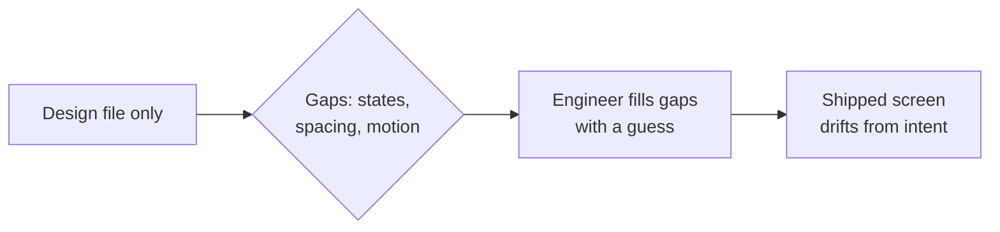

import Scenario from "../../../components/Scenario.astro";
import LevelIntro from "../../../components/LevelIntro.astro";
import PracticeCheck from "../../../components/PracticeCheck.astro";

export const unit = {
  track: "design",
  unitSlug: "design-engineering-handoff",
};

<Scenario>
  <Fragment slot="facts">
    

      

        2 of 5
        states shipped exactly as designed
      

      

        

      

    

    

      
✅ Default and loading: shipped as designed

      
🟡 Error: built, but in the wrong red

      
❌ Empty state: never built, nobody knew it existed

      
❌ Success animation: became a plain checkmark

      
📏 Spacing shipped at 16px, designed at 24px

    

    
What was handed off

    

      
🖼️ One Figma frame, no annotations

      
💬 One chat message: "checkout redesign, ready to build"

    

  </Fragment>

Imagine a friend sends you one photo of a finished cake and says "bake this." You bake something that looks like the photo from the front. Then your friend asks why there is no filling, and why it is not as tall. The photo never showed the inside, and it never said how tall to make it.

Priya had the same problem with a checkout screen. She designed five states: default, loading, success, error and empty (a cart that arrives at checkout with nothing in it). She sent one Figma frame, showing the default and loading states, with "checkout redesign, ready to build" and moved on. Sam built what he could see. A week later it shipped: the success animation was a static checkmark, the empty state did not exist, and every button had 16px of spacing where Priya had designed 24px.

**Nobody was careless. Sam built exactly what he could see. So where did the screen actually go wrong?**

</Scenario>

It went wrong before Sam opened Figma. A finished-looking design was treated as a finished specification.

<LevelIntro
  items={[
    "A design file versus a buildable spec",
    "The states a handoff must cover",
    "The artifacts that stop reinterpretation",
  ]}
/>

## What is the difference between a file and a spec?

A **design file** shows what one state looks like when everything goes right. A **spec** tells an engineer what to build for every state, every edge case and every measurement. A file is a snapshot. A spec is an instruction set.

Reinterpretation is rarely laziness. It is an engineer filling a real gap the only way available: a guess, made under a deadline, from whatever is visible.

| Missing from the file           | What an engineer does instead                                |
| ------------------------------- | ------------------------------------------------------------ |
| States not shown (empty, error) | Skips them, or invents a plausible fallback                  |
| Exact spacing and sizing values | Eyeballs the screenshot, off by however much it is off       |
| Motion and transitions          | Ships a static equivalent, or nothing                        |
| Why a choice was made           | Cannot tell a load-bearing detail from an accident of layout |

<PracticeCheck
  track={unit.track}
  unitSlug={unit.unitSlug}
  topicId="file-vs-spec"
/>

## Which states does a handoff need to cover?

**Priya's file was accurate in every pixel it showed. Why was that not enough?** Because most of a screen's life is spent outside the happy path. Each state is a separate thing to build, and an engineer cannot build one that nobody drew.

| State   | The question it answers                        | In Priya's handoff |
| ------- | ---------------------------------------------- | ------------------ |
| Default | What does it look like when all is well?       | Drawn              |
| Loading | What shows while we wait?                      | Drawn              |
| Success | What confirms it worked, and how does it move? | Not drawn          |
| Error   | What shows when it fails, and how to recover?  | Sketch only        |
| Empty   | What shows when there is nothing to show?      | Not drawn          |

Success, error and empty are the states nobody thinks to ask about, which is exactly why they go missing.

<PracticeCheck
  track={unit.track}
  unitSlug={unit.unitSlug}
  topicId="state-coverage"
/>

## What closes the gap?

Four artifacts, each answering a question the file cannot:

| Handoff artifact | Answers                                                   |
| ---------------- | --------------------------------------------------------- |
| All states shown | "What does this look like when it is NOT the happy path?" |
| Annotations      | "What are the exact spacing, sizing and copy rules?"      |
| Design tokens    | "What named value do I read instead of measuring pixels?" |
| Design QA pass   | "Does what shipped match what was specified?"             |

A spec does not remove the engineer's judgment. It removes the guessing that happens when judgment has nothing to work from. Priya's five-state design already existed in her head; only two of the five states ever left it.
