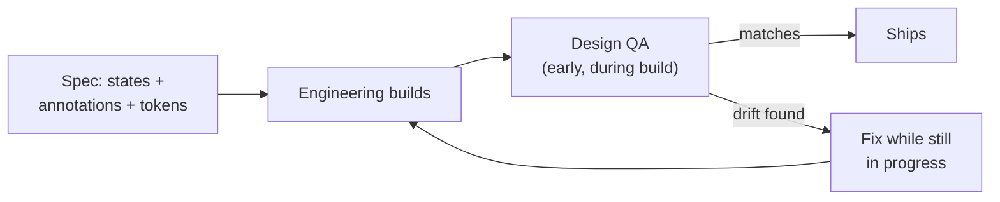

import Scenario from "../../../components/Scenario.astro";
import LevelIntro from "../../../components/LevelIntro.astro";
import Checkpoint from "../../../components/Checkpoint.astro";
import PracticeCheck from "../../../components/PracticeCheck.astro";

export const unit = {
  track: "design",
  unitSlug: "design-engineering-handoff",
};

<Scenario label="Same scenario, one level deeper">
  <Fragment slot="facts">
    

      
🖼️ Handed off: 1 Figma frame, 0 annotations

      
📋 Needed: 5 states, spacing tokens, motion notes

      
🔁 Result: spacing drifted 24px to 16px (two-thirds)

    

    
What a spec would have carried

    

      
❓ Which states exist and what triggers each

      
❓ Spacing as a named value, not pixels read off a screen

      
❓ What is load-bearing versus incidental

    

  </Fragment>

A friend who photographs a cake can also hand you a recipe: ingredients, oven temperature, how tall each layer is. Priya's file was the photo. L1 named the gap; this level asks what the recipe has to contain, and why measuring a photo gives a different answer each time.

</Scenario>

<LevelIntro
  items={[
    "Tokens as the fix for pixel drift",
    "Design QA as a loop, not a gate",
    "A checklist anyone can check",
  ]}
/>

## Why do pixels drift when nobody is careless?

**Sam did not decide to ship 16px. How did he end up there?** He hovered over the layer in Figma's inspector. The inspector reported the gap that frame's auto-layout happened to compute, which was not the value Priya intended. Reading a number off a visual is measurement, and measurement drifts.

A **design token** is a named, shared value such as `spacing-lg = 24px`. It removes the measuring step: the engineer reads the token's definition instead of the screen.

| Approach                 | What the engineer does             | Failure mode                                          |
| ------------------------ | ---------------------------------- | ----------------------------------------------------- |
| Eyeball the screenshot   | Estimates spacing by looking       | Drifts silently, nothing catches it                   |
| Read the Figma inspector | Measures the actual layer          | Measures this layer's accident, not the intended rule |
| Read a design token      | Looks up a named, documented value | Cannot drift; every use of the token stays in sync    |

Tokens prevent more than one bug. A hundred buttons that read one token share one true value, instead of a hundred measurements that each drift a little differently.

<Checkpoint question="Priya's token spacing-lg is 24px and the shipped screen used 16px. If the team later changes spacing-lg to 28px, which screens change and which stay wrong?">

Every screen that reads the token updates to 28px together. The screen with a hand-typed 16px does not move, because it never read the token. That is the practical difference: a token is a single source that a change flows through, while a measured value is a private copy that nobody knows to update.

</Checkpoint>

<PracticeCheck
  track={unit.track}
  unitSlug={unit.unitSlug}
  topicId="design-tokens"
/>

## Where does design QA belong in the workflow?

**Is design QA a final gate before launch?** If it is, a failed check has nowhere cheap to go. The version that works is a loop: QA runs while the build is still open, so a drift found goes straight back into the same work.

The same gap costs different amounts depending on when it is found. The interactive demo in L3 models this with a simple curve (an illustrative estimate, not a measurement): a gap caught 30 days before launch is about 4 hours of work, 14 days out about 19 hours, and 2 days out about 80 hours, because by then it means reopening merged, reviewed code.

| Days before launch when QA runs | Estimated rework |
| ------------------------------- | ---------------- |
| 30                              | about 4 h        |
| 14                              | about 19 h       |
| 7                               | about 44 h       |
| 2                               | about 80 h       |

<Checkpoint question="If design QA happens the day before launch instead of mid-build, does the number of bugs found go up?">

Not necessarily. The same gaps exist either way, since they come from the handoff. What rises is the cost of fixing each one: a missing state caught mid-build is an unfinished component someone is about to touch anyway, while the same gap the day before launch means reopening reviewed, merged code under a deadline. Lateness scales rework cost, not bug count.

</Checkpoint>

<PracticeCheck
  track={unit.track}
  unitSlug={unit.unitSlug}
  topicId="qa-timing"
/>

## A checklist, not a feeling

"Ready to build" is a feeling. A checklist can be checked by someone other than the designer:

| Item                                                       | Present in Priya's handoff?            |
| ---------------------------------------------------------- | -------------------------------------- |
| All states shown (default, loading, empty, error, success) | No, only default and loading           |
| Spacing and sizing as named tokens                         | No, raw layer values                   |
| Motion and transition notes                                | No, success animation undocumented     |
| Copy for every state, including edge cases                 | Partial, only the default state's copy |
| A design QA pass scheduled before launch                   | No                                     |

Five items, none fully checked. Not from neglect: the five-state design existed in Priya's head. The handoff never carried it out.
